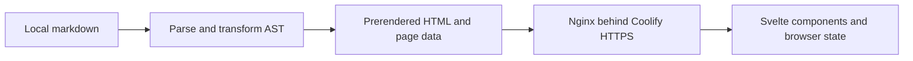

# Financial Calculators

Financial Calculators is a public application for ad hoc financial calculations and visualizations. The project is at phase 0: the application foundation, reusable libraries, development environment, and deployment pipeline are in place; calculator implementation follows separately.

The application builds complete static pages and runs browser interactions after hydration. Its private GitHub repository deploys through Coolify to `https://fincalcs.portfolio-projects.dev`, using Nginx with no application login or password gate. Production configuration and deployment checks are described in the [runbook](docs/runbooks/prod-deployment.md).

## Architecture



The app lives at the repository root, following the standalone reference. Composition lives in routes; the reusable libraries retain their original responsibility boundaries. A route lends the shell a rail and releases it on teardown. Browser preferences outlive components, but interactive controllers and pending work remain instance-owned. Server modules never become client runtime imports.

| Reusable mechanism | Contract and explanation |
| --- | --- |
| Presentation | [Elements, behaviors, layouts, views](src/lib/components/README.md), [design decision](docs/adrs/style-design-system.md) |
| Markdown | [Typed parser, transforms, renderers](src/lib/markdown/README.md), [architecture](docs/adrs/markdown-subsystem.md) |
| Visualization | [Charts](src/lib/components/charts/README.md) and [leaf icons](src/lib/icons/README.md) |
| Ownership | [State](src/lib/state/README.md), [context](src/lib/context/README.md), [lifetime decision](docs/adrs/objects-lifetime-management.md) |
| Supporting libraries | [Dates and time](src/lib/datetime/README.md), [text](src/lib/text/README.md), [filters](src/lib/filters/README.md), [DOM](src/lib/dom/README.md), [navigation](src/lib/navigation/README.md), [hooks](src/lib/hooks/README.md) |
| Server boundary | [Build-time document transforms](src/lib/server/README.md) |
| Organization | [Module decision](docs/adrs/module-organization.md), [application guide](docs/app.md) |

## Stack

Svelte 5 runes, SvelteKit 3 prerelease, TypeScript 6 strict, Tailwind CSS 4, Node 24, and npm. The static adapter uses its Kit 3-compatible prerelease. Exact versions belong in [package.json](package.json) and [package-lock.json](package-lock.json).

Kit configuration lives in [vite.config.ts](vite.config.ts), inside `sveltekit()`. There is no separate Svelte config. `#lib` imports use explicit module extensions. The app's [environment declarations](src/env.ts) use Kit 3's `$app/env` modules. Vitest's browser resolution condition remains test-only so development SSR uses the correct Svelte runtime.

## Development setup

The project name is `Financial Calculators`, its package/repository slug is `financial-calculators`, the repository owner is `awpala`, and the local dev/preview port is `2252`. These are project configuration values. The production image listens on internal port `8080`.

For a fresh checkout, copy [sample.env](sample.env) to `.env` before opening the development container; the container loads that file at startup. Inside the configured container, use the commands below. Alternatively, use Node 24 locally and run `npm ci`. Direct host builds need no environment file unless overriding the browser executable. Local environment files and references are excluded from the Docker context.

### Development container and commands

[devcontainer.json](.devcontainer/devcontainer.json) starts one container with the checkout at `/workspace` and the live harness at `/scripts`. It runs [setup-env.sh](.devcontainer/scripts/setup-env.sh) to provision Chromium/fonts, project dependencies, shell aliases, and real command symlinks for noninteractive callers. Node comes from the pinned feature. Package tools come from the lockfile. There is no Compose file or backing-service startup step.

The dependency and npm-cache volumes persist between rebuilds, as do the CLI state volumes. Runtime installation directories are not mounted as volumes: stale mounts can hide tools supplied by an updated image. Setup appends logs to `/tmp/setup-env-debug.log`, fails on required install errors, and can be retried with `bash /scripts/setup-env.sh`. Open a new terminal afterward to load updated aliases.

| Command | Behavior |
| --- | --- |
| `run-app` | Start `npm run dev` with timestamped `__logs/local/app-*.log` and a latest symlink |
| `run-checks [app\|docs]` | Run gates and report every failure; no selector runs both |
| `format` | `format_app`: ESLint fixes followed by Prettier |
| `tests` | Run Vitest |
| `build-app` | Clean generated output, install the lockfile, and build |
| `kill-app` | Stop only the configured app port, preserving PID identity through bounded escalation |
| `mmdc` | Render with the project CLI and container Chromium flags |
| `cd "$app"` | Move to `/workspace` |

The launcher owns a process group so stopping npm also stops Vite. These aliases are conveniences; the npm scripts remain authoritative and work outside the container. `cleanup.sh` runs on the host to remove this development container. `cleanup.sh --volumes` additionally deletes this project's dependency caches and CLI credentials/state; it never removes the bind-mounted checkout.

## Example routes and local content

The landing page introduces the application foundation. `/examples/` composes existing fields, cards, filtering, confirmation, and a bar chart with route-owned in-memory data. `/docs/` lists markdown under [src/content/docs/](src/content/docs/), with nested filenames mapping to nested slugs. Keep these examples as development references while adding calculator routes; preserve their reusable library contracts.

The document loader creates a fresh AST, renders Mermaid, highlights code, and extracts headings. The browser receives prepared data and lends heading navigation to the shell. Document transforms run during prerendering and development. Adding a document needs no hand-maintained route list: the catalog supplies `entries()` for prerendering, including unlinked nested documents. Content changes require a rebuild.

Static HTML contains the actual route content before JavaScript loads. Theme, rail, popup, and chart lifetimes remain scoped to their owners. MathJax is a lazy external browser enhancement, so a fully disconnected site must supply its own math runtime if required. No offline corpus cache or service worker is included.

## Run and validate

```sh
npm run dev
npm run check
npm run lint
npm run format:check
npm run test
npm run build
npm run test:deployment
```

`npm run verify` runs the app gates, static build, and artifact tests. `npm run test:container` additionally builds the production Docker image and exercises its HTTP behavior on a disposable loopback listener; it requires Docker and a preceding local build. CI runs both sets of checks. The artifact command reports the HTTP suite as skipped when no container URL is supplied. `npm run test:coverage` adds the V8 report. Browser-dependent markdown rendering needs system Chromium or Puppeteer's managed browser (`npx puppeteer browsers install chrome`); the development container and Docker builder install it. A syntax/type check does not establish browser behavior: exercise navigation, narrow layouts, both themes, dialogs, and teardown after a route change.

The output is `build/`. `npm run preview` previews it through Vite on port `2252`. Production Nginx supports direct directory-index requests, relative slash redirects, a content-free `/healthz`, and a real 404 page. HTML and route data require revalidation; content-hashed assets are immutable.

## Deployment

The [Coolify runbook](docs/runbooks/prod-deployment.md) configures one Dockerfile resource for `https://fincalcs.portfolio-projects.dev`, with repository-root build context, private Git-source access, and internal port `8080`. Node and Chromium stay in the build stage; the serving image has Nginx and public output only.

[Verify](.github/workflows/verify.yml) checks pushes and pull requests. Coolify Auto Deploy uses a GitHub App dedicated to this repository and watches `main`; GitHub Actions needs no deployment secrets. Apply the [Watch Paths](docs/runbooks/prod-deployment.md#selective-automatic-deployment) to deploy application and relevant infrastructure/CI changes while skipping repository documentation. Published Markdown under `src/content/docs/` remains a build input. Auto Deploy runs independently of Verify, so the developer checks the deployed revision, CI result, health, and HTTPS after each release. Preview deployments stay disabled.

## Agent harness

[AGENTS.md](AGENTS.md) is the shared entry point; `CLAUDE.md` is a symlink. Task guides under [docs/agents/](docs/agents/) retain the source project's detailed Svelte, organization, documentation, and lifecycle conventions. Canonical skills in `.agents/skills/` are mirrored into `.claude/skills/`, with paired Svelte implementation and review roles for both harnesses. The project-local first-party Svelte MCP is configured in both adapters; host sessions may need to adjust its `/workspace` path.

The [decision index](docs/README.md) links the retained and adapted ADRs. Library READMEs stand alone and explain contracts, ownership, failure modes, extension, and verification without requiring an agent guide. Preserve those explanations as the application grows.
