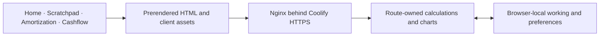

# Financial Calculators

Financial Calculators is a public application for ad hoc financial calculations and visualizations. **Scratchpad is a core calculation workspace:** its small numeric language lets users write, explain, and revise calculations with named inputs and reusable intermediate values. It complements Amortization's fixed-rate loan schedules and Cashflow's take-home income estimates. A minimal Home links to all three, which share the application's reusable UI and chart libraries.

The application builds complete static pages and runs browser interactions after hydration. Its public GitHub repository deploys through Coolify to `https://fincalcs.portfolio-projects.dev`, using Nginx with no application login or password gate. Production configuration and deployment checks are described in the [runbook](docs/runbooks/prod-deployment.md).

## Scratchpad

Scratchpad, at route `/scratchpad`, provides more room to express and review a calculation than a single-entry handheld calculator while keeping a smaller scope than a spreadsheet system such as Excel. Write assumptions once, refer to them by descriptive names, keep explanations beside the arithmetic, and inspect intermediate values alongside the final result. Editing an input and calculating again reevaluates the working as a whole.

The language supports comments, freeform names, dollar notation, magnitude and percent suffixes, arithmetic, mathematical constants and functions, flat numeric arrays with explicit argument unpacking, descriptive statistics, and finite sums and products, including nested ranges. The workspace provides a full-page editor with syntax highlighting, line numbers, diagnostics, keyboard shortcuts, and result and named-value summaries. Inputs and calculated values are saved locally in the browser without an account or runtime API.

The [Scratchpad language specification](docs/scratchpad.md) explains the motivation, syntax, numeric behavior, limits, and complete examples spanning finance, accounting, and other domains. The [calculator library guide](src/lib/calculator/README.md) documents parsing, evaluation, presentation, persistence, and ownership contracts.

## Architecture



The app lives at the repository root. Composition lives in routes; reusable libraries have explicit responsibility boundaries. A route lends the shell a rail and releases it on teardown. Browser preferences outlive components, but interactive controllers and pending work remain instance-owned. Server modules never become client runtime imports.

| Reusable mechanism | Contract and explanation |
| --- | --- |
| Calculations | [Scratchpad language and state](src/lib/calculator/README.md), [amortization model](src/lib/amortization/README.md), [cashflow model](src/lib/cashflow/README.md) |
| Presentation | [Elements, behaviors, layouts, views](src/lib/components/README.md), [design decision](docs/adrs/style-design-system.md) |
| Markdown | [Typed parser, transforms, renderers](src/lib/markdown/README.md), [architecture](docs/adrs/markdown-subsystem.md) |
| Visualization | [Charts](src/lib/components/charts/README.md) and [leaf icons](src/lib/icons/README.md) |
| Ownership | [State](src/lib/state/README.md), [context](src/lib/context/README.md), [lifetime decision](docs/adrs/objects-lifetime-management.md) |
| Supporting libraries | [Dates and time](src/lib/datetime/README.md), [text](src/lib/text/README.md), [filters](src/lib/filters/README.md), [DOM](src/lib/dom/README.md), [navigation](src/lib/navigation/README.md), [hooks](src/lib/hooks/README.md) |
| Server boundary | [Build-time document transforms](src/lib/server/README.md) |
| Organization | [Module decision](docs/adrs/module-organization.md), [application guide](docs/app.md) |

## Stack

Svelte 5 runes, SvelteKit 3, TypeScript 6 strict, Tailwind CSS 4, Node 26, and npm. The static adapter is on its stable Kit 3-compatible release. Exact versions belong in [package.json](package.json) and [package-lock.json](package-lock.json).

Kit configuration lives in [vite.config.ts](vite.config.ts), inside `sveltekit()`. There is no separate Svelte config. `#lib` imports use explicit module extensions. The app's [environment declarations](src/env.ts) use Kit 3's `$app/env` modules. Vitest's browser resolution condition remains test-only so development SSR uses the correct Svelte runtime.

## Development setup

The project name is `Financial Calculators`, its package/repository slug is `financial-calculators`, the repository owner is `awpala`, and the local dev/preview port is `2252`. These are project configuration values. The production image listens on internal port `8080`.

For a fresh checkout, copy [sample.env](sample.env) to `.env` before opening the development container; the container loads that file at startup. Inside the configured container, use the commands below. Alternatively, use Node 26 locally and run `npm ci`. Direct host builds need no environment file unless overriding the browser executable. Local environment files and development artifacts are excluded from the Docker context.

### Development container and commands

[devcontainer.json](.devcontainer/devcontainer.json) starts one container with the checkout at `/workspace` and the live harness linked at `/scripts` (a symlink to `/workspace/.devcontainer/scripts`, so branch switches that recreate the directory stay visible). It runs [setup-env.sh](.devcontainer/scripts/setup-env.sh) to provision Chromium/fonts, project dependencies, shell aliases, and real command symlinks for noninteractive callers. Node comes from the pinned feature. Package tools come from the lockfile. There is no Compose file or backing-service startup step.

The dependency and npm-cache volumes persist between rebuilds, as do the CLI state volumes. Runtime installation directories are not mounted as volumes: stale mounts can hide tools supplied by an updated image. Setup appends logs to `/tmp/setup-env-debug.log`, fails on required install errors, and can be retried with `bash /scripts/setup-env.sh`. Open a new terminal afterward to load updated aliases.

| Command | Behavior |
| --- | --- |
| `run-app` | Start `npm run dev` with timestamped `__logs/local/app-*.log` and a latest symlink |
| `run-checks [app\|docs]` | Run gates and report every failure; no selector runs both |
| `format` | `format_app`: ESLint fixes followed by Prettier |
| `tests` | Run Vitest |
| `build-app` | Clean generated output, install the lockfile, and build |
| `kill-app` | Stop only the configured app port, preserving PID identity through bounded escalation |
| `mmdc` | Render with the project CLI and container Chromium flags |
| `cd "$app"` | Move to `/workspace` |

The launcher owns a process group so stopping npm also stops Vite. These aliases are conveniences; the npm scripts remain authoritative and work outside the container. `cleanup.sh` runs on the host to remove this development container. `cleanup.sh --volumes` additionally deletes this project's dependency caches and CLI credentials/state; it never removes the bind-mounted checkout.

## Calculator views and libraries

Home links to [Scratchpad](#scratchpad), Amortization, and Cashflow. `/amortization/` estimates fixed-rate monthly payments from purchase price, down payment in dollars or percent, term, and annual rate. It provides a principal/interest stacked chart and year, quarter, or month grouping, with a matching payment table and remaining balances. The summary card's headline payment and heading follow the selected grouping; the loan totals beside it stay lifetime figures. Assumptions persist in this browser. The [model contract](src/lib/amortization/README.md) documents limits, zero-interest behavior, and rounding.

`/cashflow/` estimates take-home pay, with annual/hourly income conversion, work-hour assumptions, an effective tax rate, retirement contributions, other deductions, monthly net income, and an Annual/Monthly balance sheet. Its [model contract](src/lib/cashflow/README.md) documents the calculation policies and local persistence.

The gear beside the theme switch opens [Settings](src/lib/settings/README.md), with Amortization and Cashflow tabs for saved Reset presets. Shift S opens Settings or returns to the most recent main view, and the gear resolves to that same destination, so both toggle rather than only entering Settings; the return destination survives a reload. Global reset asks for confirmation before restoring both working calculators to those presets; Scratchpad is preserved. Home carries the shared browser-persistence note, and `InfoNote` keeps supplemental guidance visually consistent; Cashflow’s long page-level note has its own centered width limit.

The reusable UI, chart, markdown, and server libraries support application features. The local markdown catalog under [src/content/docs/](src/content/docs/) is a library fixture; it is not a published route. A future document consumer can prepare a fresh AST, render Mermaid, highlight code, extract headings, and supply prerender entries for its catalog. The standalone library guides preserve that pipeline's usage and lifecycle details.

Static HTML contains the shell and default route content. An accessible spinner hides the view until browser-local inputs are restored and chart dimensions settle; the hidden view stays mounted and measurable. Saved calculations are restored only after mounting; none enter prerendered output. Theme, rail, popup, and chart lifetimes remain scoped to their owners. MathJax remains a lazy external browser enhancement for markdown consumers. No offline corpus cache or service worker is included.

## Run and validate

```sh
npm run dev
npm run check
npm run lint
npm run format:check
npm run test
npm run build
npm run test:deployment
```

`npm run verify` runs the app gates, static build, and artifact smoke checks. `npm run test:container` builds the production Docker image and checks its HTTP behavior on a disposable loopback listener; it requires Docker but no preceding local build. CI runs the app gates followed by this image check, so the Dockerfile performs the production build once. Deployment checks cover the entry page, a generated asset, health, caching, and 404 behavior; feature coverage stays in application tests. Without a container URL, the deployment command checks local artifacts and skips HTTP; with a URL, it checks HTTP and skips local artifacts. `npm run test:coverage` adds the V8 report. Browser-dependent markdown rendering needs system Chromium or Puppeteer's managed browser (`npx puppeteer browsers install chrome`); the development container and Docker builder install it. A syntax/type check does not establish browser behavior: exercise navigation, narrow layouts, both themes, dialogs, and teardown after a route change.

The output is `build/`. `npm run preview` previews it through Vite on port `2252`. Production Nginx supports direct directory-index requests, relative slash redirects, a content-free `/healthz`, and a real 404 page. HTML and route data require revalidation; content-hashed assets are immutable.

[static/](static/) is copied into that output unchanged and supplies the app icon, web manifest, authored 404 page, `robots.txt`, and `sitemap.xml`. The sitemap lists the four public calculator views at the production origin, and `robots.txt` points crawlers at it; neither is generated from the route table, so adding, renaming, or removing a public route means editing `static/sitemap.xml` in the same change. The settings tabs are deliberately absent from it. Indexing permission is a crawler directive, not an access control.

## Deployment

The [Coolify runbook](docs/runbooks/prod-deployment.md) configures one Dockerfile resource for `https://fincalcs.portfolio-projects.dev`, with repository-root build context, a dedicated GitHub App integration, and internal port `8080`. Node and Chromium stay in the build stage; the serving image has Nginx and public output only.

[Verify](.github/workflows/verify.yml) checks pushes and pull requests. Coolify Auto Deploy uses a GitHub App dedicated to this repository and watches `main`; GitHub Actions needs no deployment secrets. Apply the [Watch Paths](docs/runbooks/prod-deployment.md#selective-automatic-deployment) to deploy application and relevant infrastructure/CI changes while skipping repository documentation. The retained markdown catalog is available to future document consumers. Auto Deploy runs independently of Verify, so the developer checks the deployed revision, CI result, health, and HTTPS after each release. Preview deployments stay disabled.

## Agent harness

[AGENTS.md](AGENTS.md) is the shared entry point; `CLAUDE.md` is a symlink. Task guides under [docs/agents/](docs/agents/) define this application's Svelte, organization, documentation, and lifecycle conventions. Canonical skills in `.agents/skills/` are mirrored into `.claude/skills/`, with paired Svelte implementation and review roles for both harnesses. The project-local first-party Svelte MCP is configured in both adapters; host sessions may need to adjust its `/workspace` path.

The [decision index](docs/README.md) links the application's ADRs. Library READMEs stand alone and explain contracts, ownership, failure modes, extension, and verification without requiring an agent guide. Preserve those explanations as the application grows.
