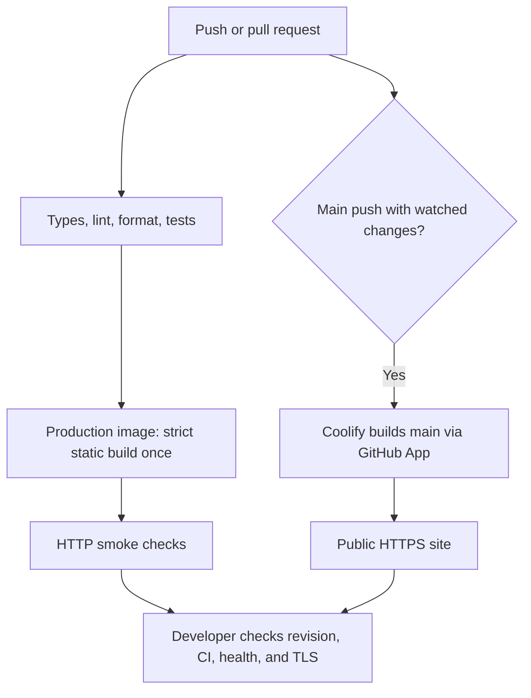

# ADR: Public Static Deployment on Coolify

- **Status**: Accepted
- **Date**: 2026-09-19

## Context

Financial Calculators is an application for ad hoc calculations and visualizations. Its initial main-branch baseline includes the application libraries and deployment configuration on which calculator features are developed. The repository is private, but the deployed content is intended for public access and contains no material requiring a site access gate. GitHub Pages is unavailable under this repository's current hosting constraints.

The application has no external data service and prepares repository-owned content ahead of time. Its interactive presentation runs in the browser. A strict static build supplies readable initial HTML while keeping the production runtime small.

## Decision

Use the SvelteKit static adapter with strict validation, SSR enabled, complete prerendering, directory indexes, and no SPA fallback. The single output directory is `build/`. The root layout exports `prerender = true` and `trailingSlash = 'always'`; the document catalog supplies entries for every local document, including nested and unlinked sources.

Deploy one Dockerfile application on Coolify at `https://fincalcs.portfolio-projects.dev`. Node 24 and Chromium prepare content in the builder stage; unprivileged Nginx serves only HTML, route data, and browser assets on internal port `8080`. Coolify owns TLS and proxy routing. Application runtime environment variables, persistent volumes, accounts, and sessions are unnecessary.

| Boundary | Owner | Contract |
| --- | --- | --- |
| Private source access | Coolify Git integration | Dedicated GitHub App scoped to this repository only |
| Document preparation | Build process | Fresh AST per load, bounded rendering, owned browser teardown |
| Public content | Nginx | Directory indexes, true 404s, relative redirects behind TLS termination |
| Browser interaction | Svelte component tree | Route-owned state and explicit cleanup |
| Deployment request | Coolify Auto Deploy | GitHub App events for `main`, filtered by Watch Paths |

Nginx requires revalidation for HTML and route data so a release does not leave cached page references indefinitely stale. Content-hashed assets are immutable. The public health marker reports liveness, while smoke checks separately verify content and navigation.

## Pipeline and release control

Verify runs on pushes and pull requests. It checks types, lint, formatting, unit tests, shell syntax, and the ADR index. The Dockerfile performs the strict static build once, and deployment smoke checks exercise that image's entry page, assets, health, caching, and 404 behavior over HTTP. CI does not repeat the build on the host or make deployment checks depend on individual example features. CI consumes the project's concrete configuration directly.

Coolify Auto Deploy listens for pushes to `main` through the repository's dedicated GitHub App. Preview deployments are disabled. Watch Paths select application code, public assets, production infrastructure, dependency/build configuration, and relevant CI tooling. Repository documentation and library READMEs do not trigger deployment; published Markdown under `src/content/docs/` does because it changes the built site. The ordered patterns and their verification procedure live in the [runbook](../runbooks/prod-deployment.md#selective-automatic-deployment).

Auto Deploy and Verify run independently. Coolify can start deployment before CI finishes, and a failed check does not automatically prevent or roll back a release. This single-developer application accepts that tradeoff and uses manual checks after merges to `main`: inspect the actual deployed SHA, its Verify result, health, and TLS, keeping release activity sequential. GitHub Actions performs no deployment request and requires no deployment secrets. Private source credentials remain in Coolify's Git integration and never enter the application image.

## Alternatives and tradeoffs

GitHub Pages would fit static output technically but does not fit this private repository's available hosting. A request-time Node application adds a running process and document-rendering dependencies without a requirement for dynamic server behavior. An account system or password gate adds session and operational complexity without an access restriction to enforce. A client-side password prompt cannot protect public static files.

An authenticated deployment webhook after successful CI could gate release requests, but adds pipeline credentials and a separate release workflow. Direct GitHub App Auto Deploy fits the chosen manual review process. Watch Paths reduce unnecessary builds, but must be configured and checked in Coolify; manual deployments bypass the filter.

An SPA fallback would conceal missing prerender entries and weaken readable initial content, so a dynamic route must supply complete entries instead. Server endpoints and form actions that need request-time execution would require a new architecture decision. Static hosting still supports calculations and visualizations implemented in the browser.

## Operations and verification

Use the [Coolify runbook](../runbooks/prod-deployment.md). Validate root and nested URLs, public route data, hashed assets, readable HTML without JavaScript, relative directory redirects, and true 404s. Published content changes require a rebuild. Local gates and image tests do not establish DNS, TLS, private Git-source access, remote Auto Deploy settings, or the deployed revision. Pause Auto Deploy during recovery, roll back through Coolify's retained deployment history, and repeat those checks.
