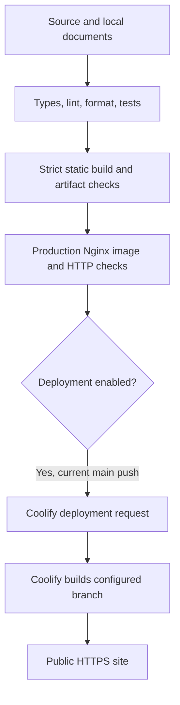

# ADR: Public Static Deployment on Coolify

- **Status**: Accepted
- **Date**: 2026-09-19

## Context

Financial Calculators will provide ad hoc calculations and visualizations. Phase 0 establishes the application foundation and deployment configuration; calculator implementation and the first deployment follow separately. The repository is private, but the deployed content is intended for public access and contains no material requiring a site access gate. GitHub Pages is unavailable under this repository's current hosting constraints.

The application has no external data service and prepares repository-owned content ahead of time. Its interactive presentation runs in the browser. A strict static build supplies readable initial HTML while keeping the production runtime small.

## Decision

Use the SvelteKit static adapter with strict validation, SSR enabled, complete prerendering, directory indexes, and no SPA fallback. The single output directory is `build/`. The root layout exports `prerender = true` and `trailingSlash = 'always'`; the document catalog supplies entries for every local document, including nested and unlinked sources.

Deploy one Dockerfile application on Coolify at `https://fincalcs.portfolio-projects.dev`. Node 24 and Chromium prepare content in the builder stage; unprivileged Nginx serves only HTML, route data, and browser assets on internal port `8080`. Coolify owns TLS and proxy routing. Application runtime environment variables, persistent volumes, accounts, and sessions are unnecessary.

| Boundary | Owner | Contract |
| --- | --- | --- |
| Private source access | Coolify Git integration | Scoped GitHub App or deploy key |
| Document preparation | Build process | Fresh AST per load, bounded rendering, owned browser teardown |
| Public content | Nginx | Directory indexes, true 404s, relative redirects behind TLS termination |
| Browser interaction | Svelte component tree | Route-owned state and explicit cleanup |
| Deployment request | GitHub Actions | Pipeline credentials separate from application configuration |

Nginx requires revalidation for HTML and route data so a release does not leave cached page references indefinitely stale. Content-hashed assets are immutable. The public health marker reports liveness, while smoke checks separately verify content and navigation.

## Pipeline and release control

Verify runs on pushes and pull requests. It checks types, lint, formatting, unit tests, complete static output, shell syntax, and the ADR index; it also builds and exercises the production Nginx image. CI consumes the project's concrete configuration directly.

The Coolify workflow follows successful Verify runs for pushes to `main` from this repository. `COOLIFY_DEPLOY_ENABLED=true` enables its authenticated webhook request once the production resource is configured. Leave it unset during phase 0. Coolify Auto Deploy is disabled so its push handler cannot bypass verification.

The workflow skips superseded revisions but cannot atomically pin the webhook's branch checkout. Operators serialize releases and verify the actual deployed revision, health, and TLS. A successful webhook response only confirms a request, not a successful rollout. Pipeline secrets never enter the application image.

## Alternatives and tradeoffs

GitHub Pages would fit static output technically but does not fit this private repository's available hosting. A request-time Node application adds a running process and document-rendering dependencies without a requirement for dynamic server behavior. An account system or password gate adds session and operational complexity without an access restriction to enforce. A client-side password prompt cannot protect public static files.

An SPA fallback would conceal missing prerender entries and weaken readable initial content, so a dynamic route must supply complete entries instead. Server endpoints and form actions that need request-time execution would require a new architecture decision. Static hosting still supports calculations and visualizations implemented in the browser.

## Operations and verification

Use the [Coolify runbook](../runbooks/prod-deployment.md). Validate root and nested URLs, public route data, hashed assets, readable HTML without JavaScript, relative directory redirects, and true 404s. Content changes require a rebuild. Local gates and image tests do not establish DNS, TLS, private Git-source access, remote secrets, or the deployed revision. Roll back through Coolify's retained deployment history and repeat those checks.
