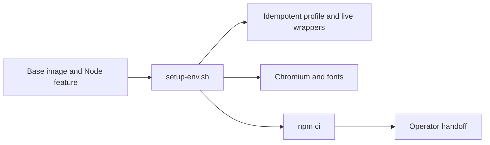

# ADR: One Standalone Development Container

- **Status**: Accepted
- **Date**: 2026-09-19

## Context

This application needs one Node toolchain and a browser for markdown diagrams. A standalone `devcontainer.json` supplies that environment without backing-service orchestration. The setup script preserves explicit ordering, logging, retry, alias, and process-ownership conventions so provisioning failures remain diagnosable.

## Decision

Use a single base-image devcontainer with Node 26 and relevant editor/CLI features. Bind the checkout at `/workspace` and link `/scripts` to `/workspace/.devcontainer/scripts` before running `setup-env.sh` after creation. `/scripts` is a symlink rather than a second bind mount because Docker pins a bind mount to the directory present at container start: a branch switch or pull that deletes and recreates `.devcontainer/scripts` would leave the mount attached to the deleted, empty directory until the container is recreated. The symlink resolves through the stable checkout mount on every access. Do not install an unrelated language toolchain or start a background app listener during provisioning.

Ordering matters. The browser must exist before document rendering is exercised; the lockfile must install successfully before the tools are described as ready. Setup stops at required failures and appends progress to its diagnostic log. A retry is explicit and does not conceal dependency drift through a fallback install.

## Persistence and boundaries

| Storage | Lifecycle |
| --- | --- |
| Checkout bind mount and `/scripts` symlink | Live host source; wrapper edits and recreated script directories require no rebuild |
| npm cache and node_modules volumes | Reused downloads; dependency tree reconstructed by npm ci |
| CLI configuration volumes | Authentication/state survives rebuilds |
| Toolchain and `/usr/local/bin` | Image-owned; never hidden behind stale persistent volumes |
| `/tmp/setup-env-debug.log` | Container-local setup diagnostics |

The container loads `.env` through Docker at startup, and Vite also reads it from the workspace. Copy `sample.env` before starting the container; changing inherited container variables requires recreating it. Browser selection and session-bus suppression are container settings. Project commands resolve TypeScript and Mermaid from the lockfile. The TypeScript feature provides a global command for ad hoc use; it must not replace the project-local compiler used by the gates.

Shell helpers use `app`, including `run-app`, `check_app`, and `format_app`. `run-app` records timestamped logs and forwards signals to its process group. Formatting stops after a failure; read-only gates continue to report all failures. Aliases are upserted instead of duplicated, and noninteractive command links point to the live scripts.

## Alternatives and consequences

Compose would add a topology with no independent services to orchestrate. Mounting global binary directories would preserve stale image contents across upgrades. Copying wrappers into the image would make a source edit invisible until rebuild. Installing tools directly on the host would not supply the same isolated, repeatable environment.

The resulting setup has one container and explicit local lifetimes. Cleanup removes that named container; deleting its known cache/CLI volumes is a separate explicit option. Setup success does not establish app correctness. Run the [application gates](../../README.md#run-and-validate), browser exercises, and the selected deployment runbook separately.
