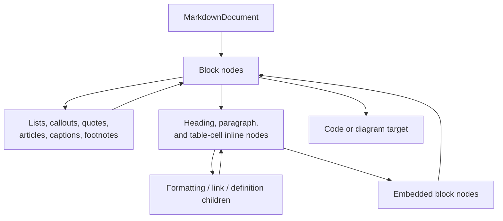

# ADR: A Typed Markdown Dialect with Separate Parsing and Rendering

- **Status**: Accepted
- **Date**: 2026-09-19
- **Related decisions**: [Module Organization](module-organization.md), [Runtime Object Lifetime](objects-lifetime-management.md)

## Context

The reference document renderer developed an authored-document dialect beyond basic paragraphs and links: nested blocks, definitions and footnotes, callouts, figures, mathematical notation, rich tables, reusable templates, and Mermaid diagrams. Those mechanisms are reusable independently of the reader application's document catalog, source repository, navigation, reading progress, or offline-download policy.

The application preserves that library and the lessons that shaped it. Reducing the documentation to “parse markdown, render a component” would discard the syntax contracts, traversal rules, lifecycle boundaries, and performance decisions a new application would otherwise have to discover again.

The central boundary is between content acquisition, parsing, enrichment, and presentation. The example loads local markdown, but the parser does not know about the catalog, routes, or hosting platform. A different source should supply text to the same pipeline without importing the example application's domain into the library.

Earlier performance work also established a methodological lesson: measure the pipeline before adding another service. In the reference application, parsing already ran on the server, while source fetching, client highlighter downloads, and diagram rendering cost much more. Its measured timings belong to that workload and are not application benchmarks. The architectural response—keep parsing local, move heavy enrichment off the client, and bound expensive work—travels without those numbers.

## Decision

**Parse source into a typed document tree, enrich that tree on the server, and render it through Svelte components with an instance-owned context. Keep content sourcing and product state outside the library.**

```mermaid
flowchart LR
  SOURCE["Application content source"] --> LOAD["SvelteKit server load"]
  LOAD --> PARSE["parse(source)<br/>document-local context"]
  PARSE --> AST["Typed MarkdownDocument"]
  AST --> DIAGRAM["Mermaid transform<br/>bounded Chromium work"]
  DIAGRAM --> HIGHLIGHT["Shiki transform<br/>dual-theme HTML"]
  HIGHLIGHT --> HEADINGS["Extract heading metadata"]
  HEADINGS --> SSR["SSR shell and page data"]
  SSR --> RENDER["MarkdownRenderer<br/>component tree"]
  RENDER --> INTERACT["Math, tables, popups, clipboard"]
```

The example route's order is parse, render Mermaid, highlight remaining code blocks, then extract headings. The transforms mutate the supplied document and resolve to `void`; they do not return a replacement document. That AST belongs to the current load. Await enrichment before returning page data, and do not accidentally assign `undefined` by treating a transform as a builder.

The renderer participates in SSR, and the application shell renders route children during prerendering. Published HTML contains the article before JavaScript loads; hydration attaches browser enhancements afterward. Changes to shell rendering must still review viewport, persisted-state, and first-paint behavior as well as the content pipeline. Artifact tests verify readable article markup rather than inferring it from server-side parsing alone.

The [markdown README](../../src/lib/markdown/README.md) is the standalone dialect and integration reference. This decision explains why the boundaries exist, what they preserve, and what an extension must maintain.

### Responsibilities and authority

| Boundary               | Owns                                                                                | Does not own                                           |
| ---------------------- | ----------------------------------------------------------------------------------- | ------------------------------------------------------ |
| Content source / route | Authorization, fetching, source identity, application errors                        | Markdown grammar or leaf rendering                     |
| Parser                 | Source interpretation, document-local templates and heading identities, typed nodes | Network requests, browser resources, application state |
| Server transforms      | Highlight HTML, diagram SVG, traversal of supported nesting                         | User identity or a global mutable current document     |
| Renderer context       | Shared rendering policy and callbacks for one component tree                        | Another renderer's popup selection or article element  |
| Browser enhancers      | DOM behavior that requires a mounted article                                        | Durable domain state or authoritative permissions      |
| Application shell      | Theme and surrounding layout                                                        | Parser state or document-source policy                 |

Server-only enrichment stays under `src/lib/server/`. The client receives the enriched AST and renders it through the component tree; it does not import Shiki grammars or the Puppeteer runtime. Type-only imports can cross that boundary because they disappear at compilation, but runtime imports cannot.

### A typed AST preserves structure and interaction

The AST is a public contract between the parser, server transforms, heading extraction, and renderer. Block and inline node unions make supported cases explicit. A code block retains its authored source alongside optional highlighted HTML; a diagram node retains source plus either SVG or a render error. The client can therefore display a useful failure and preserve copy behavior without reparsing the whole document.

Returning one opaque HTML string would make the simplest paragraphs easy to insert, but it would move footnotes, definitions, accessible controls, theme behavior, and nested rendering into an imperative DOM layer. The existing component graph already owns those interactions and their cleanup. Replacing it for a speculative wire-size saving would sacrifice the clearer boundary before measuring a benefit.

Repeated AST keys compress well in the reference workload, but the application claims no fixed source-to-AST size ratio. A new application should compare compressed payloads and rendering behavior on its own representative content before changing the wire format.

### Parsing is document-local and grammar order matters

The public parser composes responsibility-specific modules for block forms, inline forms, HTML structures, tables, and templates. A parse context owns its line cursor, heading counters, extracted template definitions, and expansion ancestry. Nested parsing shares the correct document context without turning it into a process-global registry.

The order of productions is meaningful. A fenced block must not be reinterpreted as prose; a table delimiter must not consume unrelated paragraph text; code and mathematical syntax need their own escaping rules. Moving a helper is not permission to reorder recognition. A parser extension must include ambiguous and malformed examples, not only its happy-path token.

Template definitions are extracted from standalone `{{[TOKEN]` blocks ending at a standalone `}}`. References expand in the appropriate parse context. Unknown references and recursive cycles remain literal instead of causing an infinite expansion. Expansion ancestry belongs to the current expansion chain, so one use of a template does not incorrectly disable an independent later use.

Heading IDs likewise belong to the document. Duplicate headings need deterministic disambiguation, and nested headings must agree with the heading extractor and rendered anchors. Do not generate IDs from randomness or install a shared mutable heading counter in a module.

This is an authored-document dialect, not a claim of complete CommonMark or arbitrary HTML support. Its syntax examples and tests define the supported surface. New syntax should state how it composes with existing delimiters, nesting, escaping, and fallback behavior.

### Every traversal must cover the same nesting model

A top-level loop over `doc.children` is insufficient. Code, headings, math, and references can appear inside lists, callouts, blockquotes, aside articles, figure captions, footnote definitions, formatted inline nodes, table cells, and inline embedded block containers.

When adding a node that can contain children, inspect every consumer of the AST: parser, renderer dispatch, highlighting, Mermaid traversal, heading collection, popup lookup, and text extraction. A renderer supporting the new node does not imply enrichment reaches its descendants. Nested fixtures are the evidence that prevents a feature working only at the document root.

### Highlighting belongs on the server

A process-local lazy Shiki highlighter loads the supported grammar set and both GitHub themes once. Language aliases are normalized; unsupported languages fall back to plain text. Each code node receives HTML carrying light and dark theme information, and the application's CSS chooses the active colors.

Theme changes therefore restyle existing markup rather than downloading grammars or re-running highlighting on the browser's main thread. The client retains the source text for copying. Server generation does not make arbitrary caller-supplied `highlightedHtml` trustworthy: that field is safe only when produced through the expected enrichment path.

The highlighter is shared infrastructure without user authority, so process scope is appropriate. Its current lazy promise is retained; a rejected initialization is not automatically reset for a later retry. This differs from the SVG cache's explicit failure eviction and should be considered when diagnosing a persistent highlighting initialization failure.

### Mermaid work is bounded and has an explicit owner

Diagram rendering has both a scheduling boundary and a browser boundary. Document traversal finds targets and processes them through a small asynchronous pool. A process-wide semaphore limits aggregate document rendering to four active slots, so concurrent requests do not each claim an unlimited set of Chromium instances.

The single-diagram function hashes the definition and render configuration into a 64-entry LRU of promises. Identical in-flight requests can share work; successful SVGs can be reused; rejected entries are removed so a transient failure does not poison future requests. The bound counts entries rather than bytes, so large SVGs can still retain substantial memory.

Each uncached attempt launches its own browser and closes it in `finally`. This deliberately differs from the reference implementation's shared browser: a shared external process requires process-shutdown ownership that the application's adapter composition does not supply. Per-attempt ownership trades some cold-render startup cost for a close path contained in the operation that acquired the resource.

| Resource or operation       | Current bound / contract                                              |
| --------------------------- | --------------------------------------------------------------------- |
| Document-pipeline rendering | Four active process-wide slots, shared across document loads          |
| SVG cache                   | 64 promise-valued entries keyed by source and rendering configuration |
| Browser launch              | Four-second timeout                                                   |
| Diagram render              | Eight-second timeout                                                  |
| Browser close               | Four-second wait, then process termination if graceful close fails    |
| Transient browser error     | One retry with a fresh browser                                        |
| Malformed diagram           | An error node for that diagram; the remaining document continues      |

The semaphore is applied by the document transform. Direct callers of `renderMermaidSvg` do not automatically acquire that scheduling slot and must not use it as an unbounded batch interface. Queue length and whole-document work are not globally byte- or request-bounded; an application accepting large documents must choose admission and workload limits appropriate to its domain.

A timeout implemented with `Promise.race` only stops waiting. Closing the owned browser also releases the rendering operation that lost the race. Tests cover this lifecycle with mocked collaborators; real Chromium behavior remains an integration check in the configured environment.

Rendering uses strict Mermaid security with HTML labels disabled. The executable comes from declared configuration, an available system browser, or Puppeteer's browser resolution. The UI production image supplies Chromium. Browser availability is an operational dependency, not a parser dependency.

### Renderer state belongs to its component tree

`MarkdownRenderer` constructs the shared renderer context, math helper, and popup helper for its instance. Descendant renderers consume that context rather than receiving a long list of callbacks through every intermediate component. A second renderer must not overwrite the first renderer's active popup or DOM references.

Browser-only enhancements attach after mount or through effects. Clipboard delegation belongs to its root attachment, including feedback timers and protection against late asynchronous completion. Popup listeners and article-table behavior belong to the mounted renderer. The shell supplies theme context; a standalone integration must provide that contract as described in the library README.

MathJax's script and runtime are browser-level resources, while typesetting targets and popup state belong to the renderer. One browser-only loader shares concurrent attempts, waits for startup readiness, and bounds loading/startup to 30 seconds. Failure releases event listeners and the deadline, removes the reserved script and partial runtime, and allows a later attempt to retry. Successful static runtime infrastructure stays for the browser document. No server render mutates those loader cells.

The application configures MathJax's `ui/safe` extension to filter mathematical URLs/classes/IDs/styles and disables file, JavaScript, and data protocols. TeX has its own attribute-producing commands, so ordinary markdown link or HTML sanitation is insufficient for that boundary. Automatic whole-document typesetting is disabled: article and popup owners submit explicit elements through a serialized queue, invalidate outgoing work, and clear MathJax's tracked nodes during replacement/teardown. Popup DOM references are per renderer, not a global first-match selector. Enhancement failures leave the source readable and do not create unhandled promise rejections.

The configured external script source must be allowed by the application's network and CSP policy. A preinitialized external runtime must supply equivalent safety configuration. The loader deadline does not promise cancellation of an individual typesetting operation. The application does not claim offline math availability or a self-hosted script merely because the component can request it; fake-DOM regression tests do not establish real CDN/browser behavior.

The library contains no document catalog, reading-progress persistence, reading-time product widget, private repository credentials, or offline-download manager.

### Raw HTML paths need their own trust boundary

Typed Svelte text interpolation escapes content, but HTML tables, highlighted code, and diagram SVG have explicit HTML insertion paths. These must be reviewed by provenance rather than assuming the entire AST is harmless because it has TypeScript types.

| HTML-bearing path       | Expected producer and boundary                                                        |
| ----------------------- | ------------------------------------------------------------------------------------- |
| HTML tables             | Parser expands supported markdown, then sanitizes the result with the table allowlist |
| Highlighted code        | Server Shiki transform, preserving code as text during generation                     |
| Mermaid SVG             | Server renderer with strict configuration and disabled HTML labels                    |
| Ordinary links          | Shared safe URL policy and link target attributes                                     |
| Externally supplied AST | Caller must establish equivalent provenance; types alone do not sanitize strings      |

The table sanitizer permits structural table elements, supported inline formatting, images, spans, alignment metadata, and generated footnote controls. It removes executable markup, arbitrary CSS, and unsafe URL schemes. Supported color spans are restricted to the intended hexadecimal color form. Sanitization happens after markdown expansion so generated fragments cross the same boundary as authored HTML.

External images and links still create navigation or network behavior. An application must decide whether its content is trusted authored material, user-submitted text, or imported third-party documents, and establish URL, image, SVG, MathJax, CSP, and workload policy accordingly. The current sanitizer and focused tests are concrete safeguards, not a claim that every possible document input has been security-audited.

## Performance lessons retained without reader-specific infrastructure

The reference work measured source fetch, parse, diagram rendering, enrichment, payload size, and browser work separately. Keep that discipline. A faster parser does little when network retrieval or cold Chromium startup dominates the request, and a service boundary adds serialization, deployment, and failure costs even when its implementation language is faster in isolation.

Several useful patterns remain extension options rather than existing application features:

| Pattern                         | Lesson to retain                                                                                                          | Application status                                                   |
| ------------------------------- | ------------------------------------------------------------------------------------------------------------------------- | ---------------------------------------------------------------- |
| Whole-document render cache     | Key by stable content revision and renderer/configuration version; coalesce promises and evict failures                   | Not implemented; the example transforms a fresh AST on each load |
| Source caching                  | Source identity and authorization must be established before serving cached content                                       | No remote document-source subsystem                              |
| Asset streaming and coalescing  | Stream the leader where useful, share in-flight fetches, bound retained bodies, separate versioned and unversioned expiry | No content asset proxy                                           |
| Per-stage `Server-Timing`       | Expose where time is spent before selecting an optimization                                                               | Not emitted by the example route                                 |
| Offline document storage        | Invalidation must include application rendering changes as well as source changes                                         | No offline document manager or service worker                    |
| SVG reuse and bounded rendering | Cache immutable content-derived results and limit expensive work across requests                                          | Implemented in the server rendering modules                      |

If a whole-document cache is added later, do not put caller identity, mutable popup state, or an in-progress AST shared between transforms into the cached value. Establish a completed immutable result and a key that includes every output-affecting input. A cache hit must never bypass authorization at the source boundary. Entry-count limits and byte limits solve different memory problems, and process-local caches are cold after restart and independent across replicas.

## Alternatives considered

- **Replace the dialect with a generic markdown package.** This may be a valid future decision, but requires an explicit compatibility plan for templates, table controls, custom blocks, definitions, and existing authored documents. A smaller dependency surface is not evidence that those contracts can be discarded.
- **Move parsing to a separate Go service.** The reference measurements did not justify a new network and deployment boundary. Revisit only with workload evidence and a clear contract for the interactive renderer.
- **Ship highlighting and Mermaid rendering to the browser.** That adds heavy runtime downloads and main-thread work and repeats enrichment for each visitor. The server pipeline already owns the required computation.
- **Return a complete opaque HTML document.** It weakens the component ownership model and requires rebuilding existing interactions around DOM mutation. Measure payload benefits before paying that cost.
- **Use an unbounded global cache or shared browser without teardown.** It can improve a local warm path while leaking memory or external processes over a deployment lifetime. Bound the retained resource and name its owner.

## Extension and verification

A syntax change starts with the AST contract and an authored example. Implement recognition at the appropriate parser boundary, preserve fallback for malformed input, update rendering and every applicable traversal, and document the author-facing syntax in the README. Add regression coverage for the meaningful behavior, especially nested and ambiguous cases.

Use the UI check, lint, formatting, test, and build gates. For runtime rendering changes, also exercise representative content in the configured browser environment: code in light and dark themes, nested diagrams, broken diagrams, math, table overflow and frozen columns, popup navigation, clipboard feedback, and teardown after route changes. Inspect client output when moving heavy dependencies to ensure the runtime import boundary holds.

Run Node 24 application checks and distinguish mocked lifecycle tests from actual Chromium rendering. Historical reference benchmark numbers and browser results are not validation of this application.

## Consequences

The application retains a substantial, documented library that can be lifted into another application without importing its original reader domain. Parsing, enrichment, and interaction have distinct owners, and the original syntax and performance lessons remain available when the next domain needs them.

The cost is coordinated evolution: an AST change can touch several consumers, Chromium remains an operational dependency for uncached diagrams, and authored HTML requires an explicit trust model. Those costs are visible contracts rather than surprises left for every new project to rediscover.

## References

- [Markdown library README](../../src/lib/markdown/README.md)
- [Server library README](../../src/lib/server/README.md)
- [AST contract](../../src/lib/markdown/types.ts)
- [Parser composition](../../src/lib/markdown/parser.ts)
- [Server highlighting](../../src/lib/server/highlight.ts)
- [Mermaid document transform](../../src/lib/server/mermaid-document.ts)
- [Mermaid browser and cache ownership](../../src/lib/server/mermaid-cli.ts)
- [HTML-table sanitization](../../src/lib/markdown/parsers/html-safety.ts)
- [Example server load](../../src/routes/docs/[...slug]/+page.server.ts)
