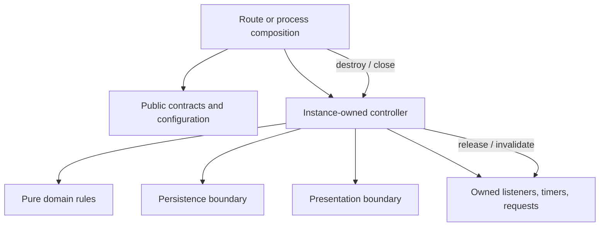
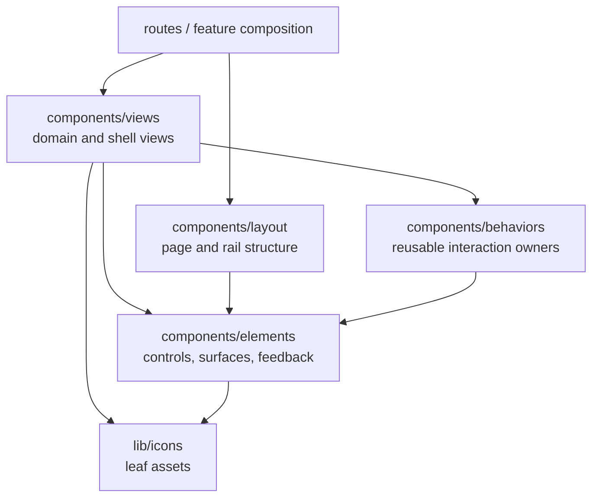

# ADR: Module Organization by Responsibility and Ownership

- **Status**: Accepted
- **Date**: 2026-09-19
- **Related decisions**: [Runtime Object Lifetime](objects-lifetime-management.md), [UI Design System](style-design-system.md)

## Context

A maintainable application needs more than a directory tree. Without the reasoning behind the tree, a new project gradually accumulates a flat set of unrelated modules, a large `utils` folder, or tiny files created merely to satisfy a line-count target. Each arrangement can look organized while making the actual dependency and lifetime boundaries harder to find.

The reference projects reached these conventions through refactoring. One subsystem mixed several parser classes, evaluation, language definitions, and persistence conversion in the same module. Another already had separate controllers with cohesive state machines and teardown. Splitting the first improved ownership visibility; splitting the second just because it was long would have distributed a single lifecycle across more files.

The component library exposed the same distinction. Generic controls, interaction wrappers, page layout, and domain views had different dependency directions even when all were Svelte components. Moving files into folders only helped when the folder explained why a caller imported that implementation.

The decision is therefore about responsibility, authorization, and ownership. File size is evidence to inspect, not the rule that decides the boundary. The application preserves the organizing principles while removing the reference domains that originally demonstrated them.

## Decision

**Keep one cohesive owner or responsibility understandable in one module. Name folders for responsibilities, import the responsible module directly, and keep state and cleanup with the instance that owns them.**

Composition knows which collaborators exist and how they are wired. A controller owns its state transitions and lifetime. Pure rules do not acquire resources. Persistence converts and stores data at an explicit boundary. Presentation translates already-owned state into a view. These are useful responsibilities even when a small subsystem needs only two of them.

### One class per file, with its contract beside it

An implementation class normally has one file. Associated helper functions, types, constants, and a private error type can remain beside it when they describe that class's contract. Moving each of them to a separate file would make the owner harder to read without creating a meaningful reuse boundary.

A pure function does not need a class. A small coherent collection of value transformations does not need an artificial object with no state. Related records describing one wire contract can remain together; “one class per file” is intended to separate independent implementations, not to scatter the fields of a protocol.

Examples in this application include the chart hover controller and server LRU cache: each has an independent owner and behavior. Markdown AST variants remain together as a contract because their union is how parser and renderer agree about a document. Date and text helpers remain grouped by the value contracts they interpret.

### Folders name work, not miscellaneous membership

Use names such as `parsers/`, `persistence/`, `presentation/`, `navigation/`, or `timing/` when the subsystem actually contains those responsibilities. Avoid `utils/`, `common/`, `shared/`, and `misc/`: those names say that code is reused without saying what rule it implements or who owns it.

A domain root holds its public contracts and composition point. Distinct implementations live beneath the responsibility they serve. This does not require creating an empty hierarchy in anticipation of work. The application's example is deliberately small; a new domain should acquire folders as real boundaries emerge.

| Concern       | Good boundary                                                        | Misleading boundary                                                                 |
| ------------- | -------------------------------------------------------------------- | ----------------------------------------------------------------------------------- |
| Parsing       | A grammar parser with its token and error contract                   | One file containing unrelated parser classes merely because all read text           |
| Persistence   | Storage conversion and version handling beside the persistence owner | Serialization mixed into a reactive controller's interaction logic                  |
| Navigation    | Destination construction, encoding, and selection policy             | URL fragments built independently at every call site                                |
| Presentation  | Shared display rules with an explicit domain home                    | Reclassifying domain-specific formatting as a generic component to make it reusable |
| Timing        | A timer owner and a pure elapsed-value formatter                     | Module-scope intervals started as an import side effect                             |
| Document preparation | Server-only transforms with serializable output | Importing browser rendering infrastructure into client code |

### Component boundaries follow responsibility

The distinction is not whether a component contains an event handler. A password field can own visibility state and remain a generic element. A native dialog wrapper belongs to behaviors because focus, opening, dismissal, and cleanup are its reusable interaction contract. A page container belongs to layout because its job is structure around caller-supplied snippets.

A domain view remains in that domain even if more than one route uses it. Shared domain presentation should have one explicit domain home instead of being copied into multiple features or promoted into a falsely generic element. Lower-level elements, behaviors, and layout must not import feature views; that would reverse the dependency direction and turn the supposedly reusable library into a hidden application dependency.

Icons live at `src/lib/icons/`, outside the component hierarchy. They are leaf assets used throughout the application rather than part of a particular design-system implementation. Within that module, visual-role directories organize actions, navigation, layout, identity, appearance, status, content, and keyboard symbols. Consumers import concrete category paths; the icon README explains category responsibilities and the shared contract. A route's current use does not change an asset's category, and relocations do not leave forwarding components behind. Charts and markdown are substantial libraries with their own contracts and standalone READMEs.

### Extract a shared rule, not matching syntax

Two functions containing similar loops are not automatically the same abstraction. Extract when the callers share the same rule and should change together. Keep separate policies separate even when their current implementation is identical.

For example, shared link policy centralizes accepted schemes and outbound targets because all prose links need the same rule. Typed application routes and authored document links still have distinct construction policies. Reusing their visual treatment does not make their input contracts identical.

A shared helper must not accidentally become a shared owner. Moving timer logic into a helper should produce one helper instance per controller, with teardown still triggered by that controller. It must not create a module singleton whose callback retains whichever route used it last. The [lifetime ADR](objects-lifetime-management.md) defines these ownership rules across components, build-time preparation, and server rendering.

### Preserve cohesive state machines

A long controller can still be the correct boundary if its methods operate on the same state and follow one lifecycle. Splitting its fields, asynchronous result guards, cleanup, and mutation policy among unrelated modules can make invalid transitions easier rather than harder.

Before splitting an owner, answer:

1. What independent responsibility is being extracted?
2. Can it describe a contract without reaching back into arbitrary private state?
3. Does it own resources, or borrow them from a caller?
4. What creates it, invalidates its pending work, and destroys it?
5. Will the extracted module change for a different reason from its caller?

If those answers amount only to “the file becomes shorter,” keep the cohesive implementation and improve its local organization instead.

### Build and browser boundaries deserve physical separation

The source catalog and document transforms stay server-only so Chromium and highlighting grammars do not enter the browser graph. The static build publishes their prepared HTML/data. Presentation components receive serializable document data and own only browser interaction; server-only module placement does not make published content private.

| Operation | Owner | Boundary |
| --- | --- | --- |
| Diagram rendering | Build-time transform | Browser and deadlines owned by each attempt |
| Markdown preparation | Server loader | Mutable AST belongs to one load |
| Display and interaction | Route/component tree | Public props and explicit cleanup |

Grouping by where code happens to render would hide these distinctions. Grouping by authority and ownership lets a reviewer trace the actual path before changing behavior.

### Relocation leaves one authoritative import path

When moving a module, update all source consumers, tests, examples, documentation links, and harness instructions in the same change. Remove the retired path. Do not leave a forwarding module, compatibility component, or barrel at the old location merely to avoid updating imports.

Forwarding shims make both locations appear supported, hide which boundary is authoritative, and encourage the next author to copy the obsolete path. They also make a later search report two apparent implementations. A deliberate public package entry point can still be valid; the rule forbids retaining a dead organization through aliases, not all curated exports. The markdown renderer's own export surface is different from a shim at a retired location.

For UI source, use the repository's `#lib` imports and explicit module extensions. A move does not justify changing reactive ownership, props, callback semantics, or CSS. Keep behavior changes explicit rather than burying them in a relocation diff.

## Documentation is part of the module contract

A reusable library's README must stand alone for someone who opened that directory. It explains purpose, dependencies, public entry points, data flow, examples, lifetime, extension points, failure modes, and verification. Tables help map parallel responsibilities; diagrams help trace composition, data flow, and cleanup. Neither is removed merely because the library is used by a small application.

The README's subject is the stable module boundary, even when the directory initially contains one implementation file. Explain responsibility, ownership, relationships, and extension criteria at that level. For example, `context/` owns contracts supplied through a component tree; shell coordination illustrates that contract without defining the module's permanent scope. Keyboard handling likewise illustrates a lifecycle integration rather than defining every future hook. A routine addition within an established boundary should not force an update to a documentation roster.

Do not duplicate the source tree with exhaustive lists of files, components, or exports. A responsibility table, contract comparison, or data-flow diagram communicates a stable relationship; a parts list changes whenever implementation membership changes. Remove the inventory column while retaining useful structure and exposition. Specific references remain valuable when they explain an actual contract, show a usable example or required command, identify an important quirk, or establish audit evidence. Keep the names and detail in those explanations rather than applying a blanket filename-removal rule. A focused leaf package may keep a narrow responsibility; that scope comes from its contract, not its file count.

Public declarations and component props document their actual contracts at the source. The README provides the exposition and rationale those local comments cannot. ADRs record why boundaries were chosen and what alternatives cost. Agent instructions carry the same conventions into automated work but do not replace application documentation or become a prerequisite for reading it.

These forms serve different readers. A new application should rewrite its domain description while retaining the reusable contracts and lessons. A new contributor should not need the old reference repository to reconstruct why a helper is instance-owned or why two credential handlers remain separate.

## Alternatives considered

| Alternative                                        | Why it was rejected                                                                         |
| -------------------------------------------------- | ------------------------------------------------------------------------------------------- |
| Flat directories indefinitely                      | Independent owners and public composition become difficult to distinguish as a domain grows |
| Split every file above a size threshold            | Fragments cohesive state machines and invents abstractions with no independent contract     |
| One helper per file                                | Adds navigation overhead without necessarily creating a meaningful boundary                 |
| Generic shared utility bucket                      | Hides the rule and ownership behind each import and attracts unrelated code                 |
| Preserve old import paths through forwarding files | Keeps two organizations alive and obscures the authoritative implementation                 |
| Centralize every repeated fragment                 | Couples callers whose policies should evolve independently                                  |

## Verification and consequences

An organizational change should be reviewable as an organizational change. Compare moved source with its previous implementation after the intended import substitutions and formatting. Inspect the dependency direction, stale imports, documentation targets, and lifecycle ownership. Run the affected service's gates in its configured environment.

For component moves, an unchanged emitted CSS asset is useful evidence that the utility rule set stayed the same, but it does not establish identical markup or behavior. Compare rendered contracts and exercise affected interactions where appropriate; the [design-system ADR](style-design-system.md) explains the limitation. Avoid tests that merely assert folder names instead of a behavioral contract.

The result is more meaningful imports and clearer review boundaries. The cost is that a relocation can touch many consumers and docs. That cost is paid once so subsequent projects inherit one understandable arrangement, rather than carrying compatibility layers or relearning the same structural lessons.

## References

- [UI library and component organization](../app.md)
- [Component library](../../src/lib/components/README.md)
- [Markdown subsystem](../../src/lib/markdown/README.md)
- [Runtime Object Lifetime](objects-lifetime-management.md)
- [UI Design System](style-design-system.md)
