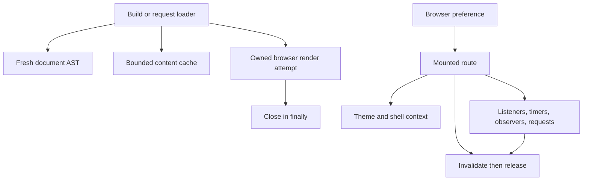
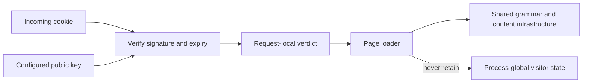
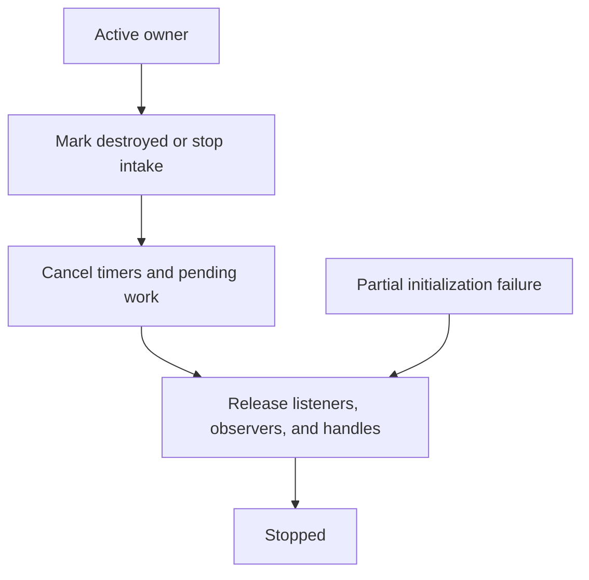

# ADR: Runtime Object Lifetime and Management

- **Status**: Accepted
- **Date**: 2026-09-19

## Context

Ephemeral behavior must remain ephemeral, and long-lived resources must have explicit owners. A missing listener cleanup can double keyboard actions after navigation; stale asynchronous work can replace a new document; a request-specific module cell can contaminate another render. These are correctness and performance failures even when the default deployment is static: prerendering and development both execute server code.

## Normative ownership rules

- Component/request scope lasts for one mounted owner or one render. Current interaction, session verdicts, and mutable ASTs belong here.
- Process scope contains reusable grammar/theme infrastructure and bounded content-derived caches. It never contains a current visitor or a cached authorization result.
- Browser persistence stores preferences with explicit keys and normalization. It does not transfer a controller's lifetime to the module that exports its class.
- Every acquisition outside the component tree has an effect/attachment/mount cleanup or an explicit `destroy()`/close path. Teardown is safe after partial initialization and repeated calls.
- Mark an owner invalid before canceling its resources. Cancellation and result validity are separate contracts; a continuation already queued must still check its owner.

Theme and rail visibility are browser-wide preferences. Element-local scroll memory uses identity/content/region keys while its attachment owns listeners, observers, debounce timers, and the final pending write. An anonymous app supplies an empty identity. An account-based app must supply the active identity without creating a global request store.

MathJax is an explicit browser-page runtime exception. One browser-only loader owns the shared script attempt, listeners, and startup deadline; failed attempts clean up and can retry. Renderer-owned targets pass through a serialized queue. Each renderer invalidates outgoing work and clears tracked math on teardown. The page-global loader contains no session, document AST, or active-popup state.

## Ownership map

| Resource | Owner | Release or invalidation |
| --- | --- | --- |
| Shell rail registration | Registering route | Returned release function, identity-checked |
| Pointer timers and tooltip lock | Hover/controller instance | `destroy()` and paired release |
| Scroll memory | Mounted element attachment | Flush pending write, remove listeners/observer/timer |
| Popup targets and math | Renderer tree | Invalidate outgoing work, clear tracked elements |
| Mutable document | One loader call | Return serializable data; never reuse mutable ASTs |
| Chromium | One uncached render attempt | Bounded close in `finally`, then forced termination if necessary |
| Highlighting/cache | Server process | Bounded content keys; no request identity |
| Session validity | Request hook | Reverify the request cookie on every request |

### Component ownership includes asynchronous results

The reusable UI mechanisms demonstrate the same rule at different scales. A [shell rail registration](../../src/lib/context/shell.ts) returns a release function owned by the registering route. [HoverController](../../src/lib/components/charts/hover-controller.svelte.ts) owns delayed hover behavior and exposes `destroy()`. A clipboard attachment owns its listener and feedback timers; cleanup removes the listener, clears timers, and prevents a late clipboard promise from scheduling more feedback after disposal.

Resource cleanup and result validity are separate checks. Removing a listener does not cancel an already-started request; aborting a request does not guarantee a queued continuation will not run. A route controller with asynchronous work should invalidate its owner before releasing resources, then accept a result only when both the owner is alive and that request's generation is still current.

The reference implementations exposed why one generation counter per entire page can also be wrong. Independent requests need independent scopes: changing a reporting window need not invalidate a resource's metadata, while selecting another resource must immediately invalidate the old detail response before the new metadata arrives. Otherwise an old result can repopulate a cleared panel or dismiss a new request's loading indicator.

These are extension rules, not claims that the application includes the reference domain controllers. When adding a controller:

1. Construct it per route or keyed component instance.
2. Name the request scopes according to which changes invalidate them.
3. Capture a scope generation before awaiting work.
4. On completion, check both generation and owner lifetime before changing state or launching follow-on work.
5. Mark destruction first; then cancel owned timers, frames, observers, requests where supported, and shell registrations.

External work may complete after a route disappears. The application must prevent that result from changing a replacement editor. For staged editors, capture submitted values and define reconciliation before introducing optimistic state.

### SSR is a process boundary, not a component shortcut

The development server runs a long-lived Node process, and static prerendering reuses a process across routes. A mutable value at module scope in a `.svelte.ts` module is shared by every server request, not recreated for every visitor. A getter that lazily repairs that value is still a write and can leak one request's identity or state into another.

[`persisted()`](../../src/lib/state/storage.svelte.ts) makes part of this rule structural. On the server it returns a deep-frozen initial value and throws on assignment. In the browser it uses `$state.raw`: callers replace the whole payload, so proxying every nested object would add tracking they do not use. Spread-and-replace is the contract; an in-place nested mutation is not a persistence operation. The helper stores preferences, not authoritative cross-device domain data, and it does not validate a successfully parsed JSON shape on the caller's behalf.

Browser-global reference counters are permitted only for an explicitly shared browser resource, with browser guards at their entry points and paired acquire/release operations. The [chart tooltip scroll lock](../../src/lib/components/charts/tooltip-scroll-lock.ts) is the example. An interactive listener installed during module evaluation is not.

### Server resources have different owners from caches

A content-derived immutable SVG cache can be process-scoped because its entries contain no request authority. A Chromium browser has external resources and requires an owner and close path. The current [Mermaid renderer](../../src/lib/server/mermaid-cli.ts) gives each uncached attempt its own browser and closes it in `finally`, including on timeout. A failed close falls back to terminating that browser process. Document rendering bounds aggregate work to four slots; the SVG cache holds at most 64 entries.

A `Promise.race` timeout rejects the caller's wait; it does not cancel the losing operation. Closing the owned browser is what stops the timed-out rendering work. The same principle applies to fetch deadlines: clear the timer after the guarded operation has consumed what it needs, so a stale deadline neither keeps the event loop referenced nor aborts a later body read.

## Request scope and process scope

The verifier can be process-scoped because it is immutable configuration. Signed tokens and their verdicts remain request-local. Rate-limit windows are explicitly bounded and keyed, and enforce only an attempt budget; they never stand in for authentication. A browser's stored preference cannot grant access.

## Shutdown and partial failure

A timeout that only rejects the wait leaves the underlying operation running. The renderer therefore closes the attempt's browser, and the launcher signals npm's process group rather than just its wrapper PID. Restart is not a normal cleanup mechanism. New work must identify the creator, state retained, invalidation point, and cleanup site before being made process-global.

## Verification contract

For component changes, navigate away while work is pending and remount repeatedly; callback counts must not grow and late results must not alter a replacement owner. Exercise teardown after success, failure, and partial initialization. For server changes, verify that separate requests cannot share mutable ASTs or session decisions. Content caches require explicit bounds and keys covering every rendering input.

Parser, persistence, request-lifetime, popup, scroll, MathJax, hover, and mocked Mermaid tests preserve selected contracts. Neither mocked browser cleanup nor a successful static build proves real browser launch or container shutdown. Report actual browser and deployment checks separately.

## Consequences

Explicit ownership bounds duplicate work, stale callbacks, and process memory. Cohesive controllers are easier to review than timer/state fragments spread across files. The cost is that each owner must expose its lifecycle and every asynchronous result must respect it. A reusable lifecycle abstraction is justified only when it makes those obligations more visible.

## References

- [Shell context](../../src/lib/context/README.md)
- [State primitives](../../src/lib/state/README.md)
- [Charts and hover ownership](../../src/lib/components/charts/README.md)
- [Markdown rendering](../../src/lib/markdown/README.md)
- [Deployment](deployment.md)
