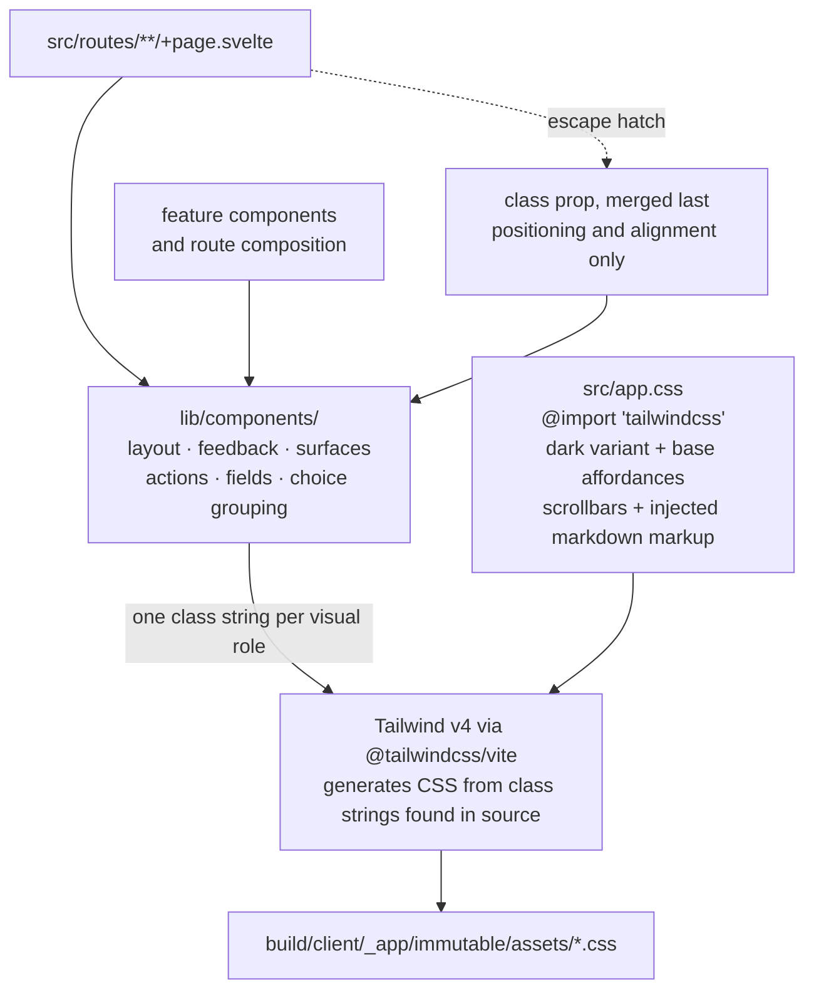

# ADR: UI Styling Design System (Container Components, Not a Token Layer)

- **Status**: Accepted
- **Date**: 2026-09-19
- **Refines**: the Tailwind convention in [UI engineering guidance](../agents/app.md#tailwind-css) — "for repeated class lists, extract a Svelte component rather than reaching for `@apply`" — which this document promotes from a preference into a named set of components and a rule about where the next visual decision goes

## Context

The UI is SvelteKit 3 and Svelte 5 styled with Tailwind CSS v4, wired through the `@tailwindcss/vite` plugin. There is no `tailwind.config.js` and no PostCSS configuration; v4 is configured from CSS, and [`src/app.css`](../../src/app.css) is deliberately thin. It imports Tailwind, declares the class-based dark variant once, and defines global interaction affordances and scrollbar treatments. The `@layer base` block uses zero-specificity `:where()` selectors for cursor, focus-visible outline, hover, and active brightness. Scrollbar rules cover `main`, the page's scroll container, and `.inner-scroll-region` for nested regions. The integrated markdown subsystem also needs global selectors for injected Shiki markup and code-copy controls. Those output-boundary rules stay global; the component system owns repeated application controls and surfaces.

That arrangement has no seam. A Tailwind utility list on an element has no shared referent, no name, and no import — nothing an author could reuse and nothing a reviewer could compare against. So each new feature did the only thing available to it: copy the class string from a nearby element that looked right and edit it. The copies then diverged, one attribute at a time, with no error at any point.

An audit of a reference application measured how far that arrangement had drifted. These are the lessons inherited by this application, not measurements of the smaller example UI:

- **The primary action button appeared nine times with nine different class strings.** Four sites had `hover:bg-slate-700` and others had no hover state at all. Disabled treatment split three ways between `disabled:opacity-50`, `disabled:cursor-wait disabled:opacity-60`, and nothing. Only two controls carried transitions, and they alone added `hover:shadow-md`. A user who pressed a disabled button on one page and the same button on another got different feedback, or none.
- **The secondary (outlined) and danger (outlined red) buttons had the same problem**, including a `dark:hover:bg-slate-900` versus `dark:hover:bg-slate-800` split between two controls filling the same visual role.
- **The card and panel surface existed in six variants**, differing in radius (`rounded-lg` against `rounded-xl`), padding (`p-4`, `p-5`, `p-4 sm:p-6`, `p-6`), and dark ground (`dark:bg-slate-900` against `dark:bg-slate-950`).
- **Semantic error text had drifted** across `text-red-700 dark:text-red-400`, `text-red-800 dark:text-red-400`, and `text-red-800 dark:text-red-300` — three answers to the question "what color is an error."
- Four route pages independently repeated a byte-identical page scaffold: a centered page header, a centered spinner gate, a dashed-border empty state, and a `max-w-384` page container. Even no-content branches duplicated the same markup and copy.

The root cause is worth stating plainly, because the fix follows from it and nothing else does: **nothing held the strings together.** This is not a discipline failure that more review catches. The UI check, lint, formatting, and test gates can all pass across those variants. Type checking has no opinion about a string attribute's contents. Formatting can make divergent markup tidier without making its behavior or visual roles agree. Vitest asserts behavior and rendered text, not whether two buttons in different routes agree about their hover state. A gate can check an explicit contract; the original markup had no shared contract to inspect.

## Decision

**Introduce a small set of container/rendering components under [`src/lib/components/`](../../src/lib/components/) that own the shared visual vocabulary, and route the affected call sites through them. The components _are_ the design system: there is no CSS token layer, no `@apply`, and no `tailwind.config.js`, because in Tailwind v4 the class string is the seam and a Svelte component is the only construct in this codebase that can own one.**

Read the diagram right-to-left to see why the alternatives lose. Tailwind 4 discovers utility candidates in source and combines generated utilities with the configured CSS. Any layer that centralizes the _names_ without owning the _element_ leaves the use site free to keep writing its own string.

### Shared visual responsibilities

| Responsibility             | Shared contract                                                                                                                               | Drift it prevents                                                                       |
| -------------------------- | --------------------------------------------------------------------------------------------------------------------------------------------- | --------------------------------------------------------------------------------------- |
| Page layout                | A centered `max-w-384` column, page title, and supporting copy                                                                                | The scaffold repeated verbatim across four reference routes                             |
| Loading and empty feedback | Centered loading indication, dashed empty panels with optional action content, and muted explanatory notices                                  | Duplicated no-content branches and inconsistent feedback                                |
| Surfaces                   | Canonical border, fill, radius, and spacing, with appropriate native element semantics                                                        | Six independent radius/padding/dark-ground variants                                     |
| Actions                    | Consistent primary, secondary, and destructive roles; small/medium sizing; text and square icon controls; native link versus button semantics | Nine primary-action class strings, divergent outlines, and per-site icon-control copies |
| Labeled fields             | Shared label/control geometry and density; text entry and typed option selection retain their own input contracts                             | Hand-built label/input pairs and four independently assembled select pairs              |
| Choice grouping            | Consistent bordered grouping within the contextual rail                                                                                       | Three hand-written choice containers                                                    |

`Button` combines `variant` (`primary`, `secondary`, `danger`, or `danger-outline`) with `size` (`sm` or `md`), and renders an anchor for an `href` and a native button otherwise. Those are behavioral and semantic contracts, not just names for class strings. It carries two danger roles rather than one because the audit found two: `danger` is the solid red that _confirms_ a destructive action inside a dialog, and `danger-outline` is the bordered red that _offers_ one from a page. Collapsing them would have made a confirmation button and its trigger indistinguishable.

Two small modules export class-string constants rather than components, in the narrow case where two components must agree on a vocabulary but cannot share an element:

- The [field styling boundary](../../src/lib/components/elements/field.ts) shares control, label, spacing, grouping, and density decisions. `TextField`, `SelectField`, and `SearchField` present the same control to the reader but cannot share an implementation — one renders a plain input, one a Clear button, another renders options. Width and padding are left to each component for the reasons given below, and the surface-dependent dark ground is deliberately absent for the same reason it is absent from the card classes: it depends on the surface behind the field, so the call site supplies it. `FIELD_BOX_CLASS` is the one constant here that does carry its dark ground, because every container that uses it lives in the contextual rail, where that ground does not vary.
- [`surface.ts`](../../src/lib/components/elements/surface.ts) exports `SURFACE_BORDER_CLASS` and `SURFACE_FILL_CLASS`. `Card` composes them into its variants, and `Modal` composes the same two alongside its own dialog chrome — it renders a native `<dialog>` whose element it must hold a reference to in order to call `showModal` and `close`, so it cannot delegate that element to `Card`.

The rule that keeps these from becoming the rejected constants-only alternative below: **a constant is consumed by a component, never by a call site.** A route that imports `SURFACE_FILL_CLASS` is writing a card by hand, which is the thing this ADR exists to stop.

`SelectField` preserves the value union of its `options` array rather than reducing every selected value to an untyped string. That contract is independent of shared field geometry. The labeled form controls expose a `density` of `form` or `rail`. This is not a second vocabulary smuggled in: the audit found the two already in use and consistent — page forms label at `text-sm font-medium` with a `mt-2` gap, while the compact contextual rail labels at `text-xs font-medium text-slate-600` with `mt-1.5`, because there a field is secondary chrome beside the content it filters. Naming the axis stops a third density appearing the next time someone needs a field in a narrow column. This is not a universal prop on every input wrapper: `SearchField` accepts a value and callback, while `TextField` exposes a bindable value. Read the component contract instead of inferring props from a neighboring control.

`Card` renders through `<svelte:element>` and `Button` chooses its own tag because the element is part of what drifted. Using a link for a non-navigation action or a button for navigation can lose native semantics and expected keyboard behavior. Shared visual treatment should preserve the element appropriate to the action. Making the component decide removes the choice from the call site.

These components retain the reuse rule: a shared component earns its place by serving more than one route or by providing a reusable primitive that feature components compose. The [application guide](../app.md) describes their current organization into elements, behaviors, layout, and feature views under the component module.

### Why not the alternatives

**A CSS token layer with `@apply`.** Tailwind v4 supports it, and it would centralize the strings. It would not centralize the element, the disabled semantics, the `<a>`-versus-`<button>` decision, or the snippet slots — so a call site that wanted a button would still write markup by hand and still be free to add one more utility. It also moves styling out of the place a Svelte developer looks for it and into a stylesheet that this project deliberately keeps to the global rules components cannot own. The [UI conventions](../agents/app.md#tailwind-css) already forbid reaching for `@apply` unless the abstraction is genuinely stylistic; a button's disabled behavior is not.

**A `tailwind.config.js` theme extension.** There is no such file, by design, and v4 does not want one. Recreating configuration-file theming to solve a duplication problem adds a build-level indirection that could not have fixed the specific drift measured above: every variant in the audit was assembled from stock Tailwind scale values, correctly. The failure was that nine sites each chose their own combination, not that the scale was wrong.

**A module of exported class-string constants.** The cheapest option, and the most tempting, because it looks like a component without the file. It fails for the reason the whole audit fails: a constant is opt-in at the use site. The next feature still writes markup, still needs a button, and still has the option of copying a nearby string instead of importing the constant — and nothing about the resulting diff signals which happened. A component is the only version of this idea where using the system is easier than not using it.

### Button sizing is padding-based, not fixed-height

`Button` sizes itself with padding — `px-4 py-2 text-sm` at `md` — rather than with a fixed `h-9` or `h-10`.

This is not a preference. Tailwind's preflight sets `box-sizing: border-box`, so a fixed height is the _total_ height, border included, while padding-based sizing adds padding outside the text box and lets the 1px border of the outlined variants extend beyond it. Adopting a fixed-height system would therefore have changed the rendered height of every bordered button by two pixels, in a refactor whose entire premise was that it was correcting accidental drift rather than redesigning anything. Padding-based sizing preserved the existing rendering at the majority of sites, which is the outcome that let the change be reviewed as a normalization instead of as a visual redesign nobody had asked for.

### `class` is an escape hatch for position, not for palette

Every component takes a `class` prop and merges it last through Svelte 5's array-class syntax: `class={[base, className]}`.

One thing that syntax does _not_ do is decide conflicts. Two utilities targeting the same CSS property resolve by their order in the generated stylesheet, not by their order in the class attribute, so "merged last" buys ordering in the markup and nothing in the cascade. That is why the hatch is scoped to properties the base does not already set.

A concrete example from the reference work is a password-reset submit button beside a labeled password field. `shrink-0 self-start sm:mt-7` positions that button on the input row rather than the label row. Those classes describe the row the button is in; they do not change what a primary button is. Without a layout escape hatch, that arrangement would either break alignment or force the control outside the component system.

The same arrangement originally forced the button and input to the same height with per-site `h-10` overrides. Shared padding made that reconciliation unnecessary. **An override that exists to reconcile two components disagreeing about the vocabulary is a defect in the vocabulary, not a legitimate use of the hatch.** Fix the shared definition so the correction reaches every instance.

The boundary is what makes the hatch safe:

- **Legitimate**: layout and alignment at a specific site — `mt-*`, `self-*`, `w-full`, `shrink-0`, `col-span-*`, and the per-surface padding a `Card` is given.
- **Not legitimate**: variant color, typography, radius, or disabled treatment. Those are the vocabulary this ADR exists to hold still, and a `class` prop is not the place to relitigate them. If a role genuinely needs a different color, it is a new `variant` on the component, argued once, applied everywhere.

A reviewer can apply that rule mechanically: an override that would look the same on any page is a variant in disguise; an override that only makes sense next to that particular sibling element is positioning.

### Competing utilities are resolved by the component, never at the call site

The same hazard surfaced three times, and the answer was the same each time: when a component needs to vary a property it already sets, that variation becomes a prop or is lifted out of the shared string — never layered on as an extra class.

- `Card` takes `radius` and `surface` as props. A caller passing `rounded-xl` to a base that already says `rounded-lg` would be relying on which of the two Tailwind emits later.
- `SelectField` takes `fullWidth` rather than accepting a `w-auto` override, for the same reason.
- `FIELD_CONTROL_CLASS` carries no padding at all. `SearchField` reserves room for its Clear button, so it needs asymmetric padding, and a shorthand such as `px-3` beside a longhand such as `pr-10` is precisely the ordering-dependent case. Components that want the ordinary box compose `FIELD_CONTROL_PADDING`; controls with inset buttons spell their padding out.

In the reference audit, `.pr-10` was emitted after `.px-3`, so the previous markup happened to render correctly. It was correct by accident, and a Tailwind upgrade that reordered its output would have silently moved a button on top of the text it sits beside. Making the padding explicit costs nothing and removes the dependency.

### Hierarchy is expressed with the surface variants, not a bespoke ground

A group of cards needs an enclosing surface to read as a group. That does not automatically require another background color. An outer `Card` with `surface="outline"` can hold filled `Card` children, allowing the page ground to participate in the hierarchy.

The page ground is `dark:bg-slate-950` and a filled card is `dark:bg-slate-900`: the outline container reads against the page, and its children against the container. Giving both the outer and inner surfaces the same fill would leave a small border difference carrying all the hierarchy. This failure was found in the reference work and is worth preventing before a new domain develops its own dashboards.

**Hierarchy between surfaces is expressed by choosing `surface` and letting the page ground participate, not by introducing a new fill.** A nesting that cannot be expressed that way is an argument for a new shared variant, rather than a one-off exemption.

## Consequences

Positive:

- One visual decision per role, in one file, with a name. The next author changing the primary button's hover state changes it once and it takes effect at every site, rather than finding independently styled copies.
- The reference normalization also corrected behavioral inconsistencies: every primary action now has a hover affordance and a consistent disabled treatment, and error text is one color pair rather than three.
- New route work composes `PageContainer`, `PageHeader`, `LoadingGate`, and `EmptyState` instead of copying a scaffold from a neighboring route, so the fifth route that needs an empty state does not produce a fifth wording of it.
- The system is legible from the outside: a reviewer who sees a bespoke class string for an existing role in a diff knows immediately that it is the thing this ADR prohibits, which is a check no linter provided before.
- `Button` and `Card` choosing their own element removes a recurring accessibility hazard from the call sites.

Tradeoffs:

- **Normalization can change rendered appearance.** Aligning hover states, disabled treatment, heights, and surface fills is a visible change even when it removes accidental drift. Distinguish an implementation-preserving move from a deliberate appearance change and review each claim with appropriate evidence. Copying the component system into this application preserves that decision; it does not make future visual changes automatically harmless.

- Indirection has a cost. Reading a page now requires opening `Button.svelte` to learn what `variant="danger"` looks like, where before the answer was on screen. The trade is deliberate: the previous arrangement made every string locally readable and globally incoherent.
- The escape hatch is a real hole. `class` can express anything, and the distinction between positioning and re-styling is a review judgment rather than something the type system enforces.

### What the gates do not check, and how to verify anyway

Type checking, linting, formatting, and ordinary unit tests do not establish visual equivalence. A useful technique from the reference work is to compare the emitted CSS under `.svelte-kit/output/client/_app/immutable/assets/` before and after a styling refactor, using the same lockfile, build configuration, and environment.

A byte-identical asset establishes that the emitted rule set did not change. A nonempty diff gives a concrete review surface: added or removed utilities and global rules can be examined rather than discovered after deployment. Asset names can change with hashing, so compare contents, not only filenames.

**Identical CSS is not proof of identical rendering.** Existing utilities can be reassigned to different elements without changing the emitted stylesheet. Moving markup, changing native elements, or altering a conditional class can also change behavior while preserving the same rules. In the reference work, controls gained already-emitted focus utilities while the CSS artifact stayed identical; the rendered class attributes revealed the change.

Use the CSS comparison alongside source or rendered-markup comparison and focused browser checks of the affected interactions, including disabled, focus, dark-theme, narrow-layout, and dialog states. For an organizational move, source equivalence after explicit import-path substitutions is strong additional evidence. These checks describe how a project validates a visual change; they are not a claim of browser validation performed on this host.

### The standing rule for new work

New visual work reaches for these components first. A new bespoke class string for a role that already has a component is the drift this ADR exists to prevent, and it will look, in a diff, exactly like the nine strings that made it necessary.

## References

- [`src/lib/components/`](../../src/lib/components/) — the components named above, each with its props type and doc comments
- [`src/app.css`](../../src/app.css) — the dark variant, global affordances, scrollbars, and injected-markup rules
- [application guide](../app.md) — the shared-component rule, the responsibility-based organization, and why the two global style blocks are global
- [UI engineering guidance](../agents/app.md) — the Svelte 5, TypeScript, and Tailwind conventions, and the UI gate
- [Runtime Object Lifetime and Management](objects-lifetime-management.md) — the ownership rules these presentation components sit under; presentation primitives keep route data with its owner; interactive behavior components release what they acquire
