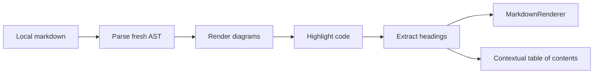
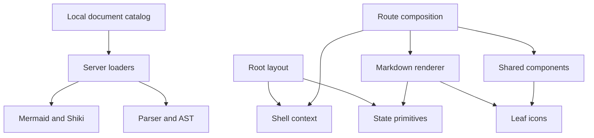

# Standalone SvelteKit application

The app uses Svelte 5, SvelteKit 3, TypeScript 6, Tailwind CSS 4, and Node 24. Deployment uses the static adapter on its Kit-compatible prerelease line. Exact versions live in the root manifest and lockfile.

## The shell

The root layout owns the top navbar, theme control, contextual rail, and narrow-screen drawer. Routes supply page content and may lend the shell a rail snippet through typed context. This avoids making every page independently reproduce navigation geometry or decide how a mobile drawer works.

The persistent rail becomes a drawer below the phone breakpoint, while primary navigation labels collapse to icons at a wider breakpoint. `MediaQuery` supplies reactive viewport state and owns its subscription. Its SSR fallback is deliberately desktop-like; responsive CSS still matters during the interval before browser state is available.

On wider screens the primary navigation is positioned around the header's center independently of the unequal title and theme-control widths. Centering the remaining flex space instead would visibly shift navigation as either side changes. On phones it returns to the flex flow so the compact controls share the available width. The wide navigation's wrapper does not intercept pointer events over neighboring controls; its actual links remain interactive.

A route registers a rail with its label, content snippet, and optional readiness getter. The shell can reserve its geometry immediately and show a spinner until the content is ready. Registration returns a release function, which belongs to the route's teardown. The release checks its registration identity so an old route cannot clear a newly registered rail.

Desktop rail visibility persists as one browser preference across routes. The phone drawer's open state is transient, closes when the viewport widens, and is cleared when its active registration is released. A route owns its data and readiness, not the shell's DOM.

### What actually renders on the server

SSR renders the complete shell and page content. Public builds save this HTML to directory indexes, so documents remain readable without JavaScript. There is no mount-only spinner hiding page content. Context-owned theme and route state still initialize per render; removing a mount gate never makes module-global interactive state safe.

The shell uses the reactive online value to show an offline status banner after hydration. That banner does not provide an offline application: there is no service worker, document download manager, or offline mutation queue in this application.

## Documents and public output

The local catalog provides summaries and exact source lookups. The document loader parses a fresh AST, renders Mermaid, highlights code, and extracts headings. It exports entries for every slug so static builds include nested and unlinked content. A route registers the resulting headings as a contextual rail and releases it on unmount.

Builds execute the loader while prerendering, publishing prepared HTML and route data. The deployed Nginx image serves those public files; loaders execute on the server only during builds and local development.

The examples route uses only in-memory state. It demonstrates filtering, whole-array replacement, fields, a confirmation dialog, and a chart. Replacing the example domain does not require modifying generic elements, charts, or the parser.

## Shared modules and their contracts

Each module is organized around a responsibility that survives changes to its implementation. The overview below describes those stable boundaries; the linked guides explain contracts, usage, ownership, and extension criteria. The source tree remains the inventory of individual files and components.

| Module                                         | Responsibility                                                                  |
| ---------------------------------------------- | ------------------------------------------------------------------------------- |
| [components/](../src/lib/components/README.md)    | Shared presentation and reusable interaction composition                        |
| [charts/](../src/lib/components/charts/README.md) | Numeric visual encodings and their drawing/interaction contracts                |
| [markdown/](../src/lib/markdown/README.md)        | Structured document syntax, interpretation, and rendering                       |
| [icons/](../src/lib/icons/README.md)              | Leaf visual assets with consistent props and caller-owned accessible names      |
| [state/](../src/lib/state/README.md)              | Reusable UI state and the rules for its ownership, persistence and invalidation |
| [dom/](../src/lib/dom/README.md)                  | Native browser operations with explicit element and resource ownership          |
| [datetime/](../src/lib/datetime/README.md)        | Calendar and time interpretation, validation and presentation                   |
| [text/](../src/lib/text/README.md)                | Pure text interpretation and value-to-text presentation                         |
| [server/](../src/lib/server/README.md)            | Private-resource and process-infrastructure integrations for the UI server      |
| [context/](../src/lib/context/README.md)          | Typed collaboration contracts across the component tree                         |
| [navigation/](../src/lib/navigation/README.md)    | Shared destination and navigation-presentation policy                           |
| [filters/](../src/lib/filters/README.md)          | Reusable selection, membership and admission policy                             |
| [hooks/](../src/lib/hooks/README.md)              | Component-owned integrations with external browser behavior                     |

The component hierarchy follows responsibility: elements own controls and surfaces, behaviors own reusable interaction, layouts own geometry, and views compose a coherent interface. Routes and controllers own route I/O and policy. A control can own password visibility without becoming a domain view; a long cohesive component does not need a wrapper merely to reduce file length.

Shared field/surface classes remain beside the components whose native roots or geometry require them. Routes compose components instead of importing styling constants. Native dialog behavior, async confirmation failures, viewport-positioned hover text, file-picker/drop mechanics, and swim-lane ordering have detailed contracts in the component guide; they are reusable lessons rather than hidden route implementation details.

Charts use D3 scale and shape functions but render SVG declaratively through Svelte. They do not retain imperative D3 selections. Their caller owns data policy and tooltip content, while timer and scroll-lock helpers have explicit release obligations.

The markdown library parses before rendering, so syntax extensions belong in typed nodes and parser productions instead of postprocessing final HTML with regex. Authored HTML tables cross an allowlist sanitizer after expansion/normalization; safe links reject executable schemes. Highlighted HTML and diagram SVG come from known server transforms. An arbitrary externally supplied AST is not a trusted substitute for that pipeline.

Mermaid uses a bounded content cache and render semaphore, with a browser owned and closed by each uncached attempt. Shiki lazily reuses grammar/theme infrastructure. MathJax is a browser enhancement. There is no whole-document cache, remote source proxy, offline corpus store, or stage-timing API in the application. The [markdown guide](../src/lib/markdown/README.md) retains the full dialect examples, parser/renderer diagrams, sizing lessons, scope limitations, and extension workflow.

## Framework constraints that are easy to undo accidentally

### Svelte 5 runes and props

Project components run in enforced runes mode. Use `$state`, `$state.raw`, `$derived`, `$effect`, and `$props`, not legacy reactive labels, `export let`, `on:` directives, or slots. Prefer derived values for computation; an effect is for a side effect with an owner.

Every component declares a documented named local `type Props`, even for one property, and annotates the destructuring pattern: `let { value }: Props = $props()`. `$props()` takes no type argument; writing `$props<T>()` is not the supported typing pattern. Document each property where the editor can expose its contract. Snippet props use Svelte `Snippet` and render with `{@render ...}`.

Generate instance DOM identities with `$props.id()` so SSR and hydration agree. Use prop shorthand when the variable and attribute names match. External resources acquired by effects or attachments must be released by their cleanup.

### Kit configuration and declared environment

There is no `svelte.config.js`. Kit 3 configuration is passed to `sveltekit()` inside [vite.config.ts](../vite.config.ts), including runes compilation and adapter selection. Instructions written for an earlier major's separate config file must be adapted to that location.

Declare runtime variables with `defineEnvVars` in [src/env.ts](../src/env.ts) and import generated `$app/env/private` or public exports. The application declares only the Puppeteer executable used for build-time and development document rendering. The deployed static app reads no runtime variables. Valibot is a direct development dependency because the environment schema uses it. An undeclared variable is a compile-time problem rather than a silent `undefined`; legacy `$env/static/*` and `$env/dynamic/*` are not the convention here.

The `#lib` subpath imports in the package manifest point to shared source with explicit module extensions. Server-only modules stay under `src/lib/server/` and cannot be runtime imports of browser code. Type-only imports are erased and can cross that boundary.

### Routes and links

Internal app links resolve through `resolve()` from `$app/paths`. Use the installed Kit 3 types for fixed route IDs and query-bearing paths. Upstream documentation still describing Kit 2 signatures does not override the pinned compiler. Do not infer active navigation solely by comparing a generated href to the browser pathname when page-relative resolution is involved; the route ID and explicit path policy answer different questions.

Authored prose links use the navigation helper's allowed-scheme and outbound-link rules; those are separate from typed app route construction.

### The test browser condition must remain test-only

Vitest needs Svelte's browser entry points while running in Node/jsdom. `resolve.conditions: ['browser']` is therefore gated by `process.env.VITEST`. Making it unconditional also points development SSR at the client build, causing context lifecycle failures on cold rendering. A production build can pass while this development-only failure remains, so exercise a cold dev request as well as the build when changing this configuration.

The workspace watcher polls because bind-mounted filesystem events can be unreliable. It ignores the specific generated startup files whose startup writes could invalidate a first SSR render. Keep those exceptions narrow rather than hiding all generated or source changes.

### Dependency majors travel with their compatibility gates

TypeScript remains on major 6 while the installed lint/check toolchain supports that line. Do not replace the pinned prerelease Kit/adapter majors with a registry's older stable major merely because its dist-tag says latest. Vitest and its coverage provider move together. Exact compatibility ranges belong in manifests and the repository's standing upgrade notes; documentation should not become another patch-version ledger.

## State, theme, and lifetime

`persisted()` uses whole-value `$state.raw` replacement. In the browser it reads JSON once and writes best-effort localStorage; parsed values need caller-owned validation. On the server it returns a deeply frozen initial value and throws on assignment. Both protections matter: the setter catches a direct write, while freezing catches mutation through a value returned by a getter.

A module-level mutable cell has one instance for every request in a Node process. The same source in the browser belongs to one loaded page. Keep that process lifetime separate from component-owned interaction and browser-local preferences. Keep getters pure, create route state inside its component tree, and guard browser-global registration outside effects. Effects themselves do not run during SSR.

`LatestRequests` gives each view independent request scopes and predicates that reject superseded or destroyed results; the owner still checks those predicates before committing asynchronous state. The scroll attachment owns element/window listeners, an optional resize observer, debounced storage writes, and teardown flushing. It remembers a user/content/region-specific vertical offset without moving page ancestors or overwriting it during a temporary non-scrolling responsive layout. Neither helper is installed globally or forced into the example route merely to demonstrate a caller.

The portable leaf helpers retain their own policies: downloads own delayed Blob-URL release, strict UTC parsing validates calendar days, local timestamp display preserves invalid source text, and fuzzy search returns false for empty token arrays. Their standalone guides document edge cases rather than hiding them behind one generic utility namespace. Date/time helpers and text helpers remain separate responsibilities.

Theme has three parts: the class-based dark variant in [app.css](../src/app.css), the pre-paint inline script in [app.html](../src/app.html), and a context-owned `ThemeStore` initialized from the document class. The early script prevents a flash before the component tree exists; the store and layout effect maintain later changes. It is a browser preference, not a credential or server session property.

| Acquired resource                       | Matching release                                       |
| --------------------------------------- | ------------------------------------------------------ |
| Timeout or animation frame              | Clear/cancel from the owning lifecycle                 |
| Manual event listener                   | Remove with matching listener and capture options      |
| Resize/intersection observer            | Disconnect on teardown                                 |
| Contextual rail                         | Call the registration's release function               |
| Tooltip scroll lock or allowed scroller | Call its idempotent release function                   |
| Helper with a delayed close             | Call `destroy()` when its owner disappears             |
| Browser object URL                      | Revoke after the operation or owner is done            |
| Server abort deadline                   | Clear in `finally` when guarded response work finishes |

Svelte owns its declarative handlers and reactive media subscriptions; it cannot release a manual resource it was never told about. A lingering non-passive wheel listener affects scrolling even when no tooltip is visible, and a stale scroller registry can retain detached DOM. The library guides explain those concrete failure modes instead of relying on a general “cleanup on unmount” reminder.

## Module dependency graph

Route data stays above presentation, server integrations stay outside the browser graph, and leaf assets have no application-view dependencies. Add domain policy in its own cohesive owner; do not make generic controls depend on their first consumer.

## Run and validate

Run `npm run check`, `npm run lint`, `npm run format:check`, `npm run test`, and `npm run build` from the root. Also run `npm run test:deployment` after the static build when changing routes, adapters, environment, or deployment configuration. `npm run verify` includes the build and artifact tests. `npm run test:container` requires Docker and exercises the production Nginx image; CI runs it after the application gates. `npm run test:coverage` reports V8 coverage without claiming complete browser integration. The tests retain parser, safety, storage, request lifetime, chart hover, popup ownership, MathJax loading, and Mermaid lifecycle coverage.

The [root README](../README.md#run-and-validate) owns development setup and command usage. The [Coolify runbook](runbooks/prod-deployment.md) covers production configuration, verification, and recovery. Exercise cold dev rendering, navigation, both themes, mobile rails, and any changed interaction in a browser; static analysis alone does not prove focus behavior or cleanup.
