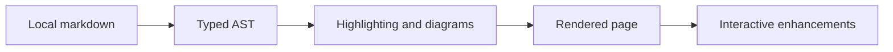

# Getting started

Financial Calculators combines a responsive application shell with reusable controls, charts, and a rich markdown renderer. Home links to Scratchpad, Amortization, and Cashflow, which build on this foundation; Settings manages the financial calculators’ Reset presets. This retained document is a library fixture, not a published application route.

## Application foundation

The calculators compose the existing libraries. Components own presentation, routes own their data, and context scopes interactive state to its component tree.

> [!TIP]
> The theme toggle remembers your choice across visits. A document consumer can also lend its table of contents to the shell's contextual rail.

## Local documents

Markdown files under `src/content/docs/` are retained catalog fixtures. A future document route can map a nested file such as `guides/deployment.md` to a nested slug and enumerate the catalog for prerendering.

```typescript
const doc = parse(source);
await renderMermaidDiagrams(doc);
await highlightCodeBlocks(doc);
```

The renderer receives the prepared document. It does not need the original source or a second parser in the browser.

## Data flow



## Shared conventions

| Boundary | Responsibility |
| :--- | :--- |
| Elements | Controls, fields, surfaces, and feedback |
| Behaviors | Interaction and cleanup |
| Layout | Page and rail geometry |
| Views | Application composition |
| State | Preferences and owned lifetimes |

See the [deployment guide](guides/deployment.md) for the public static hosting model.
