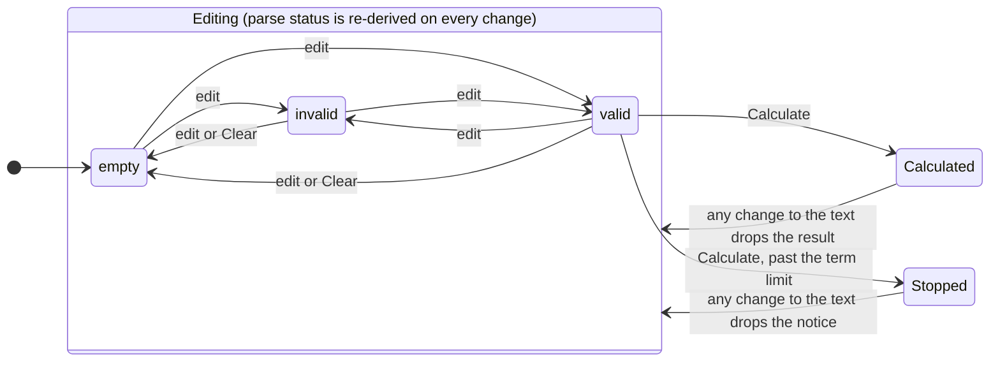
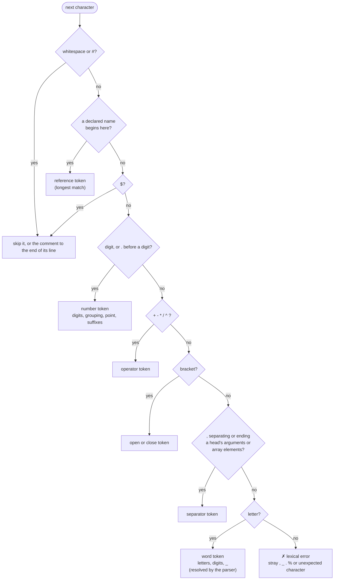
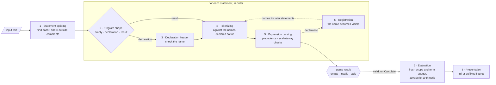
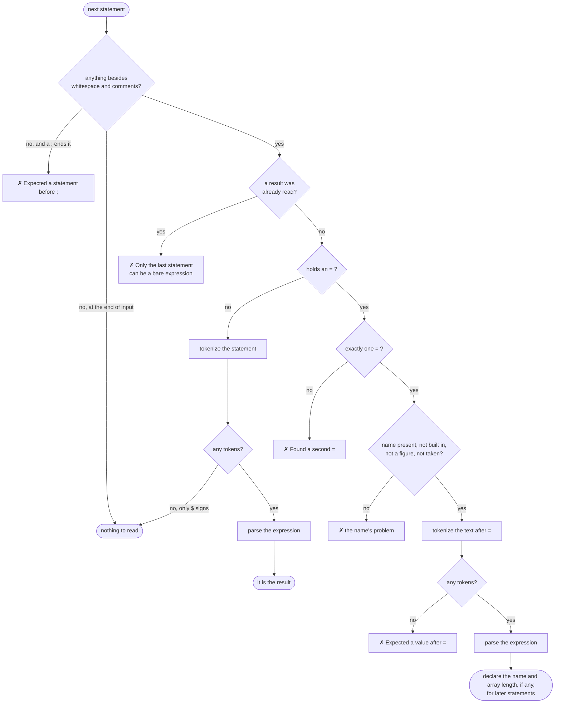
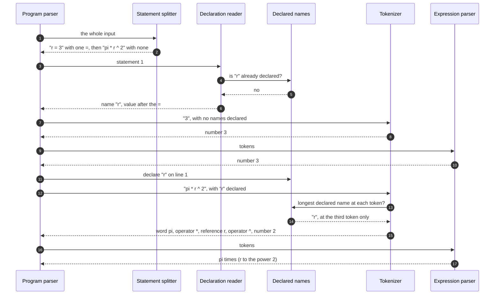
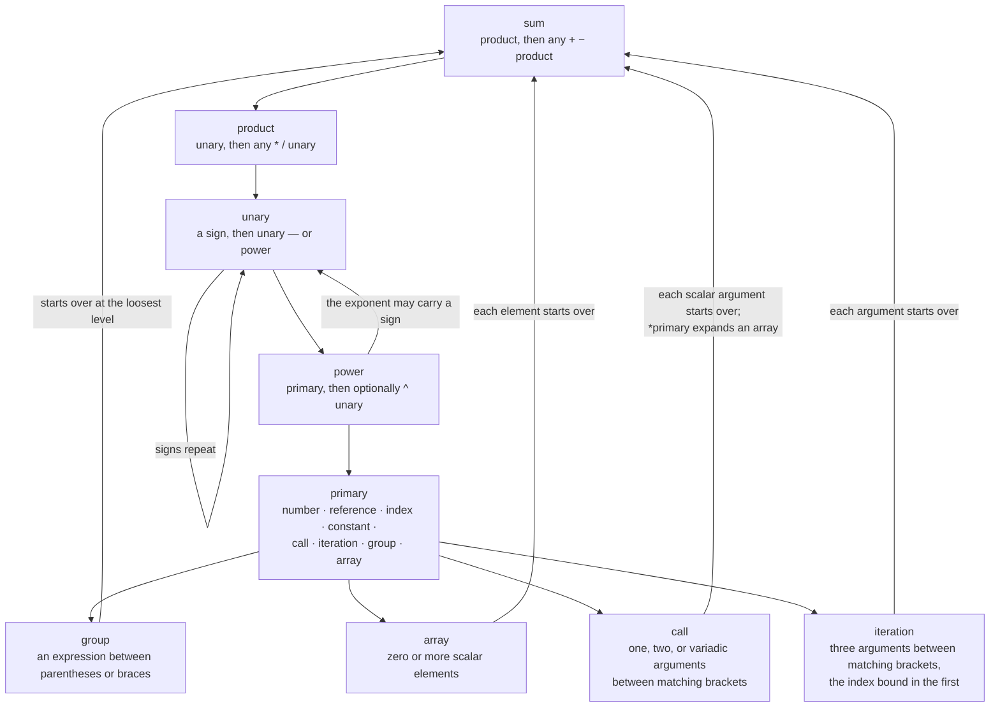
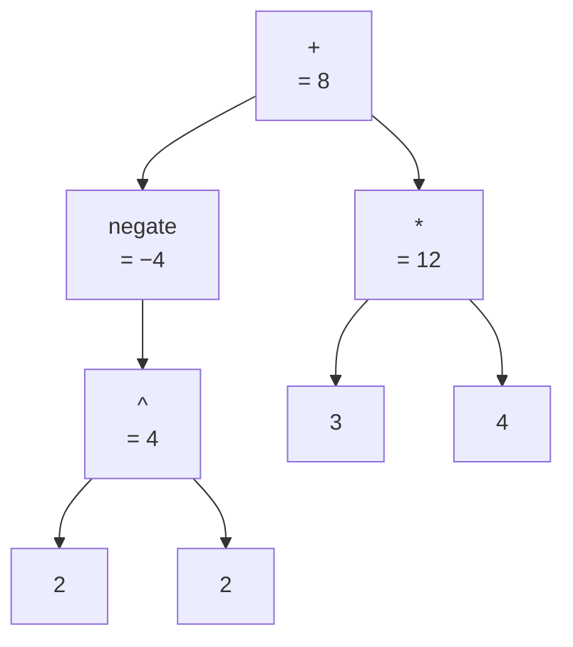
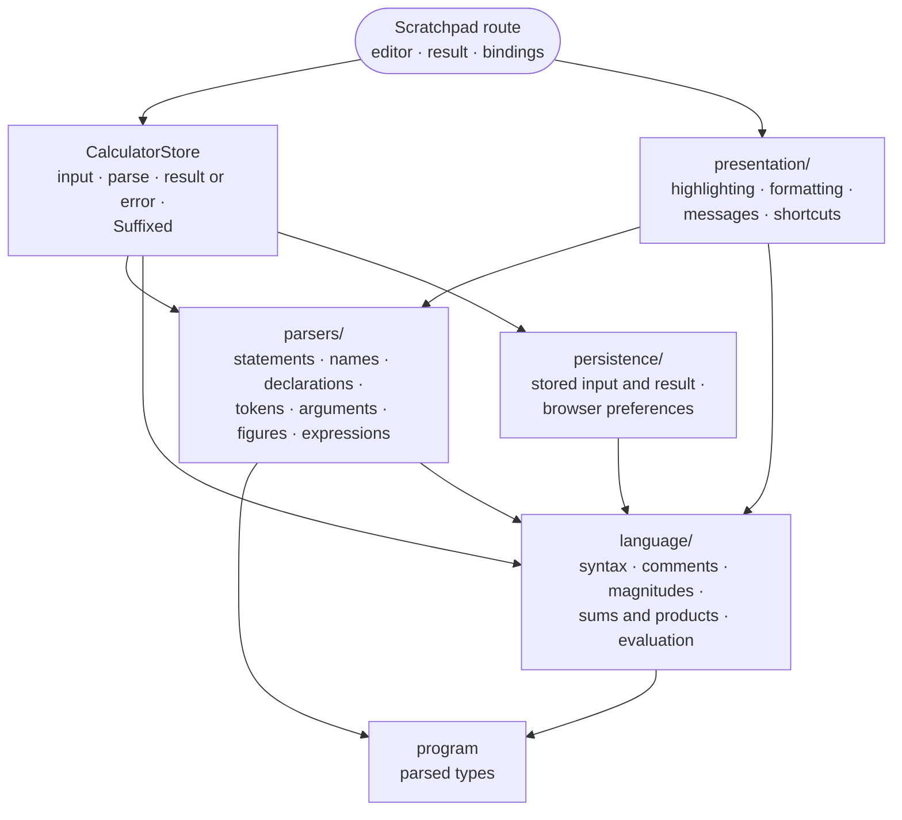

# Scratchpad calculator

A full-page calculator for ad hoc financial working at `/scratchpad/`. Its route composes a highlighted editor beside a result card and named-bindings table on wider screens; the panels stack on small screens. Input is parsed as you type, evaluated when you press Calculate, and remembered in browser-local storage. It runs entirely in the browser without accounts or a runtime API.

What a user types is a small program in a purpose-built language — named figures declared once and reused, arithmetic with the precedence of ordinary mathematics, a handful of built-in constants and functions, flat numeric arrays with explicit argument unpacking and descriptive statistics, and figures written the way they appear on paper (`$1,250.50`, `$2.5k`, `4.5%`). This document describes that language, how the input becomes a result, how the full-page workspace behaves around it, and which module owns each part. It is the authoritative account of the calculator; the rest of the application's documentation points here.

## At a glance

| Write | Meaning | Example | Value |
| --- | --- | --- | --- |
| `name = expression;` | Declare a name for later statements | `tax rate = 0.25;` | binds `tax rate` |
| A final bare expression | The result | `tax rate * $1,000` | 250 |
| `;` | Ends a statement; a line break does not | `a = 1; b = 2;` | two declarations |
| `#` | Comment to the end of the line | `$1,000 # rent` | 1,000 |
| `$` `,` `_` | Ignored dollar sign; digit grouping | `$1,000_000` | 1,000,000 |
| `k` `m` `b` `t` | Thousand, million, billion, trillion, in either case | `$2.5k` | 2,500 |
| `%` | A percent of the figure it ends | `$2k * 4.5%` | 90 |
| `+` `-` `*` `/` | Arithmetic, with the usual precedence | `2 + 3 * 4` | 14 |
| `^` | Exponentiation, right-associative | `2 ^ 3 ^ 2` | 512 |
| `( )` `{ }` | Grouping, each closed by its own kind | `(1 + 2) * 3` | 9 |
| `[ ... ]` | Flat numeric array; an optional final comma guards the last element | `[1, 2.5,]` | `[1, 2.5]` |
| `*name` or `*[...]` | Unpack a numeric array at the start of a function argument | `xs = [1, 2.5]; max(*xs)` | 2.5 |
| `log` `lg` `ln` | Base-10, base-2, and natural logarithms | `lg(1,024)` | 10 |
| `log_n(x, base)` | A logarithm in a chosen positive base other than 1 | `log_n(81, 3)` | 4 |
| `n_root(x, n)` | A real root; a negative degree takes its reciprocal | `n_root(-8, 3)` | -2 |
| `sqrt` `abs` | Square root and absolute value | `sqrt(3 ^ 2 + 4 ^ 2)` | 5 |
| `floor` `ceil` `round` | Round down, up, or to the nearest whole number | `round(2.5)` | 3 |
| `min(x, ...)` `max(x, ...)` | Least or greatest of one or more expressions | `max(4, -2, 8)` | 8 |
| `mean` `median` `mode` | Average, middle value, and most frequent value | `mean(2, 4, 9)` | 5 |
| `sd_p` `sd_s` | Population or sample standard deviation | `sd_p(2, 4, 4, 4, 5, 5, 7, 9)` | 2 |
| `fact` `inv` | Factorial and reciprocal (`1 / x`) | `fact(5) * inv(4)` | 30 |
| `nCr(n, r)` `nPr(n, r)` | Unordered or ordered selections without replacement | `nCr(5, 2)` | 10 |
| `sin` `cos` `tan` `sec` `csc` `cot` | Circular functions in radians; `_d` accepts degrees | `sin_d(30)` | 0.5 |
| `arcsin` `arccos` `arctan` `arcsec` `arccsc` `arccot` `arctan2` | Circular inverses; `_d` returns degrees | `arctan2_d(1, -1)` | 135 |
| `sinh` `cosh` `tanh` `sech` `csch` `coth` | Unitless hyperbolic functions; `arc` prefixes their inverses | `cosh(0)` | 1 |
| `mod` | Remainder after dividing, the sign of the dividend | `mod(17, 5)` | 2 |
| `sum_i(expression, start, end)` | Add the expression for each whole `i` from `start` through `end` | `sum_i(i ^ 2, 0, 2)` | 5 |
| `prod_i(expression, start, end)` | Multiply it instead | `prod_j(j + 4, -3, 5)` | 362,880 |
| `e` `pi` `phi` | Euler's number, π, and the golden ratio | `2 * pi` | 6.2831853072 |

## Examples

### A labeled budget

```text
# income
pre tax = $1,000;
tax rate=0.25;
post tax = pre tax * (1 - tax rate);
# net of rent
post tax - $300
```

The result is **450**, and the variable list beneath it shows `pre tax` 1,000, `tax rate` 0.25, and `post tax` 750. Comments label the rows, names contain spaces, the spacing around `=` is free, and the last statement — a bare expression with no `;` — is the result.

### Names that read like the labels on a form

```text
gross pay = $85k;
401(k) contribution = gross pay * 6%;
gross pay - 401(k) contribution
```

The result is **79,900** (**79.9K** with Suffixed on). A name is whatever precedes its `=`, so digits, parentheses, and spaces are all part of it, and a later `401(k) contribution` is recognized as the name before `401` could be read as a figure.

### Constants and functions

```text
r = 3;
area = pi * r ^ 2;
circumference = 2 * pi * r;
```

This input ends in a declaration, so it has no result: the workspace lists `r` 3, `area` 28.2743338823, and `circumference` 18.8495559215.

```text
principal = $10k; rate = 5%; years = 10;
principal * e ^ (rate * years)
```

Continuous compounding: the result is **16,487.2127070013** (**16.487K**). Three declarations share the first line, because only `;` ends a statement.

```text
rate = 7%;
years to double = ln(2) / ln(1 + rate)
```

`years to double` is 10.2447683511.

```text
# split a bill four ways, rounded up to the dollar
bill = $187.35;
share = ceil(bill * inv(4));
share * 4 - bill
```

Each share is 47, and the result, **0.65**, is what rounding up overpays in total.

```text
# orders of 5 study units, and pairs among them
orderings = nPr(5, 5);
pairs = nCr(5, 2);
```

`orderings` is 120 and `pairs` is 10.

### Sums and products over periods

```text
# five years of free cash flow, growing 8% a year from $100k
cash flow = $100k;
growth = 8%;
discount rate = 10%;
# present value of the forecast years
forecast = sum_t(cash flow * (1 + growth) ^ t / (1 + discount rate) ^ t, 1, 5);
# Gordon growth terminal value at 3%, as of the end of year 5
terminal growth = 3%;
terminal value = cash flow * (1 + growth) ^ 5 * (1 + terminal growth)
  / (discount rate - terminal growth);
# enterprise value
forecast + terminal value / (1 + discount rate) ^ 5
```

A discounted cash flow with a terminal value: the result is **1,815,818.4042854216** (**1.816M**), from a `forecast` of 473,379.4793450522 and a `terminal value` of 2,162,011.313005715 discounted five years. Each rate is written as the percent it is read as on a term sheet; `growth` holds 0.08, as the variable list shows. `sum_t` adds its first argument once for each whole `t` from 1 through 5, and `t` means the year only inside that argument. It is not declared, so it is not in the variable list, and a later statement could declare a `t` of its own.

```text
# 5-year bond: 4% annual coupon on $1,000 face, priced to yield 5%
face = $1,000; coupon = face * 4%; yield = 5%;
sum_t(coupon / (1 + yield) ^ t, 1, 5) + face / (1 + yield) ^ 5
```

The price is **956.7052332937**: each coupon discounted from its year, then the face value from maturity.

```text
# 30-year mortgage: $400k at 6.5%, paid monthly
principal = $400k;
monthly rate = 6.5% / 12;
payment = principal * monthly rate / (1 - (1 + monthly rate) ^ -360);
# interest paid in year one: each payment, less the principal it retires
sum_m(payment - payment / (1 + monthly rate) ^ (361 - m), 1, 12)
```

`payment` is 2,528.2720939719, and the first year's interest is **25,868.3632518223**. The principal a payment retires is that payment discounted back from the end of the loan, so month `m`'s is discounted over `361 - m` months.

```text
# sum-of-the-years'-digits depreciation: $50k asset, $5k salvage, 5 years
cost = $50k; salvage = $5k; life = 5;
digits = sum_y(y, 1, life);
# depreciation taken through year 3
accumulated = sum_y((cost - salvage) * (life - y + 1) / digits, 1, 3);
cost - accumulated
```

`digits` is 15, `accumulated` is 36,000, and the book value after three years is **14,000**. Both sums use `y` without disturbing each other, because each index belongs to its own first argument, and a bound such as `life` is read in the scope around the sum.

```text
# $5k deposited at the start of each of 5 years, at a rate that starts at
# 3% and rises half a point a year; worth at the end of year 5:
deposit = $5k;
sum_t(deposit * prod_y(1.03 + 0.005 * (y - 1), t, 5), 1, 5)
```

The result is **28,429.910985**. Each deposit grows through every year from its own to the last, so the product nested inside the sum starts at the sum's index `t`. An index reaches everything within its first argument, the bounds of a sum or product nested there included.

### One-liners

| Input | Result | Why |
| --- | --- | --- |
| `-2 ^ 2` | -4 | `^` binds tighter than a sign |
| `(-2) ^ 2` | 4 | Grouping comes first |
| `2 ^ 3 ^ 2` | 512 | `^` is right-associative: `2 ^ 9` |
| `2 ^ -1` | 0.5 | An exponent may carry its own sign |
| `2 * -3` | -6 | So may any operand |
| `mod(-7, 3)` | -1 | The remainder takes the dividend's sign |
| `4.5%` | 0.045 | A figure ending in `%` is that percent |
| `$2k * (1 + 4.5%)` | 2,090 | Which is how a rate reads beside the amount it grows |
| `2.5k%` | 25 | The percent comes last, after any magnitude |
| `lg[1,024] - log(1k)` | 7 | Any bracket kind around an argument; figures keep their grouping and suffixes |
| `phi ^ 2 - phi` | 1 | φ² = φ + 1 |
| `sqrt(abs(-9))` | 3 | Calls nest |
| `floor(-2.5)` | -3 | `floor` rounds toward negative infinity, not toward zero |
| `ceil(-2.5)` | -2 | And `ceil` toward positive infinity |
| `fact(5) / fact(3)` | 20 | |
| `2 ^ inv(2)` | 1.4142135624 | A reciprocal exponent is a root |
| `fact(2.5)` | *Undefined* | A factorial exists only for whole numbers from 0 up |
| `sum_i(i ^ 2, 0, 2)` | 5 | 0 + 1 + 4 |
| `prod_j(j+4,-3,5)` | 362,880 | 1 × 2 × ⋯ × 9; spacing is free here as anywhere |
| `sum_k[k, 1, 100]` | 5,050 | Any bracket kind holds the arguments |
| `sum_i(i, 3, 2)` | 0 | An empty range sums to 0 |
| `prod_i(i, 3, 2)` | 1 | And multiplies to 1 |
| `sum_i(sum_j(i * j, 0, i), 1, 3)` | 25 | An outer index can bound an inner range |
| `prod_i($3,000 * i, 1, 2)` | 18,000,000 | Only the last two commas separate arguments; an earlier one groups digits |
| `sum_i(i, 0.5, 2)` | *Undefined* | The bounds are whole numbers |
| `ln{e ^ pi}` | 3.1415926536 | Braces work as parentheses do |
| `2.5B / 1k` | 2,500,000 | Suffixes read in either case |
| `0.1 + 0.2` | 0.3 | Floating-point residue falls below the ten displayed decimals |
| `0.1 + 0.2 - 0.3` | 5.551115e-17 | Residue on its own is shown, not rounded to zero |
| `1 / 0` | *Undefined* | Undefined arithmetic is a value, not an error |

### Mistakes it reports

A line break is written ↵ below, and quoted input is set as code, as the workspace shows it.

| Input | Message | What went wrong |
| --- | --- | --- |
| `2pi` | Missing operator before `pi` on line 1 | There is no implicit multiplication; write `2 * pi` |
| `1e3` | Missing operator before `e3` on line 1 | There is no exponent notation; write `1k` or `1000` |
| `17 % 5` | `%` reads a figure as a percent and must follow one directly, as `4.5%`; the one on line 1 follows none, and the remainder is `mod(dividend, divisor)` | `%` ends a figure rather than dividing two; write `mod(17, 5)` |
| `1kg` | Missing operator before `kg` on line 1 | A magnitude suffix has to end the number |
| `1 + 2` ↵ `3 + 4` | Missing operator before `3` on line 2 | A line break does not end a statement |
| `a = 1` ↵ `b = 2` | Found a second `=` on line 2; a statement declares one name, so a `;` may be missing before it | The first declaration is missing its `;` |
| `1 + 2; 3` | Only the last statement can be a bare expression; the one on line 1 must declare a name, as `name = expression;` | Only the result may go unnamed |
| `x = x + 1;` | `x` is not declared by an earlier statement on line 1 | A name exists only after its own statement |
| `pi = 3.14;` | `pi` is a built-in constant and cannot be redefined on line 1 | Constants are reserved |
| `(1 + 2]` | `(` on line 1 is closed by `]` on line 1; expected `)` | Brackets close with their own kind |
| `5!` | Unexpected `!` on line 1 | There is no postfix factorial; write `fact(5)` |
| `sum_i(i, 0, i)` | `i` is bound only within the first argument of `sum_i` on line 1 | The bounds are read outside the index's scope |
| `sum_i(i, 0, 2) + i` | `i` is not declared by an earlier statement on line 1 | The index ends with its closing bracket |
| `sum(i, 1, 10)` | `sum` needs an index that starts with a letter, as `sum_i(expression, start, end)`, on line 1 | The index is part of the word |
| `sum_i(i, 1,000, 2,000)` | Only the last two `,` in `sum_i` separate its arguments, as `sum_i(expression, start, end)`, so the one on line 1 must sit between digits | Write a bound without grouping: `1000` or `1k` |
| `mod(8)` | `mod` on line 1 takes two arguments, as `mod(dividend, divisor)` | A remainder needs both figures |
| `sum_total = 5;` | `sum_total` reads as a sum over `total` and cannot be declared on line 1 | Every `sum_` or `prod_` word followed by a letter is a sum or product |

## Using the workspace

### Layout and keys

The editor occupies the wider left column; the right column separates the large result from a scrollable named-bindings table with declaration line numbers. The editor starts compact and can be resized vertically. Below it, Clear Inputs and Calculate retain visible keyboard hints; the shorter working card keeps the syntax reference close to the initial viewport. On narrower screens the result and bindings follow the editor. A collapsible syntax reference and an empty-editor example make the language discoverable without replacing existing work. Reference snippets use the same highlighter as the editor, including a nested sum/product showing how an outer index supplies an inner iteration bound. The reference’s expanded state is saved separately from the source text. Each runnable block has a clipboard button that replaces Input with its complete source, calculates immediately, and returns focus and the viewport to the editor. The route owns this action; the highlighted presentation component only reports the selected source.

| Chord or gesture | Where it works | What it does |
| --- | --- | --- |
| Shift Enter | The input and elsewhere on Scratchpad | Calculates |
| Ctrl L | The input or elsewhere on the Scratchpad route | Clears the input |
| Enter | The input | Inserts a new line |
| Try an example | Empty input only | Inserts a labeled budget without calculating it |
| Example clipboard button | Expanded syntax reference | Replaces Input, calculates, and focuses the editor |

- **Shift Enter calculates anywhere on Scratchpad and Ctrl L clears**, matching the two buttons and their keycaps. Enter alone inserts a new line in the editor, so input can span labeled rows. The editor handles its textarea's shortcuts, while the route registers Calculate and Clear Inputs outside text fields. Those global registrations yield to open dialogs and are released on navigation.
- **Browsers may claim Ctrl L first.** Chrome and Firefox bind it to the address bar and may handle it ahead of the page; the Clear Inputs button is always available.
- **Text editing stays ordinary.** Space and Shift Space separate words; there is no panel visibility shortcut. Modified chords and composition events are filtered by [the shortcut rules](presentation/shortcuts.ts).

### Results and errors

- **Calculate is disabled while the input is invalid**, with an amber notice naming the first problem and its line. Empty input — nothing, or nothing but whitespace and comments — disables it without a notice. The notice sets the pieces of input it quotes — a character, a name, a figure — as code, so they stand apart from the prose around them; the message itself stays a plain sentence, since it is also read where nothing can be marked up.
- **Input whose last statement is a declaration has no result.** Its names are the whole of what it says, so the workspace shows the variable list and explains that a final expression would produce a result.
- **Every declared name is listed with its declaration line and final value** beneath the result, with columns ordered Line, Name, Value and values always shown as full figures. When there are more than one named binding, each column header sorts ascending on selection and reverses direction on another selection; a triangle marks the active direction. With zero or one binding, the headers are plain labels with no sort controls or indicator; the saved sort preference is retained. The default is Line ascending, with declaration order retained for ties. Name sorts alphabetically and Line sorts numerically. Value sorts finite scalar numbers numerically, followed by arrays in declaration order, then *Undefined* scalars; these categories keep that order in either direction. The selected column and direction are remembered across navigation and reload.
- **Undefined arithmetic does not block a calculation.** A value that is not finite — `1/0`, `ln(-1)` — shows as *Undefined*, in amber, wherever it lands.
- **A calculation that would pass 10,000,000 terms stops instead.** Sums and products share that budget across the whole input, each term of a nested one counted, and the one that would pass it is refused before any of its terms is evaluated, so a mistyped bound such as `1t` answers at once rather than stalling the page. Calculate then shows an amber *Cannot calculate* notice naming that sum or product and its line, with no result and no variable list. The notice lasts until the text next changes and is never stored.

### What is remembered

| State | Kept in | Scope | Notes |
| --- | --- | --- | --- |
| Input text | Browser storage | This browser profile | Restored on route mount |
| Last result and variable list | Browser storage, beside the input it came from | This browser profile | Discarded on read unless paired with the stored input |
| *Cannot calculate* notice | Memory only | Mounted route | Dropped by any change to the text |
| Suffixed | Browser storage | This browser profile | Off until enabled |
| Syntax & examples expanded | Browser storage | This browser profile | Restored on navigation and reload; initially collapsed |
| Named bindings sort | Browser storage | This browser profile | Restored on navigation and reload; missing or malformed preferences default to Line ascending |

The [persistence keys](persistence/preferences.ts) belong to Scratchpad. The [storage primitive](../state/README.md) tolerates unavailable storage; its callers normalize successfully parsed JSON. There is one local workspace per browser profile, with no account namespace or cross-tab synchronization. A fresh route owner is created on navigation, then restores its input, matching result, and presentation preference on mount. SSR renders the empty editor and never reads or writes a visitor's work.

The result uses a new storage key for the array-aware language, so older saved results are ignored once while input and presentation preferences are preserved. Calculate again after any needed syntax edits. The result is stored beside the input it was calculated from and is read back only where it names that input as its own, so a stale or hand-edited entry is discarded rather than shown against text it does not describe; the cost is one press of Calculate. JSON carries no infinity, so a nonfinite scalar or array element is stored as null and read back as *Undefined*. Flat arrays of numbers or nulls are normalized element by element; strings, nested arrays, objects, booleans, and other malformed stored values cause the saved calculation to be discarded. A result describes the input as it stood at Calculate, so any change to the input's text — an edit, or Clear Inputs — removes the result and its variable list, here and in storage; clicking into the input or navigating away changes no text and leaves them in place.



The [Scratchpad view components](../components/views/scratchpad/) separate working-source editing, result presentation, the bindings table, and the syntax reference. All consume the same route-owned calculator instance or explicit callbacks. The editor owns syntax-highlight presentation and textarea shortcuts; the route owns global Calculate and Clear Inputs registration, example execution/focus, and persistence. Result and bindings cards do not allocate their own calculator stores. The bindings table reports sort changes to the route, and the syntax reference reports expansion changes and selected example source; neither writes storage itself.

## Numeric fields in other views

The [number-input adapter](presentation/number-input.ts) lets Amortization and Cashflow reuse this language’s number lexer without creating a calculator workspace. It accepts a single finite number with an optional sign, dollar signs, comma/underscore digit separators, and case-insensitive k/m/b/t suffixes. Scratchpad's `%` suffix is refused rather than divided by a hundred: these fields carry their own units, and a rate field asking for percentage points would otherwise read `6.5%` as 0.065 where it means 6.5. It returns `NaN` for empty or malformed input; each financial model owns nonnegative bounds, percentage units, and whether an invalid field blocks calculation or counts as zero. `parsePercentInput` reads percentage points: one plain number from 0 through 100, refusing letters and `%` outright, so a magnitude suffix cannot turn `0.24k` into 240%. `numberFieldIssues` reports the named fields whose text is present but unreadable, each with its problem: `malformed` when an amount is not one number, such as `$10km`, which stacks two suffixes where one number takes at most one, and `percent` when a listed percentage field fails `parsePercentInput`. Blank fields are incomplete rather than wrong and are left out. Both models build their invalid-field reports on it so the forms warn about the same text. Arithmetic expressions and declarations are not evaluated in these scalar fields. The adapter also serializes mode-conversion results without rounding and expands JavaScript exponent notation into decimal text, preserving parser-compatible input even for very small or large finite values. It has no persistent state or teardown.

## The language

Input is a small program: zero or more **declarations**, then an optional final **expression** whose value is the result. The language has two layers with different rules. The **statement layer** is found by scanning characters for just two symbols, `;` and `=`. The **expression layer** is read as tokens — figures, operators, brackets, and names — and parsed by precedence. The reason for the split is that a declared name is free text, which is taken up in [How input is parsed](#how-input-is-parsed).

The grammar below uses EBNF: `{ … }` repeats zero or more times, `[ … ]` is optional, `|` separates alternatives, and quoted text is literal. Whitespace, line breaks, and comments may appear between any two symbols and are not written into the rules; `$` is likewise skipped wherever an expression may hold it.

### Programs and statements

```ebnf
program     = { declaration ";" } [ final ] ;
final       = ( declaration | expression ) [ ";" ] ;
declaration = name "=" expression ;
name        = ? any text but "=" and ";", comments removed ? ;
```

- **Statements end at `;`, not at line breaks.** One line may hold several statements, as `assets = $100k; liabilities = $50k;`, and one statement may run across several lines, so a total can span labeled rows. A line break never stands in for a missing `;` between two statements.
- **Only the last statement may leave its `;` off, and only the last may be a bare expression** — so `1 + 2` and `1 + 2;` read the same, and so do `x = 1` and `x = 1;`. Every earlier statement is a declaration, since an unnamed value anywhere but the end could never be read.
- **An empty statement is an error.** `;;`, or a `;` with nothing before it, is reported rather than skipped. Whitespace and comments after the last `;` are simply the end of the input, and input that holds nothing else is empty rather than invalid.
- **Whitespace around a declaration's `=` is free.** Spaces, tabs, and line breaks on either side belong to the `=`, not to the name or the value, so `name = value`, `name=value`, and `name =` with the value on the next line all declare the same thing.
- **A statement holds one `=`.** A second one almost always means the `;` before it was forgotten, and the message says so.
- **Comments run from `#` to the end of the line**, on a line of their own, after a figure, or even between a name and its `=`. A `;` or `=` inside a comment means nothing, so a comment can say anything at all.

### Declarations and names

The name is everything left of `=`. It may contain spaces, digits, symbols, and letters in any script — anything but `=`, `;`, and `#`, since `#` begins a comment. Comments are removed from it, surrounding whitespace is trimmed, and inner runs of whitespace read as one space.

| Written left of `=` | Declares | Accepted? |
| --- | --- | --- |
| `pre tax` | `pre tax` | Yes |
| `␣␣gross␣␣␣pay␣` | `gross pay` | Yes; whitespace is trimmed and collapsed |
| `rent # monthly` ↵ | `rent` | Yes; the comment is not part of the name |
| `401(k) contribution` | `401(k) contribution` | Yes |
| `year-end bonus` | `year-end bonus` | Yes |
| `größe` | `größe` | Yes; letters in any script |
| `2k` | `2k` | Yes; it holds a letter, so it is not a figure |
| `rate %` | `rate %` | Yes; it holds letters, so it is not a figure |
| `PI` | `PI` | Yes; names are case-sensitive, so this is not the constant |
| `100`, `$1,000.50`, `5%` | — | No: it reads as a number |
| `e`, `pi`, `phi` | — | No: a built-in constant cannot be redefined |
| `log`, `sqrt`, `fact`, and the other functions | — | No: a built-in function |
| `sum_total`, `prod_x` | — | No: it reads as a sum or product |
| `sum`, `prod`, `sum_2023` | `sum`, `prod`, `sum_2023` | Yes; only `sum_` or `prod_` followed by a letter is a sum or product |
| Nothing | — | No: a name is expected before `=` |
| A name already declared | — | No: a name is declared once |

The refusals each protect a reader of the input. A name that reads as a figure is refused because a declared name is matched before a number is, and would otherwise silently stand in for that number everywhere it appears. A built-in is refused so that `pi` means π in every input anyone writes; redefining one of the constants is reported as exactly that. A word shaped like a sum or product is refused for the same reason, so that `sum_total` is a sum over `total` in every input rather than a figure in the inputs that happen to declare it. And a name is declared once, so every alias means one value from the line it is declared to the end.

**Names in an expression are references**, and each must be declared by an earlier statement. Nothing is hoisted, and a name becomes visible only once its own value has been read, so `x = x + 1;` refers to an undeclared `x`. The scope is the whole input and there is only one. The single exception is a sum's or product's index, which its head binds within its first argument rather than a statement declaring it; see [Sums and products](#sums-and-products).

A reference is found by matching, not by splitting the expression into words — a name can contain spaces and operator symbols, so there are no word boundaries to split on. Wherever the reader is about to take a token, it first asks whether a declared name begins there:

- **The longest declared name that fits is taken.** With `a` and `a b` both declared, `a b + a` is 11 when `a b` is 10 and `a` is 1.
- **A space in a name matches any run of whitespace**, line breaks included, so `gross pay` may be referred to as `gross` at the end of one line and `pay` at the start of the next.
- **A name ending in a letter, digit, or underscore does not match the front of a longer word**, so `tax` is not found inside `taxes` or `tax_2`.
- **A declared name wins over every other reading.** That is what lets a reference to `401(k) contribution` or `2k` be read as the name rather than as a figure, and it cuts both ways: once `-x` is declared, `3 -x` reads as `3` followed by the name `-x` and is missing an operator, while the space in `3 - x` breaks that match and the `-` is read as subtraction again — of whatever `x` a statement has declared, or an undeclared name if none has.

### Expressions

```ebnf
expression = sum ;
sum        = product { ( "+" | "-" ) product } ;
product    = unary { ( "*" | "/" ) unary } ;
unary      = ( "+" | "-" ) unary | power ;
power      = primary [ "^" unary ] ;
primary    = number | reference | index | constant | call | iteration | group | array ;
call       = function brackets ;
group      = "(" expression ")" | "{" expression "}" ;
array      = "[" [ expression { "," expression } [ "," ] ] "]" ;  (* every element must be scalar *)
brackets   = "(" arguments ")" | "[" arguments "]" | "{" arguments "}" ;
iteration  = iterated "_" index brackets ;
arguments  = argument { "," argument } [ "," ] ;  (* iteration requires scalar expressions; function arity is checked after expansion *)
argument   = expression | "*" primary ;  (* unpacking requires an array-valued primary and is allowed only in function calls *)
function   = unary_function | binary_function | "min" | "max" | "mean" | "median" | "mode" | "sd_p" | "sd_s" ;
unary_function = "log" | "lg" | "ln" | "sqrt" | "abs" | "floor" | "ceil" | "round" | "fact" | "inv" | circular | hyperbolic ;
binary_function = "mod" | "nCr" | "nPr" | "n_root" | "log_n" | "arctan2" [ "_d" ] ;
circular   = ( "sin" | "cos" | "tan" | "sec" | "csc" | "cot" | "arcsin" | "arccos" | "arctan" | "arcsec" | "arccsc" | "arccot" ) [ "_d" ] ;
hyperbolic = "sinh" | "cosh" | "tanh" | "sech" | "csch" | "coth" | "arcsinh" | "arccosh" | "arctanh" | "arcsech" | "arccsch" | "arccoth" ;
iterated   = "sum" | "prod" ;
constant   = "e" | "pi" | "phi" ;
reference  = ? a name declared by an earlier statement ? ;
index      = letter { letter | digit | "_" } ;  (* as a primary, the index of a sum or product whose first argument holds it *)
```

| Precedence, loosest first | Operators | Associativity | Example | Reads as |
| --- | --- | --- | --- | --- |
| 1 | `+` `-` | Left | `10 - 4 - 3` | `(10 - 4) - 3` = 3 |
| 2 | `*` `/` | Left | `20 / 4 / 5` | `(20 / 4) / 5` = 1 |
| 3 | Unary `+` `-` | Prefix, repeatable | `-2 ^ 2`, `--5` | `-(2 ^ 2)` = -4, 5 |
| 4 | `^` | Right | `2 ^ 3 ^ 2` | `2 ^ (3 ^ 2)` = 512 |
| 5 | Grouping, calls, sums, and products | — | `lg[8] * 2` | 6 |

The sign sits below `^` and above `*`, as it does in written mathematics: `-2 ^ 2` is the negative of a square, not the square of a negative. Because the right side of `^` and every operand of `*` and `/` are read at the sign's level, an exponent or a factor may carry its own sign — `2 ^ -1` and `2 * -3` need no parentheses.

Parentheses and braces group expressions and nest freely, while bare square brackets create arrays. Each closes with its own kind, and a mismatch is reported with both lines. A function or iteration head still accepts any bracket pair around its arguments: `lg[8]` is a scalar call, while `[8]` is a one-element array. Existing scalar grouping written with square brackets must be changed to parentheses or braces. Arithmetic and unary signs require scalar operands; unary unpacking is a separate argument form, not an arithmetic precedence level.

| Built-in | Kind | Meaning | Example |
| --- | --- | --- | --- |
| `e` | Constant | Euler's number, 2.7182818285 | `ln(e)` = 1 |
| `pi` | Constant | π, the ratio of a circle's circumference to its diameter, 3.1415926536 | `2 * pi * r` |
| `phi` | Constant | φ, the golden ratio (1 + √5) / 2, 1.6180339887 | `phi ^ 2 - phi` = 1 |
| `log(x)` | Function | Base-10 logarithm | `log(1k)` = 3 |
| `lg(x)` | Function | Base-2 logarithm | `lg(1,024)` = 10 |
| `ln(x)` | Function | Natural logarithm | `ln(e ^ 2)` = 2 |
| `log_n(x, base)` | Function | Logarithm in a finite positive base other than 1 | `log_n(81, 3)` = 4 |
| `sqrt(x)` | Function | Square root | `sqrt(16)` = 4 |
| `n_root(x, n)` | Function | Real nth root; negative degrees take reciprocal roots | `n_root(-8, 3)` = -2 |
| `abs(x)` | Function | Absolute value | `abs(-3)` = 3 |
| `floor(x)` | Function | The greatest whole number not above *x* | `floor(-2.5)` = -3 |
| `ceil(x)` | Function | The least whole number not below *x* | `ceil(2.1)` = 3 |
| `round(x)` | Function | Nearest integer, half ties toward positive infinity | `round(-2.5)` = -2 |
| `min(x, ...)` | Function | Least of one or more expressions | `min(4, -2, 8)` = -2 |
| `max(x, ...)` | Function | Greatest of one or more expressions | `max(4, -2, 8)` = 8 |
| `mean(x, ...)` | Function | Arithmetic mean of finite observations | `mean(2, 4, 9)` = 5 |
| `median(x, ...)` | Function | Middle sorted value, or mean of the middle pair | `median(9, 2, 4, 5)` = 4.5 |
| `mode(x, ...)` | Function | Most frequent value; first encountered among ties | `mode(2, 1, 1, 2)` = 2 |
| `sd_p(x, ...)` | Function | Population standard deviation, divisor `n` | `sd_p(2, 4)` = 1 |
| `sd_s(x, ...)` | Function | Sample standard deviation, divisor `n - 1` | `sd_s(2, 4)` ≈ 1.4142135624 |
| `fact(x)` | Function | Factorial, *x*! | `fact(5)` = 120 |
| `nCr(n, r)` | Function | Unordered selections without replacement | `nCr(5, 2)` = 10 |
| `nPr(n, r)` | Function | Ordered selections without replacement | `nPr(5, 2)` = 20 |
| `inv(x)` | Function | Reciprocal, shorthand for `1 / x` | `inv(4)` = 0.25 |
| `mod(a, b)` | Function | The remainder of *a* ÷ *b*, with *a*'s sign | `mod(17, 5)` = 2 |
| `sum_i(x, a, b)` | Iteration | Σ: *x* added up for each whole *i* from *a* through *b* | `sum_i(i, 1, 100)` = 5,050 |
| `prod_i(x, a, b)` | Iteration | Π: *x* multiplied together for each whole *i* from *a* through *b* | `prod_i(i, 1, 5)` = 120 |

- **Built-ins are reserved in exactly these spellings.** Names are case-sensitive, so `E`, `PI`, `Phi`, `Sqrt`, and `Sum_i` are ordinary names a user may declare; only the registered spellings are taken, including the mixed-case `nCr` and `nPr`. Every [trigonometric function spelling](#trigonometric-functions) is also reserved; `asin`, `atan2`, and `asinh` are ordinary user names rather than inverse aliases. For sums and products that means every single word of `sum_` or `prod_` and then a letter, whatever follows.
- **A function takes its arguments in a group** of any bracket kind: `log(100)`, `lg[8]`, `ceil{2.1}`, `mod[9, 4]`, with any whitespace between the name and the bracket. A function named without one — `log 100`, `fact 5` — is reported, as is one given the wrong number of arguments: `mod(8)` says it takes two. A call is a value like any other and binds tighter than every operator around it, so `-abs(-3)` is -3 and `abs(-2) ^ 2` is 4.
- **One trailing comma is optional in arrays, function calls, sums, and products.** `sqrt(16,)`, `mod(8, 3,)`, and `sum_i(i, 1, 3,)` mean the same as their forms without it. Whitespace and comments may follow the comma before the closing bracket. It neither supplies a missing argument nor permits another trailing comma; `mod(8,)`, `sqrt(16,,)`, and an ordinary group `(16,)` remain invalid.
- **`mod` is the remainder, and the only place `%` used to be.** `mod(17, 5)` is 2 and `mod(-7, 3)` is -1, since the sign follows the dividend; its divisor may be any expression, and `mod(5, 0)` is *Undefined*. Without unpacking, after setting aside an optional trailing comma, its two arguments are divided by the last comma directly within its brackets, so `mod(3,000, 7,)` keeps its grouped figure whole. `%` cannot be the remainder as well, because it ends a figure as a percent.
- **`fact` is defined for whole numbers from 0 up.** A fraction or a negative number has no factorial and gives *Undefined*, as does anything past `170!`, which overflows. Past `18!` the product is larger than the whole numbers floating point holds exactly, so it carries the same rounding as the rest of the arithmetic. There is no postfix `!`.
- **A constant is a value, not a function**, so `e(2)` is missing an operator.
- **There is no implicit multiplication.** `2(3)`, `(2)(3)`, `2e`, `2pi`, and `2 x` are each missing an operator, not products; a juxtaposition in this language is always a mistake, never a meaning.
- **A word that is neither declared nor built in is an error**, including functions the calculator does not have: `average(1)` reports `average` as undeclared.
- **`round` rounds to a whole number, with half ties toward positive infinity.** `round(2.5)` is 3 and `round(-2.5)` is -2. It takes one argument; write `round(x * 100) / 100` for two decimal places.
- **`min` and `max` take one or more expressions.** Empty lists are invalid; a single argument returns that value. Every comma at their own bracket level divides arguments, with one optional trailing comma, so `min(1,000)` means the minimum of 1 and 0. Use underscores, suffixes, names, or nested ordinary groups for grouped figures: `min((1,000), 900)` and `min(1_000, 900)` are both 900. Nested calls, comments, and declared names retain their own commas. All arguments are evaluated; nonfinite arithmetic retains its usual behavior, so `min(1 / 0, 3)` is 3 and `min(sqrt(-1), 3)` is *Undefined*.
- **`nCr` and `nPr` require nonnegative integers with `r <= n`.** They count unordered and ordered selections without replacement: mathematically `n! / (r! * (n - r)!)` and `n! / (n - r)!`. Both return 1 for `r = 0`, including `(0, 0)`. Invalid inputs give *Undefined*. Exact integer intermediates avoid factorial overflow and round to the calculator's number type on return; input precision remains floating point. `nCr(200, 2)` is 19,900 and `nPr(200, 2)` is 39,800 even though `fact(200)` overflows. Symmetry shortens combinations, and overflow ends either calculation promptly even for enormous selections; nonfinite results display as *Undefined*.
- **`n_root(x, n)` accepts any finite nonzero real degree for nonnegative inputs.** Degree 2 matches `sqrt`, and `n_root(16, 0.5)` is 256. A negative degree takes a reciprocal root: `n_root(16, -2)` is 0.25. Negative inputs require odd integer degrees: `n_root(-8, 3)` is -2 and `n_root(-8, -3)` is -0.5. Zero degrees, negative-degree roots of zero, and negative inputs with even or fractional degrees give *Undefined*.
- **`log_n(x, base)` requires a finite positive base other than 1.** Bases 10, 2, and `e` use the same calculation as `log`, `lg`, and `ln`. Other bases use `ln(x) / ln(base)`, so `log_n(81, 3)` is 4 and `log_n(8, 0.5)` is -3. Invalid bases, nonpositive inputs, and nonfinite results display as *Undefined*.

### Numeric arrays and unpacking

`[1, 2.5, expression,]` constructs a flat numeric array; `[]` is empty. Elements may mix integers and fractions and may use full scalar expressions, including earlier numeric bindings and sums or products. Every comma at the array's own bracket level separates elements, with one optional trailing comma: `[1,000]` is two elements, while `[1_000]`, `[1k]`, and `[(1,000)]` each contain one value of 1,000. Nested calls, comments, and matched names keep their own commas. Missing elements and repeated trailing commas are errors.

Arrays are immutable language values that can be bound, aliased, and returned as the final result. Numeric type validation occurs while parsing; nested arrays, strings, objects, booleans, and arbitrary JavaScript iterables cannot become elements. Nonfinite numeric arithmetic remains permitted, so `[1, sqrt(-1)]` displays `[1, Undefined]`. Arrays are not coerced into scalars: arithmetic, unary signs, ordinary function arguments, iteration bodies and bounds, and array elements reject array-valued expressions. There is no indexing, slicing, concatenation, mutation, comprehension syntax, or generic iterable protocol.

A unary `*` at the start of a function argument unpacks an earlier array binding or anonymous numeric array literal into scalar arguments in source order. Between expressions, the same token is binary multiplication: `xs = [4, 5.5, 8,]; max(2 * 3, *xs)` returns 8. Whitespace does not select the operation. Array aliases and descriptive names may be unpacked, as may array-valued primaries wrapped in parentheses or braces. `max(*[1, 2.5, 3,])` is 3; `max(*(xs))` and `max(*([1, 2]))` are valid. Scalar bindings and local iteration indices cannot be unpacked. `max(xs)`, a bare `*xs`, `[*xs]`, and `max(*xs * 2)` are invalid: unpacking occupies an entire function argument and is not an array-element or arithmetic operator. Sums and products do not accept unpacking.

Calls may mix scalars and multiple unpackings. The parser knows literal array lengths, records the length of each array binding, follows aliases and grouping, and checks arity after expansion: `pair = [14, 4]; mod(*pair)` is 2, but `sqrt(*pair)` would have too many arguments. Empty unpacking contributes zero values; `empty = []; max(3, *empty)` is 3, while `max(*empty)` is invalid. Every variadic function requires at least one expanded argument.

When a function call contains an argument-leading unpacking marker, every comma directly inside that call separates arguments, including fixed-arity calls. Thus `divisor = [4]; mod(1_000, *divisor)` is valid, but `mod(1,000, *divisor)` supplies three arguments. Calls without unpacking retain the fixed-arity last-comma rule or variadic every-comma rule. The tokenizer and highlighter share this contextual layout, which ignores nested groups, comments, and matched declared names; a binary multiplication operator never enables unpacking layout.

### Statistics

`mean`, `median`, `mode`, `sd_p`, and `sd_s` take one or more scalar arguments, including expanded array bindings and inline literals, and return *Undefined* if any observation is nonfinite. `mean` is the arithmetic average. `median` orders a copy of the observations numerically and returns its middle value or the mean of the middle pair, preserving the original array. `mode` counts repeated observations and resolves equal maximum frequencies by first appearance; all-unique input returns its first value. Numeric equality treats positive and negative zero as the same observation.

`sd_p` computes the square root of squared deviations from the mean divided by `n`, the observation count. `sd_s` uses `n - 1` instead. One population observation has deviation 0; one sample observation gives *Undefined*. An empty expanded argument list is a parse error for both, as it is for the other variadic functions. Mean calculation scales and compensates its sum, and standard deviations scale deviations before squaring to limit avoidable overflow and underflow; all results retain floating-point precision limits.

```text
observations = [2, 4, 4, 4, 5, 5, 7, 9,];
average = mean(*observations);
midpoint = median(*observations);
most frequent = mode(*observations);
population deviation = sd_p(*observations);
sample deviation = sd_s(*observations);
average
```

The result and `average` are 5, `midpoint` is 4.5, `most frequent` is 4, `population deviation` is 2, and `sample deviation` is approximately 2.1380899353.

### Trigonometric functions

Circular functions use radians by default. A `_d` suffix makes direct functions accept degrees and inverse functions return degrees: `sin(pi / 6)` and `sin_d(30)` are 0.5; `arcsin(0.5)` is approximately `pi / 6`, and `arcsin_d(0.5)` is approximately 30. Inverse names always start with `arc`. Their arguments are ratios, not angles. `arctan2(y, x)` takes the vertical coordinate first and chooses the correct quadrant for the point `(x, y)`.

| Radian call | Degree call | Meaning and principal range |
| --- | --- | --- |
| `sin(x)` | `sin_d(x)` | Sine. |
| `cos(x)` | `cos_d(x)` | Cosine. |
| `tan(x)` | `tan_d(x)` | Tangent. |
| `sec(x)` | `sec_d(x)` | Secant, `1 / cos(x)`. |
| `csc(x)` | `csc_d(x)` | Cosecant, `1 / sin(x)`. |
| `cot(x)` | `cot_d(x)` | Cotangent, `1 / tan(x)`. |
| `arcsin(x)` | `arcsin_d(x)` | Inverse sine: `-pi/2` through `pi/2`, or -90° through 90°; requires `abs(x) <= 1`. |
| `arccos(x)` | `arccos_d(x)` | Inverse cosine: 0 through `pi`, or 0° through 180°; requires `abs(x) <= 1`. |
| `arctan(x)` | `arctan_d(x)` | Inverse tangent: between `-pi/2` and `pi/2`, or -90° and 90°. |
| `arcsec(x)` | `arcsec_d(x)` | Inverse secant: 0 through `pi`, or 0° through 180°, excluding `pi/2` or 90°; requires `abs(x) >= 1`. |
| `arccsc(x)` | `arccsc_d(x)` | Inverse cosecant: `-pi/2` through `pi/2`, or -90° through 90°, excluding 0; requires `abs(x) >= 1`. |
| `arccot(x)` | `arccot_d(x)` | Inverse cotangent: between 0 and `pi`, or 0° and 180°; `arccot(-1)` is `3 * pi / 4`. |
| `arctan2(y, x)` | `arctan2_d(y, x)` | Point angle: `-pi` through `pi`, or -180° through 180°; `arctan2_d(1, -1)` is 135. |

Degree functions preserve exact sine and cosine values at multiples of 90°, so `sin_d(180)` and `cos_d(90)` are exactly 0. Poles such as `tan_d(90)`, `sec_d(90)`, `csc_d(0)`, and `cot_d(180)` display as *Undefined*. Radian functions use floating-point approximations of angles: `sin(pi)` may leave a small residual, and `tan(pi / 2)` may be a large finite number. Invalid real domains and nonfinite results display as *Undefined*.

Hyperbolic functions and their inverses are unitless and have no `_d` variants. They also use `arc` for inverse names.

| Function | Inverse | Real inverse domain and range |
| --- | --- | --- |
| `sinh(x)` | `arcsinh(x)` | Any real input and output. |
| `cosh(x)` | `arccosh(x)` | Input at least 1; nonnegative output. |
| `tanh(x)` | `arctanh(x)` | Input strictly between -1 and 1 for finite output. |
| `sech(x)` | `arcsech(x)` | Input greater than 0 and at most 1 for finite, nonnegative output. |
| `csch(x)` | `arccsch(x)` | Nonzero input and output. |
| `coth(x)` | `arccoth(x)` | Input with absolute value greater than 1 for finite output. |

The reciprocal hyperbolic functions are `1 / cosh(x)`, `1 / sinh(x)`, and `1 / tanh(x)`. Their inverses apply `arccosh`, `arcsinh`, and `arctanh` to `1 / x`. These operations follow ordinary floating-point intermediate overflow and underflow behavior; they do not promise exact symbolic cancellation.

### Sums and products

`sum_i(expression, start, end)` adds the expression once for each whole number `i` from `start` through `end`, and `prod_i(expression, start, end)` multiplies instead: Σ and Π, written as words. The operator and its index form one word, joined by `_`, and the arguments sit in brackets of any kind.

- **The index is any word that starts with a letter**: `sum_i`, `sum_year`, `prod_n2`, `sum_α`. A built-in cannot be one, so `sum_pi` and `sum_log` are refused, and `sum(…)` or `sum_1(…)` is reported as missing one.
- **The index is bound in the first argument and nowhere else.** The bounds are read outside it, so `sum_i(i, 0, i)` is refused, and past the closing bracket the index means nothing, so `sum_i(i, 0, 2) + i` refers to an undeclared `i`. It is never declared: it is not in the variable list, it may share its spelling with a declared name, which it shadows within its first argument only, and a later statement may declare that spelling freely.
- **Sums and products nest, and an index reaches everything within its first argument**, a nested sum's or product's arguments included, bounds among them: `sum_i(sum_j(i * j, 0, i), 1, 3)` is 25. A nested index spelled like an outer one shadows it within its own first argument.
- **After setting aside an optional trailing comma, the last two commas directly within the brackets separate the arguments**, as the last one does for `mod`'s two. Any earlier comma belongs to the expression and groups digits as it does anywhere else, so `prod_i($3,000 * i, 1, 2,)` reads `$3,000` whole. Reading from the right works because the bounds are whole numbers written without grouping; a bound written as `1,000` is divided at its comma like any of the last two. Commas inside a nested bracket never separate, and an earlier one that does not sit between digits is reported.
- **The bounds are inclusive, and any expression that comes to a whole number**: `1`, `-3`, `n`, `floor(n / 2)`. Both are evaluated once, before the first term. A bound that is not a whole number, or lies past 2⁵³ where floating point stops holding every whole number, leaves the sum or product *Undefined*, as a fraction does for `fact`.
- **An empty range is the empty sum or product.** When the end comes before the start, a sum is 0 and a product is 1, the convention that also makes `fact(0)` 1, and the expression is never evaluated.
- **One calculation evaluates at most 10,000,000 terms** across all its sums and products, each term of a nested one counted, so that a mistyped bound cannot stall the page. The sum or product that would pass the limit stops the calculation before any of its terms is evaluated; see [Results and errors](#results-and-errors).
- **A sum or product is a value, like a call**, and binds tighter than every operator around it: `-sum_i(i, 1, 3) ^ 2` is -36.

### Figures and other tokens

Within an expression, the reader takes one token at a time, trying the possibilities in a fixed order. Declared names come first, which is what gives them precedence over every other reading.



| Token | Recognized by | Examples |
| --- | --- | --- |
| Reference | The longest earlier-declared name that begins here | `pre tax`, `401(k) contribution` |
| Number | A digit, or `.` followed by a digit | `1,000`, `.5`, `2.5k`, `4.5%` |
| Operator | One of `+` `-` `*` `/` `^` | |
| Bracket | `(` `[` `{` and their closers | |
| Separator | An element/argument separator or optional trailing comma directly within array/call brackets | `sum_i(i, 0, 2,)`, `mod(8, 3)`, `sqrt(16,)` |
| Word | A letter, then letters, digits, and underscores | `pi`, `lg`, `taxes`, `sum_i` |
| Skipped | Whitespace, line breaks, `$`, and comments | |

A word is read whole and left for the parser to resolve as a constant, a function, a sum or product, an index, or an undeclared name — which is why `taxes` is one unknown word rather than `tax` followed by `es`.

A bracket opened right after a function, `sum`, `prod`, or a word beginning `sum_` or `prod_` holds arguments, so the reader looks ahead to its closing bracket, skipping comments and declared names. It sets aside one optional trailing comma, then marks the last remaining commas directly within the brackets as separators — one fewer than the head's arguments, so two for a sum or product, one for each two-argument function, and none for a one-argument function. Bare square brackets open array elements, and arrays, variadic functions, and function calls containing argument-leading unpacking instead mark every comma at their own bracket level, so `min(1,000)` compares 1 and 0; write `min((1,000), 900)` or `min(1_000, 900)` to keep 1,000 whole. The trailing comma is also emitted as a separator token; expression parsing accepts it before the closing bracket without adding an argument. A figure ends at a marked comma and keeps any grouping comma before one, which is why `log(1,000,)` still reads one argument of 1,000.

Figures follow their own small grammar:

```ebnf
number    = ( digits [ "." digits ] | "." digits ) [ magnitude ] [ "%" ] ;
digits    = digit { [ "," | "_" ] digit } ;
magnitude = "k" | "m" | "b" | "t" ;  (* either case, and not followed by a letter, digit, or "_" *)
```

- **`$` is ignored anywhere** in an expression, so figures can be pasted as written.
- **`,` and `_` group digits and are accepted only between two digits of one number**, apart from element/argument separators and an array or call's optional trailing comma. Anywhere else they would silently join or split values, so `1,,000`, `1, 2`, and `_5` are reported.
- **`.` marks the fractional part.** A number has one, and a digit must follow it; a leading point (`.5`) is fine.
- **A magnitude suffix multiplies by a thousand, a million, a billion, or a trillion** and comes after any `$` and digit grouping, so `$1.5k` is 1,500 and `2,500K` is 2,500,000. It binds to the digits it touches and has to end the number: `1kg`, `1kk`, and `1 k` are all reported rather than read as 1,000 with something after them.
- **A final `%` divides the figure by a hundred**, so `4.5%` is 0.045, `$1,250%` is 12.5, and `2.5k%` is 25, the percent coming last of all. It binds as tightly as the digits it follows and cannot stand apart from them: `5 %`, `% 5`, and `(1 + 2)%` are reported. Dividing is what keeps `5%` exactly 0.05, and it is why the remainder is `mod` — one `%` reads one way everywhere it appears.
- **The suffix is an expression rule only.** It says nothing about the name left of `=`, which is read whole, before any figure is; a user who declares `2k` gets their own value wherever `2k` appears.
- **There is no exponent notation and no mixed fraction.** `1e3` is `1` followed by the word `e3`, and `1-2/3` is one minus two-thirds.

| Figure | Reads as |
| --- | --- |
| `$1,000` | 1,000 |
| `1_000_000` | 1,000,000 |
| `.5k` | 500 |
| `$1,000.50` | 1,000.5 |
| `1.234_5T` | 1,234,500,000,000 |
| `4.5%` | 0.045 |
| `$2.5k%` | 25 |
| `1,,000` | ✗ `,` must sit between digits |
| `5.` | ✗ A decimal point must be followed by a digit |
| `1.2.3` | ✗ A number has more than one decimal point |
| `1kg` | ✗ Missing operator before `kg` |

## How input is parsed

### Why statements are found before tokens

A conventional parser tokenizes its whole input and then parses the tokens. This one cannot, because a name is free text: `401(k) contribution`, `year-end bonus`, and `-x` are all legal names, and what a stretch of an expression means depends on which names the statements before it declared. The characters `401(k)` are a figure followed by a group in one input and part of a name in another.

So parsing happens in two layers. First, a character scan finds the statements using only the two symbols that can never belong to a name or a figure — `;` and `=`, outside comments. Then, statement by statement in order, the declaration's name is checked, its value is tokenized **against the names declared so far**, the tokens are parsed into a tree, and only then is the new name registered for the statements after it. Tokenizing is context-sensitive, and the context grows by one name per declaration.

### The phases



| Phase | Reads | Produces | Can report | Lives in |
| --- | --- | --- | --- | --- |
| 1 · Statement splitting | Characters | Each statement's extent, whether a `;` ends it, where its `=` signs are, and where its content starts | Nothing; it cannot fail | `parsers/` |
| 2 · Program shape | Statements in order | A declaration, the result, or nothing | An empty statement; a bare expression that is not last | `parsers/` |
| 3 · Declaration header | Text before `=` | The normalized name | A second `=`; a missing, built-in, numeric, or duplicate name | `parsers/` |
| 4 · Tokenizing | One expression's text, and the names declared so far | Tokens, each with its line | A malformed figure, a stray separator or `%`, an unexpected character, a comma dividing an argument list that neither separates its arguments nor groups digits; nothing after `=` | `parsers/` |
| 5 · Expression parsing | Tokens | An expression tree | A missing value or operator, a bracket error, an undeclared name, a function without its arguments or with the wrong number of them, a sum or product without a usable index or three arguments, an index read outside its first argument, an array where a scalar is required, invalid unpacking or expanded arity | `parsers/` |
| 6 · Registration | An accepted declaration | A name later statements can refer to | Nothing | `parsers/` |
| 7 · Evaluation | The parsed program | The result and every name's value | Only sums and products past the term limit; undefined arithmetic yields a non-finite value instead | `language/` |
| 8 · Presentation | Numbers | Full or suffixed text | Nothing | `presentation/` |

Phases 1 through 6 run on every change to the input, so the workspace always knows whether Calculate is available and, if not, why. Phase 7 runs only on Calculate, which is why the term limit, which depends on the values of the bounds, is reported after Calculate rather than before it. The rules the phases share — what a comment is, which symbols are operators, which names are built in, what the magnitude suffixes are — live once in `language/` and are imported by every phase that needs them.

### The statement loop

Each statement the splitter finds is taken through the same sequence of checks. Any ✗ ends the parse with that message; there is no recovery and no second error.



### Names feed the tokenizer

The sequence below reads `r = 3; pi * r ^ 2`. The first statement's name is registered only after its value parses, and the second statement's tokens are read against a name set that now includes it. `pi` is never declared: it reaches the parser as an unresolved word and is resolved there as the constant.



### The expression parser

The expression parser is a recursive-descent parser with one rule per precedence level, written exactly as the [expression grammar](#expressions) reads. Each binary level parses an operand at the next tighter level and then loops over its own operators, building the tree leftward, which is what makes `+ -` and `* /` left-associative. `^` instead reads its right side through the sign rule, which reaches `^` again — so it associates to the right, and its exponent may be signed. A group starts over at the loosest level, and its closing bracket must be the one that matches its opener.



`primary` is where words are resolved. The index of a sum or product whose first argument is being read comes first, since it shadows every other reading there; then a declared reference becomes a variable; `e`, `pi`, or `phi` becomes a constant; a function name must be followed by a group holding as many arguments as it names and becomes a call; and a `sum_` or `prod_` head must be followed by its bracketed arguments and becomes an iteration, whose first argument is parsed with the index bound and whose bounds are parsed with it released again. Any other word is reported as undeclared, or, when it is the index of a sum or product whose bounds are being read, as bound only within that one's first argument. When the outermost `sum` returns, any token left over is reported — a closing bracket as unmatched, anything else as a missing operator.

`-2 ^ 2 + 3 * 4` parses to the tree below and evaluates to 8:



The expression parser also receives the lengths of earlier array bindings. A bare square-bracket primary reads and validates scalar elements; a variable primary preserves its known scalar or array shape. Numeric operators and scalar-only contexts reject array shapes before evaluation. At the start of a function argument, `*` reads a primary, validates its array shape, and creates an explicit unpacking argument; it does not enter the binary multiplication rule. Grouping preserves a value's shape, and aliases preserve array lengths. Index shadowing is resolved before deciding whether a name is an unpackable array value.

### Diagnostics

Parsing stops at the first error. Every message names the one-based line it concerns — the lines the input's gutter numbers — and quotes the pieces of input it mentions in single quotes, which the workspace then sets as code.

"First" follows the phases. Statements are checked in reading order, and within a declaration the name is checked before the value. Within one expression, though, tokenizing finishes before parsing begins, so a lexical mistake anywhere in a statement is reported ahead of a grammatical one earlier in the same statement: `(1 + 2] + 1..5` reports the decimal point, not the bracket.

| Phase | Message | Example |
| --- | --- | --- |
| Program shape | Expected a statement before ';' on line *n* | `;;` |
| Program shape | Only the last statement can be a bare expression; the one on line *n* must declare a name, as 'name = expression;' | `1 + 2; 3` |
| Declaration header | Found a second '=' on line *n*; a statement declares one name, so a ';' may be missing before it | `a = 1` ↵ `b = 2` |
| Declaration header | Expected a name before '=' on line *n* | `= 5;` |
| Declaration header | '*name*' is a built-in constant and cannot be redefined on line *n* | `pi = 3.14;` |
| Declaration header | '*name*' is built in and cannot be declared on line *n* | `lg = 2;` |
| Declaration header | '*name*' reads as a number and cannot be declared on line *n* | `100 = 5;` |
| Declaration header | '*name*' reads as a sum (or a product) over '*index*' and cannot be declared on line *n* | `sum_total = 5;`, `prod_x = 1;` |
| Declaration header | '*name*' on line *n* is already declared on line *m* | `a = 1; a = 2;` |
| Tokenizing | Expected a value after '=' on line *n* | `x = ;` |
| Tokenizing | ',' must sit between digits on line *n* | `1,,000` |
| Tokenizing | '_' must sit between digits on line *n* | `1_ + 2` |
| Tokenizing | '_' must sit between digits or within a name on line *n* | `_x` |
| Tokenizing | A decimal point must be followed by a digit on line *n* | `5.` |
| Tokenizing | A number has more than one decimal point on line *n* | `1.2.3` |
| Tokenizing | Unexpected '*character*' on line *n* | `1 < 2` |
| Tokenizing | '%' reads a figure as a percent and must follow one directly, as '4.5%'; the one on line *n* follows none, and the remainder is 'mod(dividend, divisor)' | `17 % 5`, `(1 + 2)%` |
| Tokenizing | Only the last two ',' in '*head*' separate its arguments, as '*head*(expression, start, end)', so the one on line *n* must sit between digits | `sum_i(i, 1, 2, 3)` |
| Tokenizing | Only the last ',' in 'mod' separates its arguments, as 'mod(dividend, divisor)', so the one on line *n* must sit between digits | `mod(pi, 3, 2)` |
| Expression parsing | Expected a value before '*token*' on line *n* | `* 2`, `()` |
| Expression parsing | Expression ends where a value is expected on line *n* | `1 +`, `2 *` |
| Expression parsing | Missing operator before '*token*' on line *n* | `2 3`, `2(3)`, `2pi` |
| Expression parsing | Unmatched '*bracket*' on line *n* | `1 + 2)` |
| Expression parsing | '*bracket*' on line *n* is never closed | `(1 + 2` |
| Expression parsing | '*bracket*' on line *n* is closed by '*bracket*' on line *m*; expected '*bracket*' | `(1 + 2]` |
| Expression parsing | '*name*' is not declared by an earlier statement on line *n* | `x = x + 1;`, `average(1)` |
| Expression parsing | '*name*' must be followed by a parenthesized argument on line *n* | `log 100` |
| Expression parsing | 'mod' must be followed by its arguments in brackets, as 'mod(dividend, divisor)', on line *n* | `mod 8` |
| Expression parsing | 'mod' on line *n* takes two arguments, as 'mod(dividend, divisor)' | `mod(8)` |
| Expression parsing | 'min' on line *n* takes at least one argument, as 'min(x, ...)' | `min()`, `empty = []; min(*empty)` |
| Expression parsing | Expected a numeric scalar, not an array, on line *n*; use '*' to unpack an array in a function call | `[1] + 2`, `[[1]]`, `max([1])` |
| Expression parsing | Unpacking '*' requires a numeric array literal or earlier array binding on line *n* | `n = 2; max(*n)`, `max(*3)` |
| Expression parsing | '*head*' must be followed by its arguments in brackets, as '*head*(expression, start, end)', on line *n* | `sum_i` |
| Expression parsing | '*head*' on line *n* takes three arguments, as '*head*(expression, start, end)' | `sum_i(i, 0)` |
| Expression parsing | '*word*' needs an index that starts with a letter, as '*operator*_i(expression, start, end)', on line *n* | `sum(i, 0, 2)`, `sum_1(i, 0, 2)` |
| Expression parsing | '*index*' is built in and cannot be an index on line *n* | `sum_pi(pi, 0, 1)` |
| Expression parsing | '*index*' is bound only within the first argument of '*head*' on line *n* | `sum_i(i, 0, i)` |

Calculate reports one message of its own once parsing has succeeded, in the same amber and with the same quoting: '*head*' on line *n* would take the sums and products past 10,000,000 terms, the most one calculation evaluates.

## Evaluation and results

Calculate evaluates the parsed program with a fresh scope and a fresh term budget: each declaration in order, then the result expression, if there is one. The parser has already guaranteed that every name and index is bound before it is read, every array is flat and numeric, scalar contexts receive scalars, and expanded argument counts fit their functions, so the only way evaluation stops short is a sum or product that would pass the term limit.

- **Arithmetic is JavaScript's own**, on double-precision floating point, so results carry its rounding. `mod` is its remainder, whose sign follows the dividend; `^` is exponentiation; native mathematical functions supply the elementary operations, while composed functions supply real roots, arbitrary-base logarithms, reciprocal trigonometry, and degree conversion. Combinatorial counts use exact integer intermediates and convert to floating point on return, avoiding avoidable factorial overflow. Variadic extrema fold in source order, while statistics consume the complete collection. Unpacking appends elements explicitly; neither path spreads an unbounded collection into native function arguments.
- **Undefined arithmetic is a value, not an error.** `1 / 0`, `inv(0)`, `ln(-1)`, `sqrt(-1)`, `fact(2.5)`, and `sum_i(i, 0.5, 2)` produce a value that is not finite, as does any declaration built from one, and each shows as *Undefined* rather than blocking the calculation.
- **Sums and products fold their terms in order**, from the start upward, with JavaScript's own `+` and `*`, so a long sum carries the rounding a long chain of `+` would. The index is bound to each whole number in turn while the first argument is evaluated, and an outer index of the same spelling is restored afterward.
- **Arrays are evaluated element by element and frozen.** References and aliases reuse the numeric array without mutation; calls evaluate unpacking operands and expand their elements in source order. Median sorts a copy. Each evaluation owns its fresh scope, arrays, and term budget.
- **The outcome is the result, if the input ends in an expression, and every declared name with its final value**, in the order declared.

The result reads in full unless the **Suffixed** toggle beside it is on. The toggle carries hover text stating what it does; the choice is a browser-wide preference off until enabled, and it changes only how the result is drawn — the variable list stays in full figures, since those are the user's own named amounts.

| Value | Full | Suffixed |
| --- | --- | --- |
| 450 | 450 | 450 |
| 3,750.5 | 3,750.5 | 3.751K |
| 2,500,000 | 2,500,000 | 2.5M |
| 1 / 3 | 0.3333333333 | 0.333 |
| 12,345,678.123456789 | 12,345,678.12345679 | 12.346M |
| 999,999,999,999 | 999,999,999,999 | 1T |
| 999.9999 | 999.9999 | 1K |
| 0.0000001 | 1e-7 | 1e-7 |
| 1 / 0 | *Undefined* | *Undefined* |

- **Arrays display as bracketed, comma-separated lists.** Within elements, digit grouping uses underscores to distinguish it from element commas, as `[1_000, 2.5]`. Nonfinite elements show individually as *Undefined*. Suffixed applies per element of an array result; named arrays keep full figures, and an empty array displays as `[]`.
- **A full figure has digit grouping and at most ten fraction digits.** The cap hides floating-point residue such as `0.1 + 0.2` without rounding away cents. A nonzero value too small to survive it is written in exponent form rather than shown as zero, and negative zero reads as plain zero.
- **A suffixed figure takes the largest magnitude that fits** — the one dropping the most trailing zeros — so 2,500,000 reads as `2.5M`, and anything under a thousand is written out either way unless rounding carries it to a thousand.
- **An abbreviated figure keeps at most three decimals, and no trailing zeros**, because it is meant to be read at a glance: `2,416.66…` is `2.417K` and `1.5K` stays `1.5K` rather than `1.500K`. The full figure is the one that carries ten, so the toggle trades precision for legibility in one direction only.
- **The magnitude is the one the figure actually reaches**, except where rounding would spill a quotient past a thousand — a hair under a trillion reads as `1T`, not `1,000B`, and a hair under a thousand reads as `1K`, not `1,000`.

## How the input is drawn

- **The input is numbered by line**, in a gutter immediately left of the field's box. The numbers start at the left edge of the column the buttons below share, and the box gives up exactly that width, so the two together still span the editor. Numbering follows the text, growing and shrinking as lines are added and removed, and it is what the error messages' line numbers point at.

The text reads like a highlighted file: comments recede, declared names use one accent, operators another, and built-in constants a third. Matching bracket pairs cycle through three additional accents by nesting depth. Figures and digit separators remain ordinary text. Every tone has a dark-theme counterpart defined by `TextAreaField`; the calculator emits semantic tones rather than colors.

- **A name is colored where it is declared and at every later reference**, exactly as an identifier is in an editor, which is what makes an alias visible as one thing rather than as words. A reference before its declaration stays plain, and so does a name inside a longer word.
- **A sum's or product's index is colored as a name** where its head binds it, the `i` of `sum_i`, and wherever its first argument reads it, and nowhere else: in the bounds and past the closing bracket it stays plain, which draws the index's scope on the text.
- **Operators are `+ - * / ^`, the function names — `log`, `sqrt`, `fact`, `mod`, and the rest — the `sum_` or `prod_` of a head, the commas that separate or end array elements or a head's arguments, and the `=` of a declaration.** A comma that groups digits stays plain, like the figure it belongs to, and so does a figure's `%`, which belongs to it as its `$` and magnitude do. The last is not arithmetic, but it is what separates a declaration's two halves, and coloring it is what makes that separation visible. A function name that falls inside a declared name — `log book` — belongs to the name, and one inside a longer word — `absolute`, `factor` — is not a function at all.
- **Matching `()`, `[]`, and `{}` share a tone for their nesting level**, cycling after three levels. Comments and declared names keep their existing tones even when they contain brackets. Unmatched or mismatched brackets stay plain; a semicolon resets nesting so an unfinished expression does not shift later statements' colors. The same pairing applies in syntax-reference examples.
- **The highlighter judges each statement on its own** rather than waiting for the whole input to parse. A user is mid-edit most of the time, and highlighting that vanished on every keystroke that broke the parse would flicker constantly. A declaration whose name is well formed and untaken colors that name; anything else is left plain, so an unusable declaration — `pi = 3`, say — is simply not highlighted rather than being marked wrong twice.

| | Parser | Highlighter |
| --- | --- | --- |
| Purpose | Decide whether Calculate is available, and why not | Color the text |
| Judges | The whole input; stops at the first error | Each statement on its own; never refuses |
| On a problem | Reports it, and the input is invalid | Leaves that text plain and continues |

Both read the input through the same statement splitting, comment boundaries, declaration checks, and name matching, so they cannot disagree about what is a comment, where a statement ends, or which text is a declared name.

The optional [Notepad++ UDL](../../../misc/scratchpad.notepad-plus-plus.udl.xml) is a separate static highlighting configuration, distributed as a `.udl.xml` file containing Notepad++'s XML language-definition format. Its function and constant entries follow the catalogs in `language/`, with prefix matching for `sum_` and `prod_`, and punctuation rules for operators, brackets, commas, declarations, and semicolon separators. `min` and `max` are excluded from keyword lists and registered as six literal `Operators1` call heads: each name immediately followed by `(`, `[`, or `{`. This leaves bare words and whitespace-separated call names plain; the matched name and opening bracket share the operator color. Literal operator matching can also color a suffix within a longer name, such as `min(` within `admin(`. Default text and numeric styling inherit Notepad++ settings. It does not use the parser or the application highlighter, so it cannot track descriptive names or index scope, resolve contextual commas, validate brackets or statements, or reject invalid iteration heads. Keep its keyword and call-head lists aligned when changing the built-in catalogs. Import instructions and user-facing limitations are in the [language specification](../../../docs/scratchpad.md#notepad-highlighting).

## Who owns what

This directory holds the calculator apart from any view. Its [`parsers/`](parsers/) directory separates statement splitting, name matching, declaration validation, tokenization, argument layout, number literals, and expression parsing; each parser class owns one input and lives in its own file. [`program.ts`](program.ts) defines the parsed types — expression trees, declarations, programs, and the three-way parse result — while [`language/`](language/) holds the shared comment, operator, function, constant, sum and product, and magnitude rules and evaluates parsed programs with a fresh name scope and term budget. [`presentation/`](presentation/) groups highlighting, result and diagnostic formatting, and keyboard shortcuts. Parsing and highlighting share declaration validation, comment boundaries, and argument layout; parsing, evaluation, highlighting, and formatting share the applicable operator, function, constant, and magnitude definitions. Highlighting still accepts incomplete expressions, while parsing reports errors before evaluation so Calculate can be disabled.



[`calculator.svelte.ts`](calculator.svelte.ts) is the `CalculatorStore`: input, parse, last result or the reason Calculate stopped short, and result presentation. It owns its adopted input/result cells and Suffixed preference. [`persistence/`](persistence/) separates browser keys from input/result normalization and JSON conversion. Changing input invalidates the result or error, adopting saved cells replaces both together, and construction only reads supplied preferences. The [Scratchpad route](../../routes/scratchpad/+page.svelte) creates an instance per mount; no global store or shell context is required. The controller acquires no timers or listeners, while the route's keyboard hook owns its listener and teardown. [`CalculatorNotice`](../components/views/scratchpad/CalculatorNotice.svelte) draws amber diagnostics.

The coloring and line numbers use `TextAreaField`'s `segments` and `lineNumbers` props. A text area cannot color part of its text, so the field draws toned runs over a transparent-text area that retains the caret, selection, and editing, with both layers wrapping and scrolling identically. The field owns the muted and accent palettes, including three bracket accents; the calculator identifies comments, names, operators, constants, and bracket-pair nesting levels.

The gutter is drawn in that same layer rather than beside it, one row per logical line holding the number and its text together. That is what keeps a number level with the line it counts when the line wraps: the wrapped remainder indents under the text, as in an editor, instead of pushing every later number out of step.

## Changing the language

Most of the language is data. Constants, functions, sums and products, operators, magnitudes, and the comment marker are each declared once in `language/`, and every phase that needs them reads them from there, so a new entry is parsed, evaluated, highlighted, and reserved without further wiring.

| To | Change | Follows automatically | Also |
| --- | --- | --- | --- |
| Add a constant | An entry in `CONSTANTS` in [`language/syntax.ts`](language/syntax.ts) | Reserved, with the constant-specific message; parsed; evaluated | Tests; the tables in this document |
| Add a function | An entry in `FUNCTIONS` in the same file, or the trigonometric catalog it includes, naming its parameters and scalar `apply` implementation or collection `aggregate` implementation. Mark functions accepting one or more arguments as `variadic`; `apply` folds pairs for such functions, while `aggregate` consumes the complete numeric collection | Reserved; parsed as a call with that many arguments; its argument list divided using fixed-arity or variadic rules; evaluated; highlighted as an operator | Tests; the tables in this document |
| Add an iterated operator | An entry in `ITERATED_OPERATORS` in [`language/iteration.ts`](language/iteration.ts), with its empty-range value and how a term folds in | Its heads reserved; its argument lists read; parsed; evaluated; highlighted | Tests; the tables in this document |
| Add a magnitude | An entry in [`language/magnitudes.ts`](language/magnitudes.ts) | Read as an input suffix in either case; offered by Suffixed output | Tests; the figure rules above |
| Add a binary operator | `OPERATOR_SYMBOLS`, a precedence level in the expression parser, and a case in the evaluator | Tokenized and highlighted | Tests; the grammar and precedence table |

Reserving a name is a change to what existing input means. A user whose remembered input declares a name that has since become built in will find it invalid on the next visit, with the message naming the conflict — which is the intended outcome, since the alternative is a name that silently means two things. Square brackets now create arrays when they do not follow a call head; saved scalar expressions using them for grouping must use parentheses or braces. Changing what a symbol means carries the same cost and is answered the same way: remembered input that used `%` as a remainder is refused on the next visit, by a message that names `mod`, rather than quietly reading `17 % 5` as 17 followed by a percent of nothing.


## Validation

The calculator owns its language, parsers, highlighter, formatters, diagnostics, and calculation persistence. The Scratchpad route owns the workspace and restores browser-local input and results. The parser/evaluator/highlighter regression tests live in [tests/calculator](../tests/calculator/); run `npm run test` and the [application gates](../../../README.md#run-and-validate), then exercise editing, wrapping/scrolling, saved results, keyboard shortcuts, both themes, and narrow layouts through the dev server.
