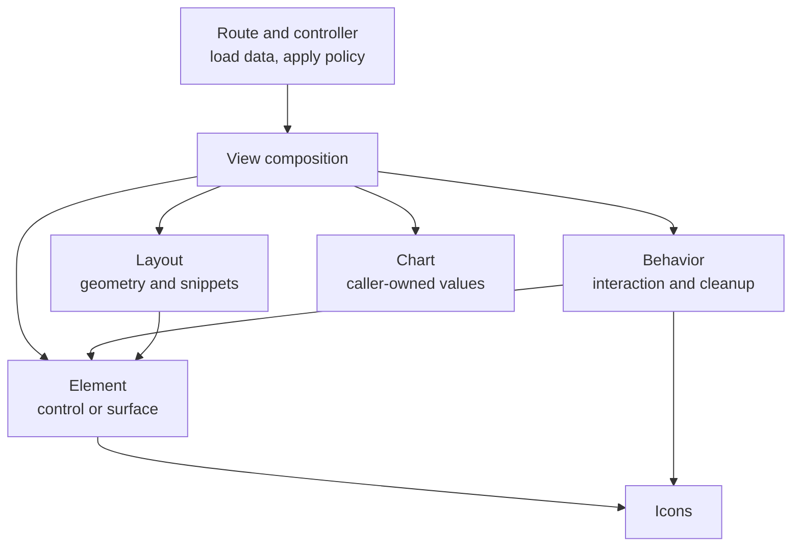
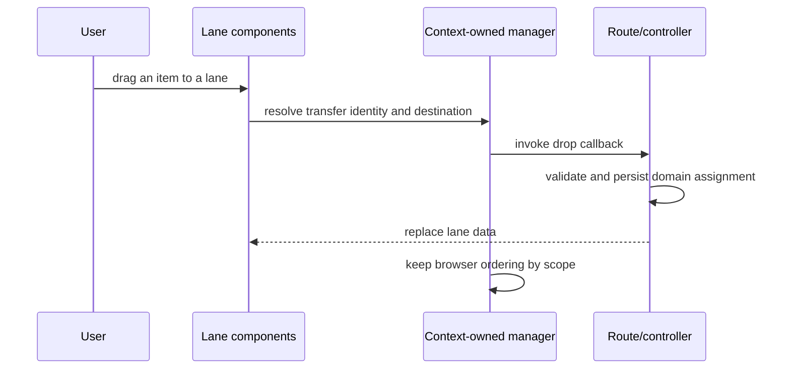

# Shared UI components

This library supplies Svelte 5 controls, reusable interactions, and page geometry styled with Tailwind CSS 4. It owns presentation and the interaction state needed to present it. Routes and their controllers own domain I/O, authorization-sensitive decisions, and durable application state.

Its identity is the shared presentation layer. New components join the responsibility that matches what they own; adding a presentation need does not require teaching an existing component an unrelated job. The focused examples below explain composition and interaction contracts rather than enumerate the library.

## Organize by responsibility

Import the responsible component directly through `#lib/components/...svelte`; there is no root barrel to turn unrelated concerns into one dependency. The directory boundaries describe ownership rather than component size. The following groups define the stable presentation boundaries.

| Boundary                    | Responsibility                                                                                                                                           |
| --------------------------- | -------------------------------------------------------------------------------------------------------------------------------------------------------- |
| [elements/](elements/)      | Controls, fields, feedback, surfaces, tables, and constrained text rendering; shared field and surface styling lives beside these consumers              |
| [behaviors/](behaviors/)    | Reusable interaction wrappers such as native modal synchronization, asynchronous confirmation, hover explanations, clipboard actions, and file selection |
| [layout/](layout/)          | Page and contextual-rail structure, headings, and caller-supplied content slots                                                                          |
| [views/](views/)            | Cohesive interfaces grouped by feature or interaction, including the shell, calculators, settings, and swim lanes |
| [charts/](charts/README.md) | Domain-neutral SVG plotting, chart headings, and tooltip ownership helpers                                                                               |

An element may own local state, such as an expanded option list, without becoming a feature view. A behavior wraps caller content or reports an interaction; business policy remains with its caller. Layout, elements, and behaviors must not import application feature views. A cohesive component can remain intact even when its implementation is long; a file split is useful when it establishes a distinct responsibility or lifetime.

Route files are composition and lifecycle boundaries. They choose the page's sections, connect calculations to presentation, and own route-level persistence and registrations. Extract recognizable sections with a coherent contract instead of leaving large anonymous card, table, or editor implementations inline. View-specific compositions belong in `views/<feature>/`; a pattern shared across features belongs in the appropriate reusable layer only when its behavior is independent of those features. For example, `InputCard` knows about fields and Clear/Reset callbacks, while the Amortization chart knows what principal and interest mean. Reuse across a calculator and its settings tab does not make financial field semantics domain-neutral.

The financial routes share one calculated result with their summary and detail components. Amortization's chart owns transient hover and responsive axis presentation, while its route computes the groups shared by chart and schedule. Cashflow's balance sheet formats annual model values for the route-owned period selection. Scratchpad's editor, result, bindings, and syntax reference all consume the route's single calculator owner; moving markup does not create additional workspaces or storage writers. Settings separates tab presentation and reset-confirmation interaction from the controller action supplied by its layout.

Icons are [leaf assets in their own library](../icons/README.md), outside this hierarchy. State and shell context likewise have independent contracts. Moving a component never transfers its state into module scope.

## Public contracts and composition

Every component declares a documented local `type Props` and destructures `$props()` with that type. Each property documents what its value means, optional defaults, and caller obligations. A named props contract matters even for a one-property component: it keeps editor hover information and `ComponentProps` consistent across the library.

Read those contracts before assuming a value is bindable. Some controls report `onChange` or another callback so the owner can validate and commit an update; others explicitly expose `$bindable` values. Snippet props are typed as Svelte `Snippet` and rendered through `{@render ...}`. They replace slots and avoid manufacturing wrapper components solely to forward a fragment of markup.

The visual vocabulary is components first. [`elements/surface.ts`](elements/surface.ts) shares border and fill classes between controls whose native roots cannot be the same component, such as a card and a dialog. [`elements/field.ts`](elements/field.ts) shares field density and control styling. Routes compose controls rather than importing these class strings.

Field geometry remains with the control. The shared control classes intentionally omit width, padding, and some background choices: a search field reserves space for its inset icon and Clear button. Combining a shared `px-*` class with a local `pr-*` class and relying on class-string order would misunderstand Tailwind's stylesheet ordering. Shared styling should remove a repeated decision without silently making the wrong geometry decision for every consumer.

## Interaction choices worth preserving

`Modal` wraps native `<dialog>`. The browser supplies the top layer, backdrop, and focus containment, so the component synchronizes open state and close callbacks instead of reimplementing a modal stack. `ConfirmDialog` builds on it: an asynchronous failure leaves the dialog open and presents its error inline, so the caller can retry or cancel.

`TextField` defaults to a stable input identity derived from `$props.id()`, because an ID must agree across SSR and hydration. Random IDs can make labels and inputs disagree before interaction begins. The caller remains responsible for meaningful labels and autocomplete intent.

`HoverText` places its bubble in viewport coordinates, so a control inside a clipped rail can explain itself outside that rail. Hover and keyboard focus both matter. Pointer departure clears the focus left behind by clicking the trigger, preventing an abandoned tooltip from lingering; keyboard-only focus remains a supported way to reveal it. The component owns and releases its positioning registrations.

`Switch` and `CheckboxField` communicate different semantics. A switch is an on/off control with `role="switch"`; a checkbox is an ordinary form choice. Choose the semantic control before choosing its appearance. The switch’s theme variant draws its track and thumb from the document’s `dark` class so the theme control matches the pre-paint preference before hydration. Its owner keeps the checked state aligned with that class. The neutral variant keeps its track color constant within each theme while the thumb follows checked. `OptionSwitch` composes that variant with two visible labels, emphasizing the selected label and muting the other. Use it for two-option selections such as Annual/Hourly and Amount/Percentage; its owner supplies the selection, accessible name describing the second option, and change callback. Ordinary switches retain their checked-dependent fill. Switches initially suppress transitions until mount-time restoration has reached a rendered frame, then enable animation for subsequent changes. Their scheduled frames are canceled on teardown. This prevents restored Amount/Percentage or Annual/Hourly selections from sliding into place when the shell reveals a view. `ThemeToggle` likewise renders both decorative icons and lets the document theme choose the visible one, avoiding a hydration-time icon swap or thumb animation. Keyboard-prompt components preserve readable key names for assistive technology while drawn key symbols remain decorative. Their responsive CSS also covers the SSR interval before viewport queries have a browser value.

`InfoNote` pairs supplementary copy with a decorative Info icon. Compact inline notes serve input notation and financial assumptions; its panel variant carries Home’s single browser-persistence explanation. Notes use their containing card’s width by default. Callers can pass wrapper layout classes; Cashflow’s page-level assumptions note opts into a centered width-limited container with left-aligned text. Error and confirmation messages retain their separate status/dialog semantics.

`RoutingCard` presents a destination as one native link with a decorative icon, level-two heading, description, and coordinated color accent. The caller supplies a typed, resolved application path and owns the surrounding grid. Home uses it for its three calculator destinations. It owns no navigation state, listeners, or resources; keyboard focus and activation retain native anchor behavior.

`InputCard` provides the common input-section heading, Clear/Reset buttons and hover explanations, and validation status. Its field snippet, action callbacks, explanatory text, and error come from the owner. It performs no clearing, reset, validation, or persistence itself. Amortization and Cashflow therefore share the same framing while retaining distinct input rules and presets.

`PresetEditor` owns the shared settings workflow: deterministic initial draft, mount-time restoration, validation feedback, change detection, Save/Discard, and save acknowledgement. A route supplies its preset reader, validator, saver, and a field snippet bound to the editor’s draft. The instance owns this draft and discards it on teardown; the root settings controller owns saved values. Financial form controls are shared by calculators and their preset editors so unit conversion, input notation, and dark-field styling have one owner.

## Shell and contextual rails

The root layout owns the navbar, desktop rail container, and phone drawer. During initial hydration and route changes, a loading spinner covers the area below the navbar. The route and rail remain mounted, laid out, invisible, and inert while local state restores. After the navigation commits, the layout flushes pending DOM work and waits one rendering cycle for chart dimension observers before revealing the view. Rail registration skips its entrance animation during this initialization so the first visible chart uses the settled width; user-triggered rail toggles retain their animation. Pending animation frames are canceled on replacement and layout teardown, with a generation check protecting the pending DOM-flush continuation. A route lends the shell a snippet through [`registerContextualRail`](../context/shell.ts), with a label and optional readiness getter. That registration returns its own release function. Call it from the route's mount/effect teardown; otherwise the next route can inherit content registered by its predecessor.

The release checks that it still owns the active rail before clearing it, so an old route's cleanup cannot remove a newer route's registration. Readiness replaces the rail body with a spinner while keeping the shell geometry stable. The route supplies content and readiness; it does not manipulate the drawer's DOM.

The shell changes to a drawer at phone widths and collapses navigation labels at a wider breakpoint. Desktop rail collapse is a browser preference shared across routes; drawer opening is transient. Shift R toggles the registered rail or drawer outside text editing and open dialogs, using a layout-owned keyboard registration. Shift S opens Settings or returns to the last main view using the same keyboard filters; the gear shows a shortcut keycap. Widening the viewport closes the drawer so it cannot unexpectedly reappear on the next narrowing. [The UI README](../../../README.md) describes startup rendering and navigation in context.

## File selection without upload policy

`Dropzone` combines a native file picker, drop target, and keyboard activation. It passes the first selected or dropped `File` to `onSelect`; it neither parses the file nor sends a request. The owner decides acceptable sizes and types, reads the content, reports progress, and chooses any upload endpoint.

`accept` filters the picker and is not validation: drag-and-drop can supply a different type. `disabled` prevents activation and selection while the owner is busy. The hidden input resets so selecting the same file again still produces an action. Drag-leave handling checks containment rather than clearing the highlight whenever the pointer crosses a child element. These are interaction mechanics that belong in one shared implementation, independently of any particular import workflow.

## Swim lanes and caller-owned domain moves

Swim lanes receive owner-supplied lane definitions and `LaneItem` values. An ancestor creates one `SwimLaneManager`, installs it with `setSwimLaneContext`, and supplies the drop callback. The manager holds the current drag item, hovered lane, and optional per-scope ordering; it does not decide what moving an item means in the application.

The drag transfer carries a dedicated MIME identifier and a text fallback. The manager can also use the in-flight identity while the drag is local. Ordering updates replace arrays and write only when the order changes. Scope the persistence key by account when several identities use the same browser; the default key is a convenience, not an authorization boundary. Never construct the manager at module scope under SSR.

## Lifetime, extraction, and validation

Every listener, observer, timer, object URL, or refcounted global acquired outside the component graph needs a matching release through an effect, attachment, mount teardown, or an explicitly destroyed helper. Computed state belongs in `$derived`; effects are for registrations and other side effects. The [state library](../state/README.md) explains why these rules also protect server rendering.

To extract this library, bring the Tailwind setup, icons, relevant state/context helpers, and navigation helpers imported by the selected components. Keep the direction of dependencies intact. Replace shell routes and application names without adding business imports to generic elements.

Run the [UI gate](../../../README.md#run-and-validate) for code changes. Browser verification should cover keyboard and pointer operation, both themes, narrow layouts, repeated mounting, and navigation away while an interaction is active. Static checks do not demonstrate focus behavior or release of a mounted observer.
