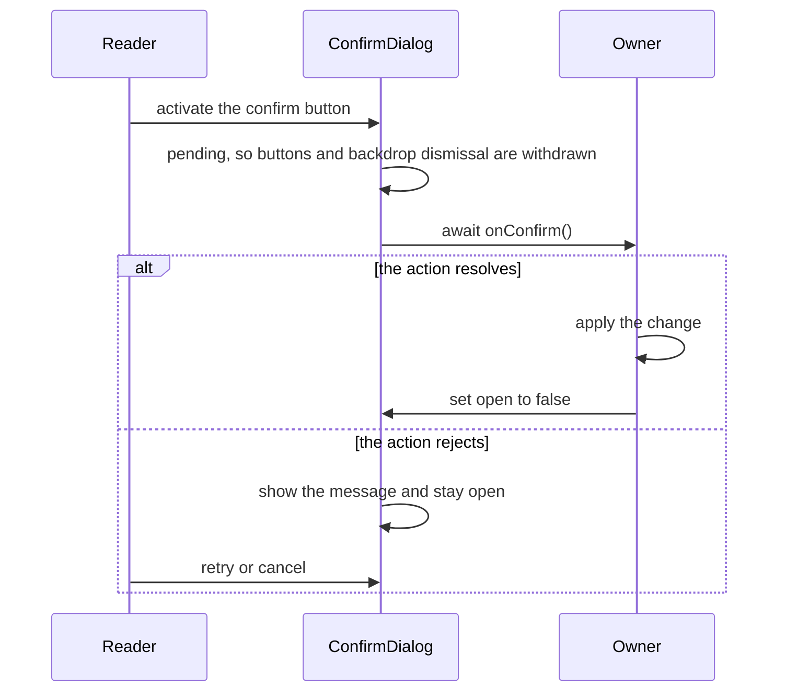

# Reusable interactions

The behaviors module owns interaction mechanics worth getting right once: opening a native dialog, keeping an explanation up while a pointer or the keyboard asks for it, delegating copy clicks across rendered content, and accepting a dropped file. Each Svelte 5 component wraps caller-supplied content or reports that something happened, and each releases whatever it acquired outside the component graph. None of them decide what the interaction means to the application: the value being confirmed, the text being explained, the file being read, and the flag that says a dialog is open all stay with the caller.

A component belongs here when its correctness lives in the mechanics rather than the content — focus order, dismissal paths, listener lifetime, browser fallbacks — and when those mechanics hold whatever is placed inside it. A control that owns a value of its own is an element, a structure that only arranges snippets is layout, and anything that knows what a number means belongs to a feature view.

| Interaction                                              | The behavior owns                                         | The caller owns                                |
| -------------------------------------------------------- | --------------------------------------------------------- | ---------------------------------------------- |
| Native dialog ([Modal](Modal.svelte))                    | Top-layer opening, the dismissal paths, initial focus     | `open`, the accessible name, the content       |
| Confirmed action ([ConfirmDialog](ConfirmDialog.svelte)) | Pending state, dismissal lockout, inline failure          | The promise, its wording, what the action does |
| Explanation ([HoverText](HoverText.svelte))              | Reveal rules, viewport placement, listener lifetime       | The trigger, the text, its wording             |
| Copying ([Clipboard](Clipboard.svelte))                  | One delegated listener, the copy path, transient feedback | Button markup, the copied text, styling        |
| File selection ([Dropzone](Dropzone.svelte))             | Picker, drop target, keyboard activation                  | Reading, validation, progress, any upload      |

## Interaction state flows one way

Nothing here is `$bindable`. A dialog's `open` is the owner's state: the behavior reports a dismissal request through `onClose`, and the owner decides whether the dialog closes. Escape, a backdrop click, and a Cancel button all arrive along that one path, so the owner's flag remains the single answer to whether the dialog is open. Letting the dialog close itself and write back is what produces the state that looks closed to the browser and open to the application.

The same rule covers the rest. A drop target hands over a `File` and forgets it, the clipboard wrapper writes text and applies a class, and the hover bubble is derived from pointer and focus alone. A behavior that started keeping its own copy of the caller's decision would be a view filed in the wrong directory.

## Native dialog and confirmed action

[Modal](Modal.svelte) wraps a native `<dialog>` and synchronizes it with `open`, calling `showModal()` when the owner opens it and `close()` when the owner closes it. The browser supplies the top layer, the backdrop, focus containment, and Escape, so there is no focus trap, scroll lock, or z-index stack maintained here. Escape is intercepted only to keep ownership straight: the cancel event is prevented and forwarded to `onClose`, so the owner drives the closing instead of discovering it afterwards. A backdrop click is recognized by the event landing on the dialog element itself rather than on its content, and `closeOnBackdrop` withdraws that path. Content marks its own starting point with `data-modal-initial-focus`, which is focused in a microtask after the dialog opens, because nothing inside a closed dialog can take focus.

[ConfirmDialog](ConfirmDialog.svelte) composes Modal into the shape a destructive or slow action needs. `onConfirm` returns a promise: while it is pending the buttons are disabled, backdrop dismissal is withdrawn, and the cancel path returns early, so a half-finished action cannot be walked away from. A rejection is caught, turned into readable text by [the shared error reader](../../errors.ts), and shown inside the dialog through [ErrorAlert](../elements/ErrorAlert.svelte) while the dialog stays open — the reader retries or cancels with the message still in front of them instead of watching the dialog vanish and hunting for what went wrong. Cancel carries the initial focus, so a dangerous confirmation never opens with the destructive button under the keyboard. `tone` selects emphasis only; it changes no behavior, and a danger color is not a substitute for wording that says what will happen.

## Hover and focus explanations

[HoverText](HoverText.svelte) reveals text for a trigger the reader is pointing at or has focused. Its visible state is two flags and nothing else: the pointer is inside the trigger, or keyboard focus is asking for the text. Pointer departure clears both, which is what takes the bubble down after a click — activating a control moves focus into the trigger, and a bubble that outlived the pointer would go on explaining a control the reader has left. A pointer press suppresses the focus reveal without hiding the bubble already up, because text that disappears the instant a checkbox is ticked reads as a glitch while the reader is still asking the question. A key press restores it, so someone returning to the keyboard gets the explanation back.

`hideOnActivate` exists for the one trigger those rules do not fit: a trigger that opens a modal. The dialog makes the trigger inert, so the pointer-leave that would close the bubble never arrives, and closing the dialog returns focus to the trigger, which would raise the bubble over a control the pointer left long ago. The option takes the bubble down on activation and then ignores exactly one returned focus, so a later deliberate focus still gets its explanation.

The bubble is placed in viewport coordinates and, where the browser has the API, opened in the top layer as a manual popover. A `z-index` cannot make that promise: the bubble is confined to its trigger's stacking context, and a sibling context later in the document wins however high the bubble climbs — which matters precisely because these triggers sit inside clipped rails and scrolling cards. The popover attribute is set from script rather than written in the markup, so an engine that hides `[popover]` through its user-agent stylesheet but ships no API to open one cannot leave the bubble permanently invisible. Measurement waits a tick, since a closed popover measures zero, and the deferred work carries a disposal flag so a bubble hidden and reshown quickly is not positioned from the previous run's alignment. The effect owns the resize and capture-phase scroll listeners that keep an open bubble anchored, and releases them together with the popover when it closes.

`text` stays the accessible description even when `content` renders richer markup such as a key prompt, and whitespace-only text suppresses the bubble rather than drawing an empty one. The bubble takes no pointer events and keyboard focus never enters it: it explains a control, and is not a place to put one.

## Delegated copying

[Clipboard](Clipboard.svelte) puts a single capture-phase listener around a subtree instead of a handler on every button, because those buttons belong to rendered content whose size the wrapper cannot know — a document may contain any number of code blocks. A matched button carries its text in a `data-code` attribute; the wrapper copies it and applies a transient class, leaving the button's markup, icons, and styling to whoever rendered it. `selector`, `feedbackClass`, and `feedbackDuration` are properties so that contract stays with the caller instead of being fixed here.

Copying prefers the asynchronous Clipboard API in a secure context and falls back to a hidden textarea with `execCommand`, which keeps the control working over plain HTTP and in older engines. The work is an attachment rather than an effect because its lifetime is the DOM node's. Its cleanup removes the listener, clears every pending feedback timer, and strips the class it applied, while a disposal flag stops a copy that resolves after unmount from scheduling feedback on a detached button.

## File selection without upload policy

[Dropzone](Dropzone.svelte) combines a native file picker, a drop target, and keyboard activation, then hands the first selected or dropped `File` to `onSelect`. It does not read, parse, validate, or send the file and reports no progress; those decisions belong to the owner, along with any endpoint. No route in this application currently mounts it — it is kept as the one implementation of the mechanics below, which is where file selection usually goes wrong.

`accept` filters the picker and is not validation, because drag-and-drop can deliver anything. Drag enter and drag over are prevented, or the browser navigates to the dropped file and discards whatever the page was doing. Drag leave checks containment, so the highlight does not flicker as the pointer crosses child elements. The hidden input's value is cleared after each selection, so choosing the same file twice in a row still produces an event. `disabled` refuses activation and takes the target out of the tab order.

## What each behavior releases

| Component     | Acquired outside the component graph                                                         | Released by                                               |
| ------------- | -------------------------------------------------------------------------------------------- | --------------------------------------------------------- |
| HoverText     | Resize and capture-phase scroll listeners, a top-layer popover entry, a deferred measurement | Effect cleanup, plus a disposal flag for the deferred run |
| Clipboard     | A capture-phase click listener, one feedback timer per button, a class applied to each       | Attachment cleanup, plus a disposal flag for a late copy  |
| Modal         | Nothing; the dialog is its own markup                                                        | Unmounting, which removes the `<dialog>`                  |
| ConfirmDialog | Nothing beyond the Modal it composes                                                         | Its own state, which goes with the component              |
| Dropzone      | Nothing; its handlers are declared on its markup                                             | The component tree                                        |

Everything acquired outside the component graph is returned, and each deferred path carries a disposal flag so a promise or microtask that outlives its run cannot touch a detached node. Modal is worth naming as the exception: it registers nothing of its own, and unmounting removes the `<dialog>`, which ends the modal. This module is the small-scale case of the repository's [runtime lifetime decision](../../../../docs/adrs/objects-lifetime-management.md); a behavior that acquires something new without a matching release is a defect, not a style preference.

## Extraction and validation

To lift this module, bring Tailwind CSS 4, the [shared surface classes](../elements/surface.ts), and — for the confirmation dialog — [Button](../elements/Button.svelte), [ErrorAlert](../elements/ErrorAlert.svelte), and [the error reader](../../errors.ts). Keep the dependency direction intact: behaviors may use elements and icons and must never import a feature view, which would turn the reusable layer into a hidden dependency on the application.

Run the [UI gate](../../../../README.md#run-and-validate) for code changes, then exercise the interactions in a browser, because none of this is visible to a type check. Cover Escape and backdrop dismissal, a rejected confirmation, focus returning from a closed dialog, a bubble at the viewport edge and inside a clipped rail, keyboard-only reveal, copying over plain HTTP, dragging across nested children, and navigating away while a dialog is open or a copy is in flight. Mount and unmount repeatedly: a listener or timer that survives teardown shows up as stale feedback on the next visit rather than as an error.
