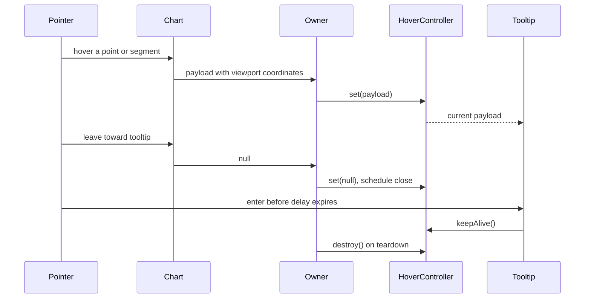

# SVG charts

The charts module owns reusable visual encodings of caller-owned numeric data: drawing contracts, geometry, axes, legends, and interaction reporting. The current Svelte 5 components use D3 7 scales and shape helpers to render SVG, with Tailwind CSS 4 for surrounding text, surfaces, and themes. Callers shape domain results into those contracts and retain responsibility for fetching, business aggregation, and persistence.

Additional chart forms belong here when they preserve that drawing boundary and can consume data without importing a feature's models or clients. Keep a chart-specific drawing rule with its plot until another plot actually needs the same rule.

## Data enters as a drawing contract

Choose a plotting API by its data shape and interaction contract. The comparison below explains those differences and the framing shared around a plot:

| Component                                 | Input and responsibility                                                                                                                               |
| ----------------------------------------- | ------------------------------------------------------------------------------------------------------------------------------------------------------ |
| [LineChart](LineChart.svelte)             | `LineSeries[]` with numeric x/y points; continuous axes, interpolation, optional point markers and point-hover callbacks                               |
| [BarChart](BarChart.svelte)               | Ordered group labels and `BarSeries[]`; each series supplies one value per group                                                                       |
| [StackedBarChart](StackedBarChart.svelte) | Ordered group labels and `StackedBarSeries[]`; each group contains signed segments, with optional reference lines, labels, and segment-hover callbacks |
| [PieChart](PieChart.svelte)               | `PieSlice[]` of nonnegative magnitudes; one wedge per slice sized by its share of their total, with a share-bearing legend and optional slice-hover callbacks |
| [ChartHeading](ChartHeading.svelte)       | Title, supporting text, and optional content/action snippets; usable beside any plot                                                                   |
| [ChartHoverToggle](ChartHoverToggle.svelte) | The rail section that turns a chart's hover response on or off; the owner holds and persists the preference and supplies only the hover payload's description |

[types.ts](types.ts) defines the shared data and hover contracts, margins, and categorical palette. Give series stable unique IDs and each stack segment a stable ID within its group and series. Group labels are keys, not merely decoration: keep them distinct and align every values/stacks array with their order. The stacked chart offers separate display labels when the visible wording should differ from the key.

Supply finite numeric values. Order line points by x before passing them to the renderer; monotone interpolation does not sort a domain dataset. A chart cannot decide whether missing data means zero, a gap, or an omitted observation. Resolve that policy in the caller. The line path excludes nonfinite points, but that does not make arbitrary malformed input a supported chart contract.

The pie is a part-to-whole encoding, so its whole is the sum of the slices it was given: a slice's share is its value divided by that sum, and a caller wanting shares of some other total supplies slices that add up to it. A value that is not a finite positive number weighs nothing and draws no wedge, though it keeps its legend entry at a zero share so a category does not vanish from the key on the day it reads zero. Negative magnitudes have no pie representation at all; a caller holding one owes the reader a different chart or an explanation in place of the plot. Keep the slice count small — a part-to-whole read at a glance degrades past roughly six wedges, where a stacked bar or a table serves better.

```svelte
<script lang="ts">
  import LineChart from '#lib/components/charts/LineChart.svelte';
  import type { LineSeries } from '#lib/components/charts/types.js';

  const series: LineSeries[] = [
    {
      id: 'example',
      label: 'Example',
      points: [
        { x: 1, y: 4 },
        { x: 2, y: 7 },
      ],
    },
  ];
</script>

<LineChart {series} title="Example values" xLabel="Step" yLabel="Value" />
```

The line series can override color, dash pattern, stroke width, and marker radius. The grouped-bar contract is intentionally smaller. Stacked-bar segments can override the series color and carry labels that return in hover payloads; these are presentation values, not an implicit domain hierarchy. Pie slices override color the same way, and the pie's legend prints each slice's share beside its label, since the share is the pie's datum rather than an annotation on it. `formatShare` governs both that legend and hover text, so an owner rendering its own tooltip should pass the same formatter it uses there and avoid two roundings of one number.

## Geometry, axes, and signed values

Charts measure their container width and take an explicit height, defaulting to 320 pixels. The common margins reserve space for axes; callers may override individual edges. Inner dimensions have a lower bound so narrow containers do not produce negative drawing areas. This does not make long labels fit automatically: choose formatting, margins, and the appropriate layout at the call site.

Automatic numeric y domains include zero and add padding, with a fallback extent for degenerate data. Explicit domain and, where supported, minimum/maximum overrides let the caller preserve comparable scales across charts. Axis tick formatters convert numeric coordinates into meaningful labels; the line chart's x axis is numeric, so a time series must provide numeric timestamps and a formatter.

The pie takes an explicit height and centers itself in the measured width; its radius is half the smaller of the two, less the caller's padding, so a wide container yields a centered circle rather than an ellipse. Wedges are separated by a stroke in the surrounding card's ground rather than by a pad angle, which has no stable meaning at a zero inner radius.

Grouped bars use a band scale for groups and another for series inside each group. Stacked bars accumulate positive and negative values separately around zero. Summing all signed segments into one height would conceal the negative portion and misrepresent the composition. Group and bar padding adjust spacing independently. The stacked chart’s SVG fills its container even before measurement; continuous band ranges distribute every group across the full measured plotting width without a fixed pixel width or integer rounding. Resizing the container, including opening or closing a contextual rail, recomputes that distribution.

The stacked chart also supports separators, secondary and tertiary labels over inclusive group spans, annotations, horizontal overlays, and custom legend entries. `legendAlign` positions the legend at the start by default or centers the items below the chart; Amortization chooses center. These remain drawing instructions. The chart does not know whether an overlay is a target, threshold, or computed statistic; the caller must calculate and label it. Keep index spans aligned when filtering or reordering groups.

D3 is used for pure calculations. Svelte owns the SVG nodes, so there is no imperative D3 selection, retained chart instance, or third-party DOM lifecycle to reconcile with component teardown. Derived scales and paths recompute from props and measured size. Scratch maps created inside a derivation are temporary aggregation values, not independently reactive application state.

## Tooltips have an owner

Hover and scroll-lock ownership are part of chart-interaction lifetime; the caller determines tooltip content.

The line, stacked-bar, and pie charts report hover data with viewport `clientX`/`clientY` coordinates and send `null` when the pointer leaves. The stacked and pie charts also update their callback as the pointer moves within a mark, allowing a value bubble to follow the pointer. They do not choose the tooltip's domain content, position policy, or interaction controls. `ChartTooltip` supplies a noninteractive floating bubble clamped to the viewport, taking either `text` for a plain string or a `children` snippet when part of the bubble carries emphasis, such as the line item the value belongs to. Its caller owns visibility and dismissal, while Svelte owns its measurement and viewport subscriptions. The owner renders the tooltip and decides whether it is interactive.

Accenting the hovered mark is a drawing decision, so the stacked-bar and pie charts keep it themselves rather than waiting for an owner to hand the hover back. Pointing at a mark recedes every other mark to `DIMMED_MARK_OPACITY` from [types.ts](types.ts); the pie also lifts the matching legend label to the primary ink so the key and the plot agree about what is being read. A chart with no hover callback still accents, because the accent answers "which mark is under the pointer," not "does someone want a tooltip." The state is presentation only and per chart: it holds a mark key, and a key left behind by replaced data simply matches nothing. It is not an owner's selection, and a caller needing a persistent selection owns that separately.

`hoverEnabled` turns that whole response off as one thing. A reader who does not want a tooltip does not want the plot rearranging itself under the pointer either, so `false` withholds the pointer handlers, the accent, the pointer cursor, and the native `<title>` bubble together; a chart with hover off is inert under the pointer and keeps every mark at full strength. The charts read the accent through the flag rather than clearing their own cell, so switching hover off while a mark is accented cannot strand it lit. Each mark keeps its `aria-label` either way: the flag governs pointer response, not what assistive technology can read. [`ChartHoverToggle`](ChartHoverToggle.svelte) is the control that sets it — one rail section, shared so that two calculators cannot drift into describing the same switch differently, taking only a sentence naming what this chart shows on hover. The preference behind it belongs to the owner, not to the chart or the toggle; in this application one [root-owned setting](../../settings/README.md) serves every calculator's rail.



[`HoverController<T>`](hover-controller.svelte.ts) owns one reactive payload and one optional close timer. `set(payload)` updates immediately and cancels a pending close; `set(null)` schedules clearing after the configured delay, defaulting to 180 milliseconds. `keepAlive()` cancels that pending close as the pointer enters the tooltip. `close()` clears immediately. `destroy()` clears both timer and payload and belongs in the owner's teardown.

Create the controller during component initialization, not at module scope. The delay solves the physical gap between the plotted shape and an interactive tooltip; it is not an application-wide cache of the most recently hovered point. A route that disappears while the delay is pending still owns that timer.

## Scroll locking and resource release

[`tooltip-scroll-lock.ts`](tooltip-scroll-lock.ts) exposes `activateTooltipLock()` and `registerTooltipScroller(element)`, each returning an idempotent release function. While a lock is active, browser listeners suppress wheel and navigation-key scrolling outside allowed tooltip surfaces. This keeps a tooltip's anchor stable while the user works inside its scrollable content. It does not hide page scrollbars or disable every possible scroll mechanism.

The helper is shared and reference-counted because several mounted surfaces may need it simultaneously. The first lock installs listeners; the last release removes them. Registered elements are also released by their owners, with detached elements pruned defensively during event handling. Editable controls retain their keyboard behavior.

A listener that can cancel scrolling must be non-passive. Leaving it registered unnecessarily affects the browser's scrolling path, and leaving a detached tooltip in the registry retains DOM that the component tree no longer owns. Pair acquisition with cleanup, including early closure and navigation. Both entry points are no-ops outside the browser, so server renders cannot mutate the module-level counts on behalf of later requests.

## Accessibility, extraction, and validation

Provide meaningful axis labels and surrounding explanations. Color alone cannot carry a category or result; series labels and legends matter. If users need exact values or a nonvisual equivalent, supply a table or textual summary alongside the chart. Hover callbacks do not themselves create a complete keyboard-accessible data explorer.

Empty inputs use a configurable empty-state message. Check empty, all-zero, signed, narrow, and long-label datasets, plus both themes. A pie also needs its degenerate cases exercised: every slice zero, a single slice at the whole, and a slice small enough to be a sliver, where the legend's share is the only readable figure. Retain the [shared type contracts](types.ts), heading component, and tooltip helpers when extracting the relevant pieces; no item-domain client is required.

Run the [UI gate](../../../../README.md#run-and-validate) for code changes and inspect actual rendering and teardown in the application. Compiler success does not establish that labels fit or that an interactive tooltip releases its global lock.
