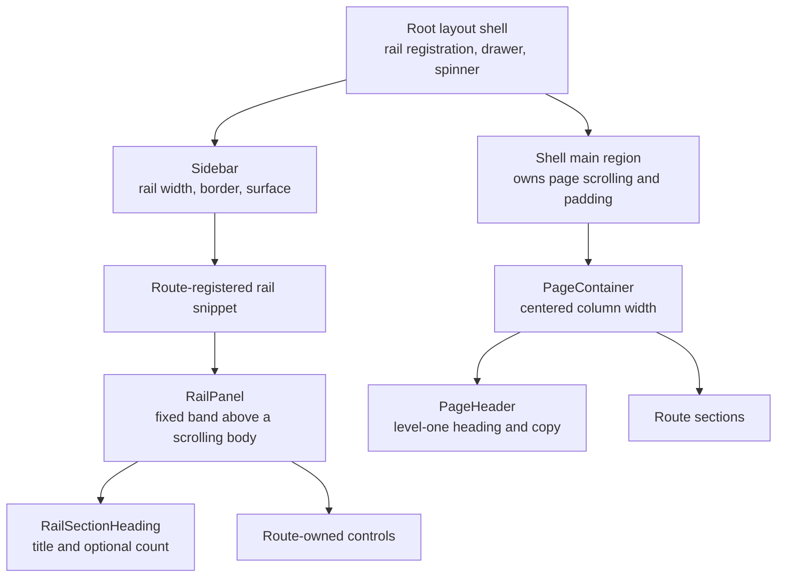
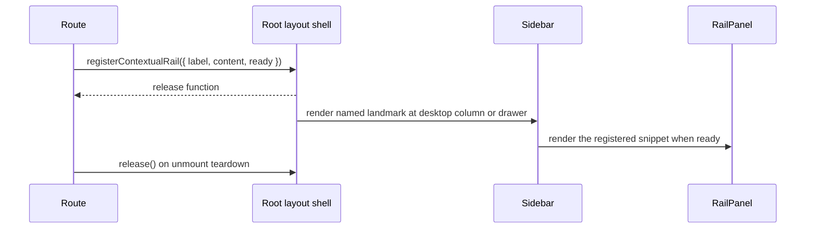

# Page and rail layout

The layout module owns the structural geometry every route is composed into: the centered page column, the route's heading block, and the frame around a contextual rail. Its Svelte 5 components arrange caller-supplied content with Tailwind CSS 4 and nothing else. They hold no domain state, read no stores, register nothing with the application shell, and acquire no listeners, timers, or observers; a route composes them and keeps its own data, persistence, and lifecycle.

Geometry belongs here when a second surface would otherwise copy it and its rules stay independent of what the surface displays. A structure that only makes sense for one feature belongs with that feature's view components instead. The boundaries below describe that ownership; adding a component within one of them is an ordinary change.

| Boundary        | Responsibility                                                                                                              |
| --------------- | --------------------------------------------------------------------------------------------------------------------------- |
| Page column     | The centered content column shared by every full-page surface, and the route's title, supporting copy, and trailing content |
| Contextual rail | The rail's outer width and surface, its fixed heading band above an independently scrolling body, and section headings      |



## The page column

[PageContainer](PageContainer.svelte) centers a vertical flex column and chooses between two widths. `width="wide"` is the default and suits data-heavy routes that place cards, charts, and tables side by side; `width="narrow"` produces a short measure for a single block of text, such as an error page. Two named widths rather than a free-form maximum keep the application's page rhythm a shared decision instead of a per-route guess.

The `class` property is the escape hatch for the spacing a route genuinely owns: the gap between its sections, bottom padding, or a height constraint. Vertical rhythm differs legitimately between a landing page and a calculator, so the container does not impose one. It also does not scroll. The shell's main region owns page scrolling and outer padding, which is why a route adds bottom padding rather than a margin that a scrolling ancestor would collapse.

[PageHeader](PageHeader.svelte) renders the route's level-one heading with supporting copy beneath it, and an optional snippet for trailing content such as a status badge or a note. Because it owns the `<h1>`, a route renders one header and starts its own sections at level two. `align` defaults to centered for full-width introductory surfaces and takes `start` for working routes, where a centered title would drift away from the content it labels. The component owns no wording: titles and descriptions come from the route, including a description derived from an error's message.

```svelte
<script lang="ts">
  import PageContainer from '#lib/components/layout/PageContainer.svelte';
  import PageHeader from '#lib/components/layout/PageHeader.svelte';
</script>

<PageContainer class="gap-6 pb-6">
  <PageHeader
    title="Amortization"
    description="See what you'll pay each month."
    align="start"
  />
  <!-- route sections -->
</PageContainer>
```

## The contextual rail

[Sidebar](Sidebar.svelte) supplies the rail's outer box: the `<aside>` landmark and its accessible name, responsive width, border, and surface color in both themes. The shell renders it in two places — the persistent desktop column and the small-viewport drawer — so it deliberately knows about neither. Its own transitions, backdrop, and open state belong to the shell. Routes do not import it; they register content and the shell decides where that content appears.

The desktop width sizes to its content between a minimum and a viewport-relative maximum, while the narrow-viewport width is capped at a fixed measure or a share of the viewport, whichever is smaller. A rail's content therefore affects its width, and opening or closing the rail changes the width available to the main region. Components that measure their container, such as charts, resize in response, so verify a rail change against a route that plots something rather than assuming a static column.

[RailPanel](RailPanel.svelte) frames the content inside that box as a full-height column: a fixed band carrying the heading, an optional count, and optional controls, above a body that scrolls on its own. The body scrolls rather than the page so the heading and any filter controls stay reachable while the reader works through a long rail. That structure depends on a full-height parent, which the shell provides through Sidebar.

[RailSectionHeading](RailSectionHeading.svelte) is the title row inside the band: a level-two heading with an optional short summary, such as a result count, aligned opposite it. A rail body that needs the same pairing for a subsection uses this component rather than rebuilding the row, and nests its own headings below level two.

One name travels with a rail, and the shell owns it. The `label` passed to [`registerContextualRail`](../../context/shell.ts) becomes the toggle's wording, the loading message, and the accessible name on Sidebar's `<aside>`. The landmark belongs to the shell rather than to the registered content, so the name reaches it from the registration instead of from a panel that cannot label its own ancestor; RailPanel therefore takes a visible `title`, not an accessible name. Word it in title case as the region's own name, such as `Amortization Options`, because it is announced by itself as the landmark's name and read back inside the toggle's `Show <label>` and the rail's `Loading <label>`.

## Registration and readiness stay with the route

These components are the rail's geometry, not its lifetime. A route registers its rail through the shell context and owns the release function it is handed back, calling it from the same mount teardown; skipping that leaves the next route wearing a rail it never registered. The shell also owns readiness: while a registration's optional `ready` getter returns false, it replaces the body with a spinner so the rail's geometry settles before the content arrives. RailPanel neither knows nor asks whether its body is ready, and it does not manipulate the drawer's DOM.



## Contracts and conventions

Every component declares a documented local `type Props` and destructures `$props()` with it, including the single-property contract, so hover information and `ComponentProps` stay consistent. Content arrives as typed `Snippet` properties rendered with `{@render ...}`: `children` for a required body, plus optional snippets such as the page header's trailing content and the rail band's controls, each rendered through the optional call form so an absent snippet simply contributes nothing.

Nothing here is bindable and nothing reports an event, because none of these components own a value or an interaction. A property named `class` is appended to the component's own classes and defaults to an empty string; it carries the caller's spacing, not a replacement for the geometry the component exists to provide. Since these components register nothing outside the component graph, they add no teardown obligation to their callers — a property of this module worth keeping as it grows.

## Extending, extracting, and validating

A new component joins this module when routes or views would otherwise repeat the same structural decision and that structure carries no knowledge of the content inside it. Keep the dependency direction intact: layout may use elements and icons, and must not import feature views or domain models. When a structure needs a feature's vocabulary, compose it in that feature's view directory and let it render these components from the outside.

To lift this module into another project, bring the Tailwind CSS 4 setup and provide a full-height flex parent for the rail frame; nothing else here is required. The shell's registration contract is a separate concern and can be replaced with any owner that renders the rail snippet.

Run the [UI gate](../../../../README.md#run-and-validate) for code changes, then check the result in a browser. Static checks do not demonstrate that a long title wraps, that a rail body scrolls while its band stays fixed, that the drawer and the desktop column both look right at their breakpoints, or that both themes read correctly.
