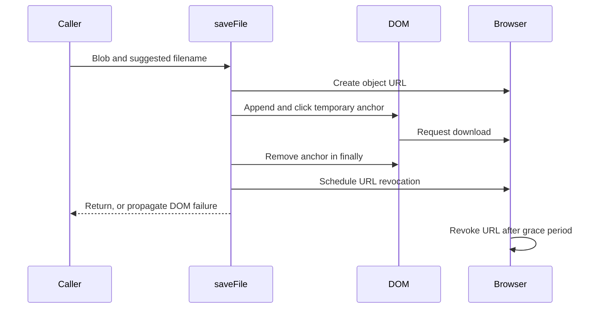

# Browser DOM boundaries

The `dom` module owns reusable browser-facing operations with explicit element and resource contracts. It is the boundary for native DOM mechanics that callers can use without importing a component or controller. Reactive application state, route policy, and the meaning of a file's contents stay with the caller.

## Responsibilities and boundaries

Direct form-event readers and a file-download handoff are the current entries. Each states its environment, caller obligation, and resource ownership; additional browser operations should supply those same kinds of contract without inheriting unrelated behavior from an existing helper.

| Browser operation  | Responsibility                                                 | Caller obligation                                                   |
| ------------------ | -------------------------------------------------------------- | ------------------------------------------------------------------- |
| Native form events | Read the value or checked state from an event's current target | Bind the handler directly to the appropriate native control         |
| Download handoff   | Create a temporary download link and release its object URL    | Call in browser code with a ready document body and a prepared Blob |

## Form-event readers

`valueFrom(event)` reads the current target as an input, select, or textarea. `checkedFrom(event)` reads it as an input. These helpers centralize a TypeScript cast; they do not perform runtime element validation.

The distinction between `target` and `currentTarget` is the contract. The current target is the element on which the listener was registered. In a delegated listener attached to a container, it is the container even when a descendant input originated the event. Use these readers in a handler attached directly to the control:

```svelte
<script lang="ts">
  import { checkedFrom, valueFrom } from '#lib/dom/events.js';

  let title = $state('');
  let enabled = $state(false);
</script>

<input value={title} oninput={(event) => (title = valueFrom(event))} />
<input
  type="checkbox"
  checked={enabled}
  onchange={(event) => (enabled = checkedFrom(event))}
/>
```

For event delegation, inspect and narrow `event.target` explicitly instead. Read values during the handler; retaining the event for later asynchronous work is a different lifetime from retaining the extracted string or boolean. Svelte bindings remain appropriate when two-way value ownership is intended; these readers serve handlers that deliberately process an event.

## File downloads and object URL ownership

`saveFile(blob, filename)` hands already prepared bytes to the browser. It creates an anchor, creates a Blob URL, assigns the suggested download name, appends the hidden anchor, clicks it, and removes it. The filename is a browser suggestion, not a server path or a guarantee about the final saved name.

```ts
import { saveFile } from '#lib/dom/download.js';

const report = new Blob(['# Export\n\nPrepared content.\n'], {
  type: 'text/markdown;charset=utf-8',
});
saveFile(report, 'report.md');
```

Call this from a browser event or another browser-owned flow. Importing the module does not allocate resources, but invoking the function requires `document`, a document body, and object-URL support. It does not fetch a resource, serialize an object, request a filesystem path, or confirm that the browser completed a download.



Immediate revocation can race a browser that resolves the URL after the click handler returns. `OBJECT_URL_LIFETIME_MS` therefore keeps the URL alive for 30 seconds before revoking it. This is a bounded handoff allowance, not a measured download-completion signal. Large files still belong to the browser's download machinery; the helper has no progress API.

The helper owns the timer and URL after acquisition. Callers do not need a route teardown function, and navigating away from the originating component should not immediately invalidate a just-started download. Each invocation creates a separate URL and cleanup timer. The anchor is removed and revocation is scheduled even if append or click throws; creating the anchor happens before URL acquisition, so a failed element creation owns no URL. Exceptions remain visible to the caller.

## Extension and verification

Keep reusable DOM mechanics here and file/content policy in the caller. A future drag interaction, observer, or subscription with a component-length lifetime must return cleanup to its owner; the bounded download handoff is not a precedent for unowned permanent timers.

The [download tests](../tests/dom/download.test.ts) verify that the clicked anchor is connected, the filename and Blob URL reach the browser boundary, the anchor is removed, revocation is delayed, and both append and click failure still release the URL. These tests use DOM and URL mocks; they do not establish browser-specific download completion or permissions behavior. Exercise those in the application's supported browsers and run the [UI gates](../../../README.md#run-and-validate).
