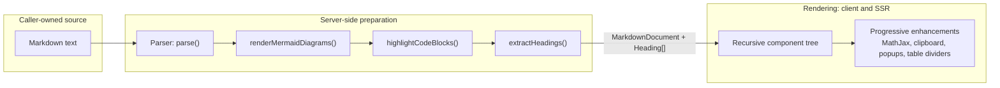
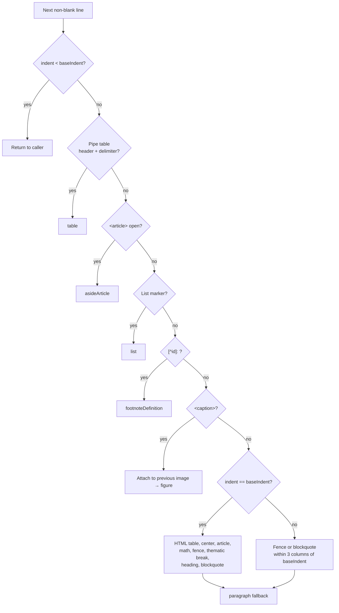
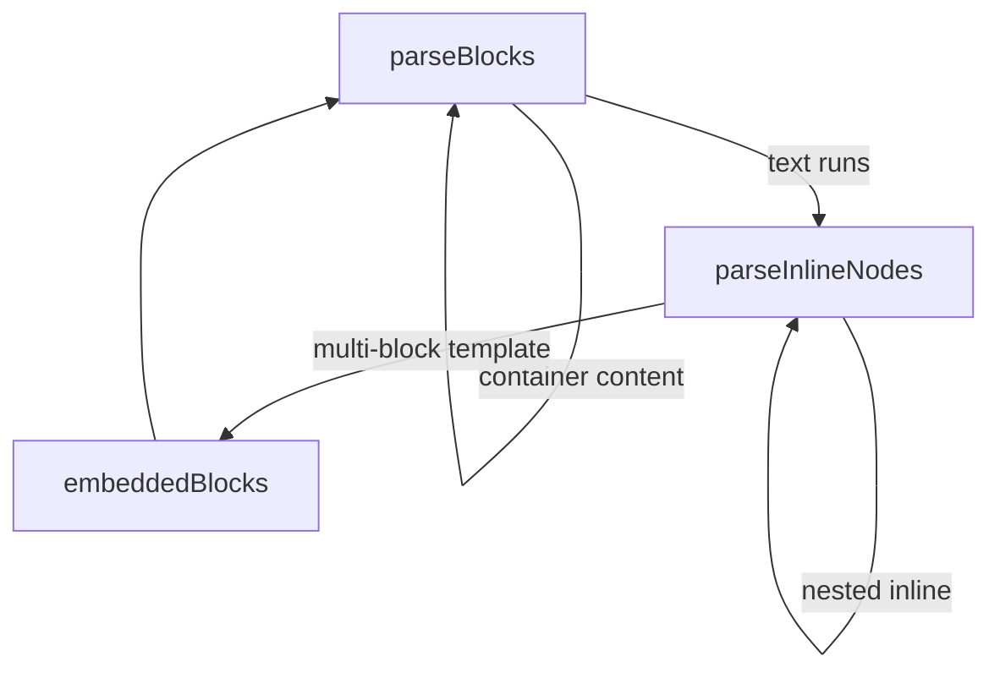
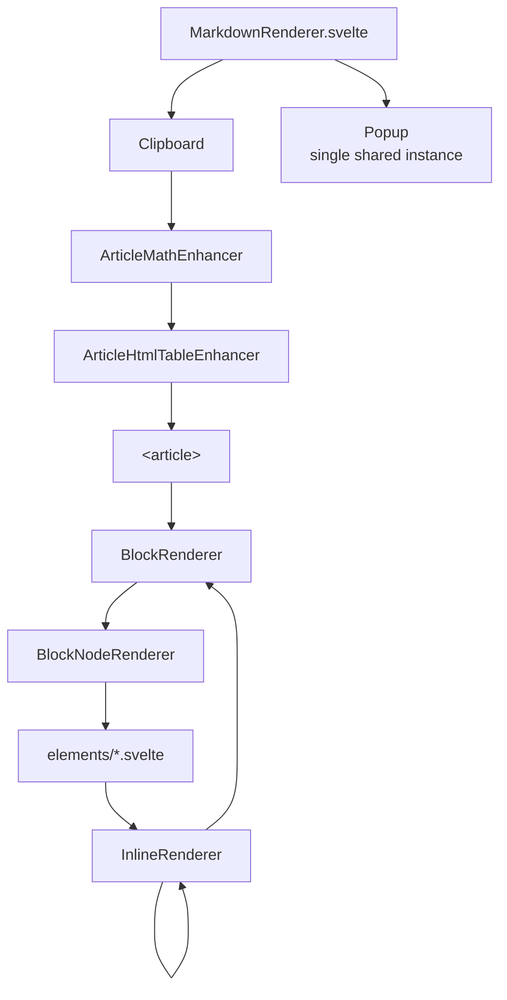
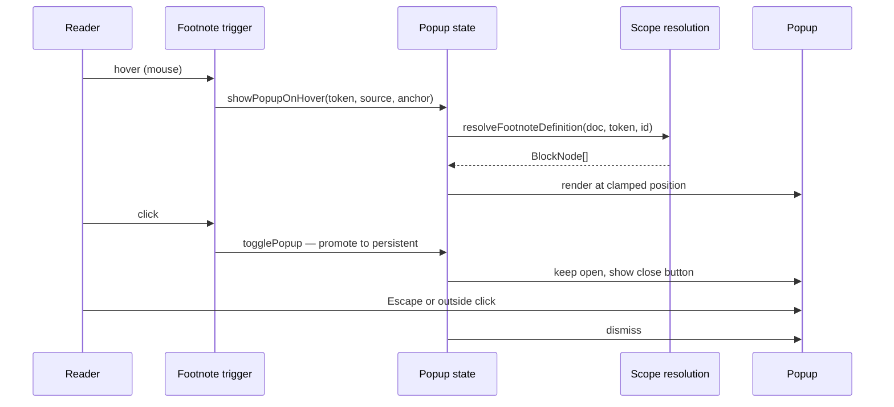
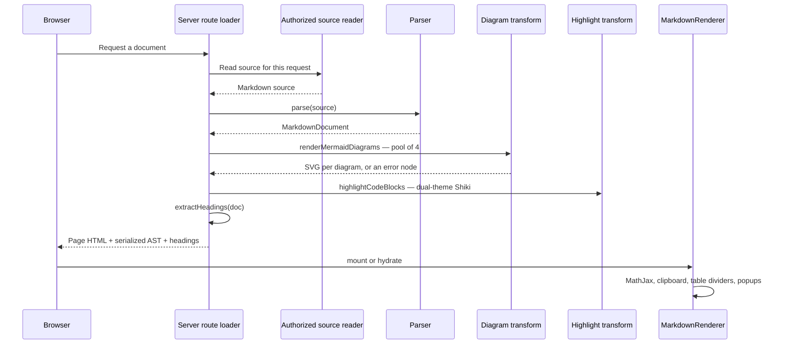

# Markdown Subsystem

The markdown subsystem takes caller-supplied markdown text and turns it into a rendered, interactive Svelte tree: headings and navigation data, syntax-highlighted code, server-rendered Mermaid diagrams, callouts, tables, footnote and definition popups, math, and figures. It is independent of where the source is stored and how the owning application authorizes access to it.

It is a hand-written parser producing a typed AST. The supported dialect mixes CommonMark-like syntax with authored HTML fragments (`<article>`, `<table>`, `<center>`, `<caption>`, definition spans) and additional constructs such as callouts, templates, subheader table rows, and image width attributes. These constructs are parser productions and typed nodes rather than transformations of already rendered markup. The implementation and parser tests define the dialect; this is not a promise of complete CommonMark compatibility.

The module's responsibility is document syntax, structured content, and its rendering behavior. The parser, AST, traversal, and rendering boundaries described below separate syntax from presentation and resource ownership. New syntax or rendering behavior belongs at the corresponding pipeline boundary; source retrieval, authorization, and application navigation stay with the integrating owner. Server-only rendering infrastructure lives in the [server module](../server/README.md), even when markdown is its current consumer.

## Architecture

The subsystem follows one rule: **parse → transform AST → render**. Custom constructs are implemented as parser productions and AST transforms, never as regex rewriting of rendered output. The AST is the contract between the two halves: renderers consume nodes rather than reparsing the source document. Authored HTML tables are the contained exception to fully structured parsing; their normalized markup crosses an explicit sanitizer before entering the AST.



Each stage owns a narrow concern:

| Stage                  | Runs         | Produces                                                   |
| ---------------------- | ------------ | ---------------------------------------------------------- |
| Template extraction    | server       | Source without `{{[TOKEN]}}` definitions, plus a token map |
| Block and inline parse | server       | `MarkdownDocument`                                         |
| Mermaid rendering      | server       | `codeBlock[language=mermaid]` → `mermaidDiagram` with SVG  |
| Syntax highlighting    | server       | `codeBlock.highlightedHtml` (dual-theme Shiki)             |
| Heading extraction     | server       | Flat `Heading[]` available to a navigation owner           |
| Rendering              | SSR + client | DOM, then client-only enhancements                         |

The document loader performs parsing and transforms during the static build or a development server request, so the browser receives structured data, heading navigation needs no second parse, and heavy work such as Puppeteer and Shiki grammars stays out of the client bundle. The parser and heading extractor are pure functions and do not intrinsically require a server. Relative image URLs are left as authored; an application that stores assets elsewhere must supply its own resolution policy.

Each call to `parse(source)` produces a fresh document. Both `renderMermaidDiagrams(doc)` and `highlightCodeBlocks(doc)` mutate that tree in place and return `Promise<void>`. Await them and return the same `doc`; assigning their return value would discard the document. Do not share a mutable document between requests.

The rendering component requires the [theme context](../state/README.md#theming) installed by its ancestor. It provides its own markdown context to descendants. A minimal integration is:

```svelte
<script lang="ts">
  import MarkdownRenderer from '#lib/markdown/MarkdownRenderer.svelte';
  import type { MarkdownDocument } from '#lib/markdown/types.js';

  /** Inputs provided by the owner after parsing and optional transforms. */
  type Props = {
    /** This page's document, constructed through the supported pipeline. */
    doc: MarkdownDocument;
  };

  let { doc }: Props = $props();
</script>

<MarkdownRenderer {doc} />
```

## The parser

### Design

The parser is a single-pass recursive-descent reader over an array of lines. It carries one mutable [`ParserContext`](parsers/context.ts) holding the line cursor and the services a subparser needs:

| Field                   | Purpose                                                                    |
| ----------------------- | -------------------------------------------------------------------------- |
| `lines`, `index`        | The cursor. Subparsers advance `index` past exactly what they consumed     |
| `idCounts`              | Document-wide slug tally, so duplicate headings get `-2`, `-3`, … suffixes |
| `templates`             | Token → definition source, extracted before parsing began                  |
| `visitedTemplateTokens` | Expansion path, so a self-referencing template terminates                  |
| `parseInline`           | Inline entry point bound to the current template and id state              |
| `parseNestedBlocks`     | Re-entry into block parsing for container content                          |

Nesting is expressed by **re-entry, not by a stack**: a list item, blockquote, callout, article, figure caption, or footnote definition collects its own lines, strips its own indentation or marker, and calls `parseNestedBlocks` on the result. The same code therefore handles a table inside a callout inside a list item without any construct needing to know about the others.

Parsing is split into focused modules rather than one large file:

| Parsing concern      | Responsibility                                                                           |
| -------------------- | ---------------------------------------------------------------------------------------- |
| Block dispatch       | Block dispatcher, paragraph accumulation, block-start lookahead                          |
| Structural blocks    | Lists, blockquotes and callouts, `<article>` asides, math blocks, fenced code            |
| Pipe tables          | Pipe tables: alignment row, cell splitting, subheader rows                               |
| Authored HTML blocks | Authored HTML blocks: `<table>`, `<center>`, `<caption>`, footnote definitions, comments |
| HTML safety          | Allowlist sanitation of normalized HTML tables before raw markup reaches the AST         |
| Inline tokenization  | The inline tokenizer                                                                     |
| Inline HTML          | Authored spans and block-level HTML (`<p>`, `<ul>`, `<ol>`) met in inline position       |
| Templates            | `{{[TOKEN]}}` definition extraction, reference parsing, cycle-safe expansion             |
| Shared syntax rules  | Indentation math, slugs, HTML attribute parsing                                          |

### Block dispatch

Block recognition is an ordered cascade, and the order is itself behavior. Tables and articles are probed first because they are recognized at any indent at or past the base, while most constructs require the indent to match exactly. The paragraph fallback comes last because it is the only production that always succeeds.



The paragraph fallback is not naive: it accumulates lines until a blank line, a dedent, or a line that `startsStandaloneBlock` identifies as the opening of any other construct. That lookahead is what lets a table, list, or callout follow a paragraph without a blank line between them.

### Indentation model

Indentation is measured in **columns, with a tab worth four**, not in characters. `leadingIndent` and `sliceIndent` in [parsers/helpers.ts](parsers/helpers.ts) exist because slicing by raw character count would eat real content on tab-indented lines. Fences and blockquotes are additionally accepted up to three columns past the current base indent, matching the usual markdown tolerance for slightly misaligned continuation lines.

### Block constructs

| Construct           | Authored form                                                     | Node                           | Notes                                                                          |
| ------------------- | ----------------------------------------------------------------- | ------------------------------ | ------------------------------------------------------------------------------ |
| Heading             | `#` … `######`                                                    | `heading`                      | Slug id from the heading text, deduplicated document-wide                      |
| Paragraph           | Consecutive text lines                                            | `paragraph`                    | Joined with spaces; ends at the next recognized block start                    |
| Fenced code         | ` ``` ` or `~~~`                                                  | `codeBlock`                    | Info string's first word becomes `language`                                    |
| Mermaid             | ` ```mermaid `                                                    | `mermaidDiagram`               | Parsed as a code block, replaced during the server transform                   |
| Lists               | `-` `*` `+`, `1.`, `a)`                                           | `list` / `listItem`            | Ordered marker kind and start ordinal preserved; item bodies reparse as blocks |
| Blockquote          | `>`                                                               | `blockquote`                   |                                                                                |
| Callout             | `> [!NOTE]`, `[!IMPORTANT]`, `[!WARNING]`, `[!CAUTION]`, `[!TIP]` | `callout`                      | A blank line between two markers splits them into separate callouts            |
| Pipe table          | Header row plus `:---:` delimiter row                             | `table`                        | Column alignments; a lone first-cell row becomes a subheader band              |
| HTML table          | `<table>` … `</table>`                                            | `htmlTable`                    | Depth-counted; normalized and sanitized HTML retained (see below)              |
| Article aside       | `<article data-*>` … `</article>`                                 | `asideArticle`                 | Nestable; `data-*` attributes preserved for theming                            |
| Figure              | Standalone image followed by `<caption>`                          | `figure`                       | The caption attaches backwards onto the preceding image                        |
| Centered block      | `<center>` … `</center>`                                          | `paragraph[centered]` or image | A lone `` becomes a centered image, including its `width`                 |
| Math block          | `$$ … $$`                                                         | `mathBlock`                    | Single-line and multi-line forms                                               |
| Footnote definition | `[^id]: …`                                                        | `footnoteDefinition`           | `>`-prefixed continuation lines extend the body                                |
| Thematic break      | `---`, `===`, `- - -`                                             | `thematicBreak`                |                                                                                |
| Template definition | `{{[TOKEN]` … `}}`                                                | —                              | Removed from the source and stored for reference expansion                     |

### Inline parsing

`parseInlineNodes` is a left-to-right scanner with an explicit precedence chain. Literal characters accumulate in a buffer that flushes into a `text` node whenever a construct matches.

```mermaid
flowchart LR
  A["newline / &lt;br&gt;"] --> B["backslash escape"] --> C["template ref"] --> D["footnote ref"]
  D --> E["code span"] --> F["math"] --> G["link / image"] --> H["definition span"]
  H --> H2["colored span"] --> H3["block-level HTML"] --> I["inline HTML tag"]
  I --> J["*** ** ~~ *"] --> K["literal text"]
```



| Construct               | Authored form                                         | Node                                                                      |
| ----------------------- | ----------------------------------------------------- | ------------------------------------------------------------------------- |
| Bold                    | `**x**`, `<strong>`, `<b>`                            | `bold`                                                                    |
| Italic                  | `*x*`, `<em>`, `<i>`; `***x***` nests bold inside it  | `italic`                                                                  |
| Strikethrough           | `~~x~~`, `<del>`, `<s>`                               | `strikethrough`                                                           |
| Underline               | `<u>x</u>`                                            | `underline`                                                               |
| Code span               | `` `x` ``, `<code>x</code>`                           | `code` — keeps `<u>` runs as children so part of a span can be underlined |
| Link                    | `[label](url)`                                        | `link`                                                                    |
| Image                   | ``, optional `{ width=320 }`               | `image`                                                                   |
| Footnote reference      | `[^id]`                                               | `footnoteReference`                                                       |
| Definition              | `<span class="definition" data-term data-definition>` | `definitionReference`                                                     |
| Math                    | `$x$`, `$$x$$`                                        | `mathInline`, `mathDisplayInline`                                         |
| Superscript / subscript | `<sup>`, `<sub>`                                      | `superscript`, `subscript`                                                |
| Hard break              | Newline inside a run, or `<br>`                       | `lineBreak`                                                               |
| Colored text            | `<span style="color: …">`                             | `coloredText` — the authored color is kept verbatim                       |
| Authored block HTML     | `<p>`, `<ul>`/`<ol>` with `<li>`                      | `embeddedBlocks` wrapping real `paragraph` / `list` blocks                |
| Template reference      | `{{[TOKEN]}}`                                         | Splices in nodes, or `embeddedBlocks` for multi-block content             |
| Escapes and entities    | `\*`, `&amp;`, `&#x2014;`                             | `text` (decoded)                                                          |

Two properties matter for a docs corpus that is edited by hand:

- **Malformed input degrades to text.** Every construct requires its closing delimiter before it commits; an unmatched `**`, `$`, `<sup>`, or `<p>` is emitted literally rather than swallowing the rest of the document.
- **Nesting is uniform.** Inline containers reparse their content, so formatting composes inside links, table cells, captions, and definition popups without special cases.

### Authored HTML in inline position

Selected HTML tags work inside pipe-table cells, where markdown alone cannot express a colored label, stacked paragraphs, or a bulleted list. Those tags are parsed rather than passed through:

- `<span style="color: …">` becomes a `coloredText` node. The authored color is kept exactly because it may carry meaning; silently substituting an unrelated contrast color would change the document. The value's syntax is screened so a `style` attribute cannot smuggle in unrelated declarations. A `<span>` carrying no valid color unwraps to its contents. An author still owns the contrast of a deliberately chosen color in both themes.
- `<p>`, `<ul>` and `<ol>` become real `paragraph` and `list` blocks, handed back to the inline stream as `embeddedBlocks`. Content that mixes text and a nested list regroups so the list is a sibling of the text rather than illegally nested inside a paragraph element.

Nested same-name tags are depth-matched, so an outer span closes against its own `</span>` rather than the first one encountered.

### Source decorators

A decorator is an HTML comment placed on its own line that carries a `data-*` flag into the AST. It is a preprocessor macro in the loose sense: the source line never renders, and the parser instead stamps metadata on the block that follows it. Decorators are recognized in the block dispatcher in [parsers/blocks.ts](parsers/blocks.ts), so they work at any nesting depth — inside a blockquote, a callout, or a list item — and each one applies to the **next block only**.

| Decorator                                     | Applies to                      | Effect                                                                                                                                                  |
| --------------------------------------------- | ------------------------------- | ------------------------------------------------------------------------------------------------------------------------------------------------------- |
| `<!-- data-is-extra-content="true" -->`       | The next `heading`              | Preserves `heading.isExtraContent` as source metadata. The baseline renderer gives it no separate presentation or timing behavior                       |
| `<!-- data-is-dense-content-table="true" -->` | The next `table` or `htmlTable` | `isDenseContent`. The rendered `<table>` carries `data-is-dense-content-table="true"` and its columns are widened for prose-heavy cells                 |
| `<!-- data-freeze-cols-left-offset="N" -->`   | The next `table` or `htmlTable` | `frozenLeftColumns`. The rendered `<table>` carries `data-freeze-cols-left-offset="N"` and its leftmost N columns stay in view during horizontal scroll |

Shared rules:

- **Quoting is tolerant, the value is not.** `\s*` is allowed around the `=`, and either quote style works. The boolean decorators act on `"true"` alone, and the freeze decorator on a positive integer. Any other value parses as an ordinary standalone comment and is dropped.
- **Decorators are orthogonal and stack.** A table may carry both table decorators, on consecutive lines, in either order.
- **One block of reach.** The flag is consumed by the block that follows and cleared, so a decorator stranded before a paragraph, a list, or the end of the document has no effect on anything later.
- **Blank lines are fine, other content is not.** The decorator may sit one or more blank lines above its target.
- **A decorator breaks a paragraph.** `startsStandaloneBlock` knows about them, so a decorator directly under a text line starts a new block rather than being absorbed into the paragraph.
- **Fenced code is literal.** A decorator inside a code fence is sample text, never a decorator.

#### Dense-content tables

Auto table layout distributes width by each column's intrinsic maximum, which is close to the wrong metric for a reference table: a column of short unbreakable labels holds its width while a column of paragraph-length prose is squeezed into a tall narrow strip, and every other column in that row inherits the resulting dead space. The decorator switches the table to fixed layout and reassigns the widths.

The two table kinds reach that goal differently, because only one of them has measurable AST content:

- **Pipe tables** are measured. `denseTableLayout` in [renderers/renderer-helpers.ts](renderers/renderer-helpers.ts) takes each column's **longest single cell** — the cell that dictates how tall that column makes its worst row — skipping subheader bands, which span the whole row. The longest cell in the table is given a full prose measure of 72ch and every other column scales against it, with a 24ch floor so a column of short labels never collapses to one word per line. Widths are emitted as a `<colgroup>`.
- **HTML tables** get an even split. Authored tables exist precisely because they use `colspan` and `rowspan`, which makes per-column text measurement unreliable, so the decorator only sets `table-layout: fixed` at a column width midway between the floor and the prose measure; an authored `<colgroup>` with explicit widths still wins.

Because the widths are absolute, their sum is also the width the table needs, and it becomes the table's `min-width`. A table denser than its container therefore scrolls horizontally in the frame it already sits in, rather than compressing its prose into tall ribbons — which is the whole point of the decorator. Both kinds also switch the surrounding frame from `w-fit` to `w-full`, and neither relaxes word breaking: cells still wrap only at word boundaries, so the floor has to be wide enough to hold an ordinary phrase.

A hyphen remains a line-break opportunity under the table's ordinary wrapping rules; `word-break: keep-all`, `line-break: strict`, and `hyphens: none` do not express the intended keep-together behavior for terms such as `state-machine` or `release-ready`. Marking a table dense therefore also rewrites intra-word hyphens to U+2011 NON-BREAKING HYPHEN: `markTableAsDenseContent` in [parsers/tables.ts](parsers/tables.ts) walks the cell inline trees, and the authored-HTML path rewrites only text between tags, so attributes like `data-class="line-item"` are untouched. Em dashes and hyphens with spaces around them keep their break opportunity.

#### Frozen columns

`data-freeze-cols-left-offset` is Excel's freeze panes for the leftmost columns. The value is a **one-based** column offset, so `1` pins the first column, `2` the first two, and so on. It complements the sticky header row the tables already have, and the two meet in a fixed corner.

Column widths only exist after layout, and an authored HTML table's widths are invisible to the AST entirely, so the offsets cannot be computed at parse time. The `freezeLeftColumns` attachment in [renderers/frozen-columns.ts](renderers/frozen-columns.ts) measures the header row instead, writes each pinned cell's cumulative `left`, and tags it with `data-frozen-column` — `last` on the rightmost pinned one, which draws the pane edge. A `ResizeObserver` re-measures on reflow. Both table components share the attachment, which is why it accepts either the `<table>` itself or a wrapper to search. Rows whose first cell spans several columns — subheader bands — are skipped, since there is no single column to pin.

Two details follow from sticky positioning, and both were bugs before they were rules:

- **Every pinned cell needs an opaque background of its own**, or scrolled content shows through it. A frozen pipe table therefore stripes its rows with opaque colors instead of the usual translucent `even:` stripe, and body cells inherit that stripe. Header cells must _not_ inherit: a `<thead>` row carries no background of its own, so inheriting there leaves the sticky corner transparent and lets rows scroll visibly through it. Pinned header cells restate the header color instead.
- **Stacking order is explicit.** Pinned body cells sit at `z-index: 15`, above the subheader band's `10`; pinned header cells sit at `25`, above the header row's `20`. The corner therefore wins against both the rows passing under it and the header cells passing beside it.

### Templates

Templates let one source document define a fragment once and reuse it. A definition is a standalone block:

```markdown
{{[DISCLAIMER]
**Note:** figures are illustrative.
}}
```

Definitions are stripped from the source before block parsing, then `{{[DISCLAIMER]}}` references expand wherever they appear — in inline runs, and inside HTML table cells. Expansion recurses so a template may reference another; the `visitedTemplateTokens` set on the expansion path keeps an unknown or cyclic token literal instead of looping. A reference whose definition is a single paragraph splices its inline nodes in place; anything larger becomes an `embeddedBlocks` inline node that carries block content back into the inline stream.

### Block ↔ inline recursion



`embeddedBlocks` is the edge that carries blocks back into inline position. AST walkers such as highlighting and Mermaid collection must follow it to avoid missing content. A new scope, heading, or asset walker needs to decide explicitly whether it includes those nested blocks; the existing scope and heading limitations are listed below rather than hidden behind an assumption that every walker already covers the whole tree.

### HTML tables: the one deliberate markup boundary

Authored `<table>` fragments are the single place where the parser manipulates HTML as a string. Pipe tables cannot express `colspan`, `rowspan`, or multi-`<colgroup>` layouts, so those tables are kept as sanitized HTML in an `htmlTable` node and rendered with `{@html}`. Before sanitation, each `<td>`/`<th>` body is normalized in [parsers/html-blocks.ts](parsers/html-blocks.ts):

- Template references expand.
- `**bold**` and `***bold italic***` become `<strong>` / `<em>`.
- Markdown images become ``.
- Escaped literals (`\[`, `\*`, `\%`, `\$`) unescape, while math runs are left untouched.
- `[^id]` becomes a real `<button data-html-table-footnote="N">`, with `N` indexing the node's `footnotes` array so the renderer can wire it to the shared popup.

Normalization runs only on text outside tags: inline tags are tokenized out and restored so expanding markdown does not accidentally rewrite an attribute. The result then passes through [sanitizeTableHtml](parsers/html-safety.ts), after template expansion and generated footnote/image markup have been introduced. Applying the boundary after expansion prevents a template from bypassing it.

The sanitizer allows table structure, spans, ordinary prose/list formatting, links, images, and generated footnote buttons. It preserves the supported row/column spans and alignment classes, removes event handlers and executable elements, constrains inline color styling, and screens URL schemes. Anchor target/rel behavior is rebuilt through the shared link policy, and generated buttons keep `type="button"`. Dense-table and frozen-column metadata is stamped by parser code rather than accepted as arbitrary authored executable behavior.

The other raw-markup fields have known producers: Shiki supplies `highlightedHtml`, and the strict Mermaid transform supplies diagram SVG. A TypeScript assertion on externally supplied JSON does not establish that provenance. An application must construct ASTs through this parser and the supported transforms, or validate and sanitize every trusted-markup field itself. [Navigation policy](../navigation/links.ts) screens authored links; image URLs have their own supported schemes. CSP and external MathJax loading remain integration concerns for the application.

## The AST

[types.ts](types.ts) defines the whole contract. Two node families, one document root.

**Block nodes:** `heading`, `paragraph`, `codeBlock`, `mermaidDiagram`, `footnoteDefinition`, `mathBlock`, `list` / `listItem`, `blockquote`, `callout`, `asideArticle`, `figure`, `table`, `htmlTable`, `thematicBreak`.

**Inline nodes:** `text`, `lineBreak`, `bold`, `italic`, `strikethrough`, `underline`, `coloredText`, `code`, `link`, `image`, `footnoteReference`, `definitionReference`, `mathInline`, `mathDisplayInline`, `superscript`, `subscript`, `embeddedBlocks`.

Two fields are intentionally left empty by the parser and filled by server transforms:

| Field                           | Filled by               | Meaning when absent                          |
| ------------------------------- | ----------------------- | -------------------------------------------- |
| `codeBlock.highlightedHtml`     | `highlightCodeBlocks`   | Renderer falls back to a plain `<pre><code>` |
| `mermaidDiagram.svg` / `.error` | `renderMermaidDiagrams` | Node only exists after the transform         |

Because the AST is plain serializable data, it crosses the SSR boundary in `page.data` unchanged.

## The renderer

### Design

[MarkdownRenderer.svelte](MarkdownRenderer.svelte) is a thin shell. It wires client-side services, publishes a render context, and hands the document to a pair of mutually recursive components that mirror the AST's own shape: `BlockRenderer` walks block arrays, `BlockNodeRenderer` switches one block to its element component, and `InlineRenderer` walks inline trees.



Each block kind gets one small component under [renderers/elements/](renderers/elements/), which keeps markup and Tailwind classes next to the node they serve. Containers (`List`, `Blockquote`, `Callout`, `AsideArticle`, `Figure`) recurse back into `BlockRenderer`, so structure composes the same way the parser produced it.

### Render context instead of prop drilling

Every element component needs the same handful of derived helpers, and passing them down through an arbitrarily deep tree would be untenable. [state/renderer-context.svelte.ts](renderers/state/renderer-context.svelte.ts) publishes them once via Svelte context:

| Context member                                                                         | Used for                                                                                               |
| -------------------------------------------------------------------------------------- | ------------------------------------------------------------------------------------------------------ |
| `headingClass`, `listClass`, `paragraphClass`, `tableAlignClass`, `tableCellFlowClass` | Shared styling decisions, including bullet-style cycling by list depth                                 |
| `isTableTitleParagraph`                                                                | Centers a "Table N …" paragraph that immediately precedes a table                                      |
| `subheaderCellContent`                                                                 | Resolves which cell supplies a subheader band's label                                                  |
| `articleHeadingAndBody`, `articleThemeData`                                            | Splits an article's bold first paragraph into a sticky title; maps `data-color` to theme-aware accents |
| `normalizeLatexValue`                                                                  | Applies the LaTeX spacing fixes the corpus needs before MathJax sees it                                |
| `denseTableLayout`, `denseHtmlTableMinWidthCh`                                         | Resolves the distinct measured-pipe-table and even-HTML-table width policies                           |
| `togglePopup`, `showPopupOnHover`, `hidePopupOnHover`                                  | Footnote and definition popup activation                                                               |

Layout, text, and content-inspection helpers remain plain TypeScript within the [renderer boundary](renderers/), so they stay unit-testable without mounting components. Article accents are derived from supported authored colors and the active theme; there is no domain-specific color lookup table.

### Scope tokens

Every rendered node receives a `scope` string built from its path through the tree — `root.3.ul.1.0.paragraph.2`. Scopes identify which popup trigger is open and support reference-relative footnote resolution. They are paths within this document tree, not durable identities across arbitrary edits to the document.

| Segment                                                                    | Emitted by                                        |
| -------------------------------------------------------------------------- | ------------------------------------------------- |
| `root.<i>`                                                                 | Top-level block index                             |
| `.ul.<i>` / `.ol.<i>`                                                      | List item                                         |
| `.blockquote`, `.callout`, `.footnote`, `.article-body`, `.figure-caption` | Container descent                                 |
| `.paragraph`, `.heading`, `.thead.<i>`, `.tbody.<r>.<c>`                   | Inline runs                                       |
| `.embedded.<i>`                                                            | `embeddedBlocks` bridge                           |
| `.html-footnote.<n>`                                                       | Generated footnote button inside a raw HTML table |

[render-scope.ts](renderers/render-scope.ts) re-derives these tokens by walking the AST directly, which is what lets `resolveFootnoteDefinition` answer "which definition of `[^1]` does _this_ reference mean" — it prefers the first matching definition **after** the reference in render order, falling back to the first anywhere in the document. That behavior matters for long documents that reuse short footnote ids per section.

### Client-side enhancements

The renderer can produce document markup during SSR; its progressive enhancements require the browser. The application renders the component during prerendering so the published HTML contains readable document content before hydration.

| Enhancement         | Behavior                                                                                                                                      |
| ------------------- | --------------------------------------------------------------------------------------------------------------------------------------------- |
| Math typesetting    | Lazily injects MathJax once, configures `\(…\)` / `\[…\]` delimiters, typesets the article and any opened popup                               |
| Popups              | One shared dialog, viewport-clamped placement, hover vs click activation, Escape and outside-click dismissal, reposition on scroll and resize |
| Code copy buttons   | Delegated copy handling for the buttons rendered beside highlighted code                                                                      |
| HTML table dividers | Computes super-column boundaries from multiple `<colgroup>`s, honoring `colspan` and `rowspan`, and marks the cells CSS draws dividers on     |

Footnote definitions are never rendered inline — `BlockNodeRenderer` emits a hidden placeholder for them, and their content reaches the reader only through the popup.



Touch and pen taps activate on `pointerup` and suppress the browser's synthesized click, so a tap opens the popup immediately instead of waiting out the click delay.

### Ownership and teardown

`MarkdownRenderer` creates its math and popup helpers during component initialization and provides one renderer context to its subtree. A second document renderer gets its own active popup and document accessor. None of that interaction state belongs in a module-level mutable cell: under SSR, such a cell would be shared by every user served by the Node process.

Popup effects own their document/window listeners and remove them when the effect is destroyed. Each popup also attaches its DOM element to its own controller, so math typesetting and outside-click handling use that owner's element and anchor even when multiple renderers use identical scope tokens. The HTML-table component delegates footnote events through an attachment that returns matching listener removal. The frozen-column attachment disconnects its `ResizeObserver` and restores touched cells' previous styles/attributes on teardown; reducing or removing the frozen count cannot leave old columns pinned. Those resources belong to the rendered document's lifetime, even if a route reuses the component with new data.

MathJax is different: the script is shared browser infrastructure, identified by the reserved `mathjax-script` element. [The loader](renderers/state/mathjax-loader.ts) shares one browser-only in-flight attempt, waits for the runtime's startup promise and typesetting API, and bounds loading/startup to 30 seconds. Every settled attempt clears its listeners and deadline. Failure removes the reserved script, clears partial runtime state, and permits a later call to retry; an already-ready runtime is reused. Server calls do not allocate browser state. The successful script stays for the loaded browser document rather than being removed whenever one article unmounts.

The application-created runtime disables whole-document automatic typesetting and loads MathJax's `ui/safe` extension. Its attribute policy filters URLs, classes, IDs, and styles within MathJax's internal math tree; HTTP/HTTPS links are allowed, while file, JavaScript, and data protocols are disabled. This is separate from the markdown HTML sanitizer because authored TeX can itself introduce links and styles. An application supplying an already-initialized external MathJax runtime owns equivalent configuration; the loader cannot retrofit a different startup policy into it.

MathJax 3 typesetting operations are serialized across the browser page. Each request names a connected article or popup element; detached or invalidated queued work is skipped, and rejected work does not poison the queue. Owners call `typesetClear` through `clearElement` when replacing/removing content, invalidating its queued work and clearing tracking again if an in-flight operation finishes afterward. Article and popup enhancements catch failures and leave readable source in place. Loading has the deadline described above; individual MathJax typesetting promises remain owned by the runtime and are not presented as cancellable work. These behaviors have fake-DOM lifecycle tests; real CDN loading, CSP, and browser math output remain integration checks.

## Integrated view

### One request, end to end



The caller owns source retrieval and content policy. The library renders article markup during SSR, and this application prerenders it after the server loader prepares the AST. Browser enhancements attach to that initial markup after hydration.

The baseline does not cache whole rendered documents or add a source-version cache key, asset proxy, service worker, or stage-timing response headers. If an application adds a document cache, its key and ownership must account for the source and access model without allowing a mutable AST from one request to become another request's workspace.

### Where the two halves are coupled

The parser and renderer are otherwise independent, but three contracts tie them together. Breaking any of them produces silent misbehavior rather than a type error, so they are worth naming.

| Contract                             | Held by                                                          | Failure mode if broken                                                           |
| ------------------------------------ | ---------------------------------------------------------------- | -------------------------------------------------------------------------------- |
| Scope derivation must match          | `render-scope.ts` mirrors the scope strings the components emit  | Footnote popups resolve to the wrong definition or fall back to the first one    |
| Child-bearing nodes need traversal   | highlight, Mermaid, scope traversal, heading and text extraction | Template-injected or nested content can silently lose enhancements or navigation |
| Transform-filled fields are optional | `highlightedHtml`, `mermaidDiagram.svg`                          | Renderer must keep working when a transform is skipped or fails                  |

The scope mirroring retains known limitations: `render-scope.ts` labels heading inline runs `.paragraph` while components emit `.heading`, and it does not descend into markdown table cells. A footnote reference in a heading or pipe-table cell therefore resolves to the first matching definition in the document instead of the first one after it. Its definition traversal also does not collect every inline-embedded block subtree. These are fallback semantics to account for when extending the dialect, not evidence that every traversal covers every node.

Heading extraction has a separate, deliberate traversal shape: top-level headings and headings inside lists, blockquotes, callouts, and article asides are collected. Figure captions, footnote bodies, table cells, and inline `embeddedBlocks` are not all traversed by that helper. A navigation feature that needs those headings must extend [headings.ts](headings.ts) and its tests instead of reparsing rendered HTML.

### Performance and caching

| Layer             | Mechanism                                                                                  | Scope                                                                                     |
| ----------------- | ------------------------------------------------------------------------------------------ | ----------------------------------------------------------------------------------------- |
| Mermaid SVG       | 64-entry LRU keyed by SHA-256 of definition plus render config; values are promises        | Shared across documents, including concurrent identical requests; lost on process restart |
| Mermaid rendering | Bounded pool of 4 concurrent renders; each uncached attempt owns a fresh Puppeteer browser | Process-wide scheduling, per-attempt browser ownership                                    |
| Shiki highlighter | Created once with the configured grammar set and two themes                                | Process-wide; unknown languages degrade to plain text                                     |
| MathJax           | Script injected once into the loaded browser document                                      | Per client; no offline cache is provided by this library                                  |

The cache stores promises so simultaneous identical diagrams share work. Failed promises are evicted rather than permanently caching a transient error. The key includes the render configuration so a configuration change does not reuse an SVG generated under different settings. The document transform converts a failed render into an error node retaining the source.

Each uncached Mermaid attempt selects the declared browser executable, then a known system Chromium installation, then Puppeteer's default. It applies launch and render deadlines, closes the owned browser in `finally`, and kills the child if bounded graceful close fails. A transient browser failure gets one retry with a new browser. Timers are cleared on every exit path. This costs a browser startup on a cache miss, but no warm browser is left without an owning shutdown path. The document scheduler limits this cost across concurrent requests; starting more documents does not create an unbounded browser pool.

The server uses Mermaid's strict security mode and disables HTML labels. Its container launch arguments accommodate the supplied Chromium environment; accepting source from a new trust boundary still requires reviewing the application's content policy and runtime isolation. No dependency-specific minor or patch version is a documentation promise: the manifest, lockfile, and runtime configuration are authoritative.

### Tests

The [markdown tests](../tests/markdown/) cover parser blocks, inline content, tables, headings, unsafe HTML and URLs; the [server tests](../tests/server/) cover Mermaid browser ownership through mocks. Template and HTML-table cases live with the relevant parser suite. These tests establish selected parser and transform contracts; they do not demonstrate every renderer interaction, a real Chromium launch, or a complete browser integration.

When changing a production, preserve representative accepted input and malformed-input fallback cases. Changes to table normalization must cover generated footnote buttons, spans and alignment, template expansion, and executable markup removal together. Changes to browser ownership need success, failure, and teardown paths. Interactive layout and actual diagram rendering still need an exercise in the configured environment when those paths change.

## Extending the pipeline

Adding a block type touches a predictable set of places:

1. Add the node interface to [types.ts](types.ts) and to the `BlockNode` or `InlineNode` union.
2. Add the production to the appropriate module under [parsers/](parsers/), and register it in the dispatch cascade in [parsers/blocks.ts](parsers/blocks.ts) — position matters. If it can follow a paragraph without a blank line, also teach `startsStandaloneBlock` about it.
3. Add a component under [renderers/elements/](renderers/elements/) and a branch in [BlockNodeRenderer.svelte](renderers/BlockNodeRenderer.svelte).
4. If the node contains children, extend the AST walkers that need it: `render-scope.ts`, `node-text.ts`, `headings.ts`, and the server-side collectors in `highlight.ts` and `mermaid-document.ts`. Keep scope tokens synchronized with the component tree, and explicitly decide whether navigation includes the new nested content.
5. Cover it in [../tests/](../tests/), including malformed-input and trust-boundary cases, then run the UI gate: `npm run check`, `npm run lint`, `npm run format:check`, `npm run test`, and `npm run build`. The optional coverage command does not replace these checks. Respect explicit environment limits and report deferred runtime exercises.

A new server transform is simpler: write a server-only function that mutates the request's document in place, then await it in the owning loader between parse and heading extraction. Keep its result serializable, state whether it can be skipped, define its error-node or fallback behavior, and give any process resources an explicit lifetime. The current document loader is one integration, not a required document-source API for the library.

## Invariants and gotchas

- **The AST is the boundary.** Parsing produces nodes and rendering consumes them. The HTML-table exception is contained to cell-body normalization followed by sanitation; externally supplied raw AST markup cannot skip that provenance check.
- **Order is behavior.** Both the block cascade and the inline precedence chain encode real disambiguation decisions; reordering them changes what documents mean.
- **Indentation is columns, not characters.** Use `leadingIndent` and `sliceIndent` rather than `slice` or `trimStart` when handling indentation.
- **Malformed input renders.** Unclosed markers stay literal. The parser is expected never to throw on authored content.
- **Ids are document-scoped.** Heading slugs deduplicate through the shared `idCounts` map, which is why anchors stay stable when a document repeats a heading title.
- **Transform-filled fields may be missing.** Always render a sensible fallback.
- **Everything server-side must stay serializable.** The document crosses the SSR boundary as data; functions, class instances, and DOM references cannot live in the AST.
