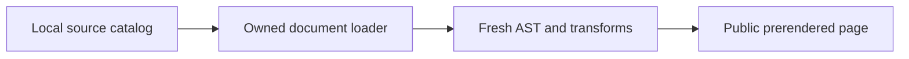

# Server-only application integrations

The `server` module adapts private resources and process-owned infrastructure into data and services the UI server can use. It defines the SvelteKit server-only integration boundary: browser modules must never import it as runtime code, while type-only imports disappear at compilation and may cross that boundary. Request-specific values remain arguments and results; neither a server-only filename nor a content cache makes identity safe to retain globally.

## Responsibilities and boundaries

The integrations support local document sources and build-time transforms. Their names describe responsibilities rather than tying this module to a particular document route.

| Integration            | Responsibility                                                                           |
| ---------------------- | ---------------------------------------------------------------------------------------- |
| Syntax highlighting    | Server-only grammars/themes and AST highlighting                                         |
| Diagram transformation | Document traversal, bounded scheduling, and diagram replacement                          |
| Browser rendering      | Owned Chromium attempts and content-keyed SVG reuse                                      |
| Cache storage          | Bounded process-local entries for integrations that explicitly own their keys and values |

## Document sources and deployment lifetime

[`documents.ts`](documents.ts) owns a Vite glob of local markdown sources. Consumers can request summaries or an exact selected source. A document route should use the same catalog for dynamic-route prerender entries, so an unlinked or nested file cannot silently omit its page. The current calculator routes do not consume the retained catalog. Slugs index known bundled strings and are never passed to filesystem reads.

When a route consumes these integrations, the static adapter executes its loader during the build and publishes prepared HTML/data; the same loader executes during local development. A content update requires rebuilding the deployed artifact. Static assets, prepared document data, and client modules are public; server-only imports keep build tools out of the browser bundle.

## Request-owned document transforms

The [markdown pipeline](../markdown/README.md) parses caller-provided source into a document AST. Server transforms enrich that same tree in place and return `Promise<void>`:

1. Mermaid processing replaces diagram code blocks with rendered SVG nodes or visible error nodes.
2. Shiki processing annotates ordinary code blocks with highlighted HTML.
3. The loader returns the tree to the renderer along with any extracted heading metadata.

Each request owns a fresh AST. Reusing an authorized user's whole rendered document as an unkeyed process cache would mix content ownership with optimization. The shared caches here contain content-derived rendering results and reusable tool infrastructure, not session identity or authorization decisions.

### Syntax highlighting

The Shiki module lazily creates a shared highlighter promise with the configured grammar set and light/dark themes. Language aliases normalize common fence names, and an unsupported language falls back to plain text. One highlighter can be reused because its grammar and theme state is independent of the document's user.

Highlighted HTML is generated by that known transform. It is not permission to accept an arbitrary pre-highlighted AST from an untrusted external client. The renderer's raw-HTML sites rely on the parser and approved transforms as their producers; authored HTML tables cross a separate sanitizer boundary described in the markdown guide.

### Mermaid rendering and Chromium

A process-wide semaphore limits rendering to four active slots. A bounded cache holds 64 content-keyed promises, allowing identical concurrent definitions/configuration to share work. Failed entries are evicted so a later request can retry. The cache key hashes both source and rendering configuration; changing a theme or configuration must not accidentally reuse an incompatible SVG.

Each uncached render attempt launches and owns a Chromium browser. It does not retain a global warm browser. The renderer chooses the configured executable, then available system candidates, then Puppeteer's default. Launch and render operations have deadlines, and `finally` performs bounded browser closure; if closure fails or hangs, the owned browser process is killed. A recognized transient browser failure gets one retry. Deadline timers are cleared when their operation finishes.

This makes cleanup ownership explicit, at the cost of browser startup for uncached diagrams. Cached content avoids that cost, but a large set of unique diagrams still consumes CPU and browser processes within the concurrency limit. Deployment must provide the expected executable and sandbox/container arrangement; the development wrapper's root-container launch settings are not a generic host installation procedure.

## Extending and validating

Add a server integration only when its responsibility cannot run safely in a browser. Keep request-owned values in parameters; keep any shared cache bounded and keyed only by everything that determines its content. If a new helper acquires a resource, define who closes it on success, failure, cancellation, and shutdown before adding a process-global singleton.

Use the [app gate](../../../README.md#run-and-validate). Unit tests cover parser contracts and Mermaid lifecycle behavior with mocks; those checks do not prove a real Chromium installation. A consumer that invokes document preparation uses the installed browser; a diagram failure becomes a visible error node rather than failing the build. Current calculator builds do not exercise this optional integration. Exercise actual rendering when changing this integration; deployment smoke checks only validate packaging and serving. Report rendering checks separately from compiler/test success and from production-image HTTP checks.
