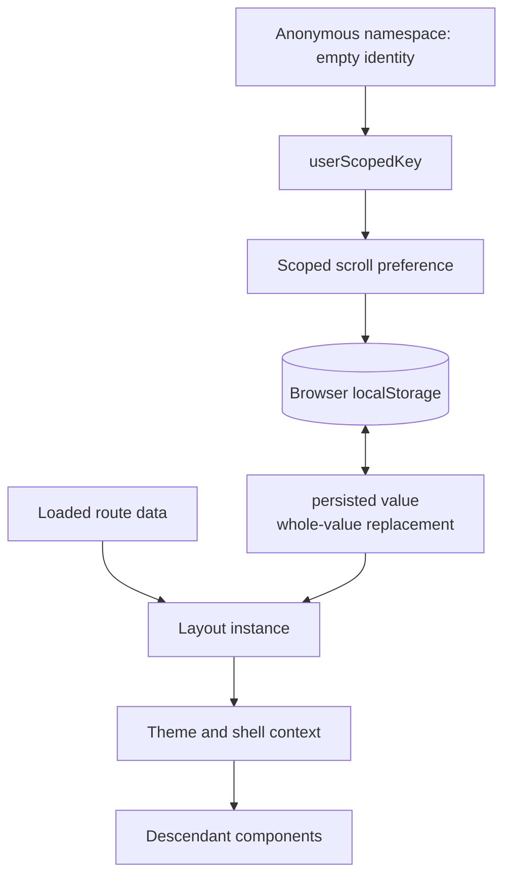
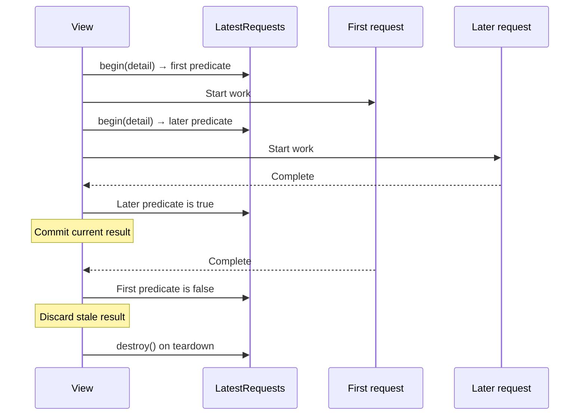

# Browser persistence and context-owned state

The `state` module owns reusable UI state primitives and the lifetime rules that keep their values with the correct owner. Its central concern is how state is created, replaced, persisted, invalidated, and released across component, browser, and server environments. A value can survive navigation without becoming shared state in the server process. Server sessions, credentials, and a process-wide current user remain outside this module.

## Responsibilities and boundaries

The current primitives cover preferences and asynchronous/scroll ownership. Add another primitive only when callers share its state semantics and lifecycle; a feature-specific controller stays with its feature.

| Concern                        | Owner contract                                                            |
| ------------------------------ | ------------------------------------------------------------------------- |
| Whole-value persistence        | Caller chooses lifetime and key; server writes are rejected               |
| Theme state                    | Component-tree controller with a browser-level preference                 |
| Preference identity and policy | Explicit browser/storage namespaces and contract-specific normalization   |
| Asynchronous result ownership  | Per-view scopes, invalidation, and permanent teardown                     |
| Element-local scroll memory    | Namespace/content/region keys with element-owned registrations and flushing |

## Choose the lifetime before choosing the primitive

The same imported module has two very different lifetimes. In the browser it belongs to one running page; during prerendering or development SSR it can serve many routes and requests for the lifetime of the Node process. A module-level `$state` cell is therefore not a convenient request store. A value written while rendering one visitor can be read by the next visitor.

| Scope                    | Appropriate values                                     | Owner                                                |
| ------------------------ | ------------------------------------------------------ | ---------------------------------------------------- |
| Server process           | Immutable configuration and content-derived caches     | Server composition; never current-user state         |
| Render                   | Mutable document AST and loaded route data              | Build or development loader arguments                |
| Component tree           | Theme controller, shell registration, route controller | An ancestor installs context; descendants consume it |
| Component instance       | Input values, open panels, pointer state               | The component's `$state` and cleanup                 |
| Browser profile          | Theme and shell-visibility preference                  | Explicit localStorage key                            |
| Storage namespace        | Isolated preference keys; anonymous in this application | A caller-supplied namespace encoded in the key        |
| Active view/controller   | Which asynchronous result is still relevant            | A `LatestRequests` instance destroyed with its owner |
| Mounted scrolling region | Scroll listeners, observer, and pending writes         | A Svelte attachment released with the element        |

Context is the bridge between an owner and its descendants. Create a controller during component initialization, install it once with a typed `createContext` accessor, and read it from descendants. Moving a helper into a `.svelte.ts` file does not transfer ownership to the module.



## `persisted`: one value, replaced as a whole

[`storage.svelte.ts`](storage.svelte.ts) exports `persisted<T>(key, initial)`, which returns an object with a reactive `value` getter and setter. In the browser construction reads JSON from localStorage once. Assignment updates the reactive value and attempts to serialize it back to the same key.

The backing cell is `$state.raw`, deliberately. Preference payloads are replaced as a whole, so deeply proxying every object and nested property would add tracking no caller uses. Replacement is also a reviewable boundary: a reader cannot quietly edit another owner's current value.

```svelte
<script lang="ts">
  import { persisted } from '#lib/state/storage.svelte.js';

  const preferences = persisted('example_preferences', {
    compact: false,
    hiddenColumns: [] as string[],
  });

  function toggleCompact() {
    preferences.value = {
      ...preferences.value,
      compact: !preferences.value.compact,
    };
  }
</script>

<button type="button" onclick={toggleCompact}>
  {preferences.value.compact ? 'Use roomy layout' : 'Use compact layout'}
</button>
```

Do not mutate `preferences.value.hiddenColumns` in place. Build a new array and replace the containing object. A raw cell does not publish nested mutations; a browser-only mutation that appears visually harmless can also conceal a server ownership mistake.

Storage is best-effort. Invalid JSON or denied reads fall back to the supplied initial value; quota or access failures on writes leave the in-memory change intact. Successfully parsed JSON is not shape-validated. The generic type is a TypeScript promise made by the caller, not a runtime validator. Callers own normalization, schema versions, migrations, and storage namespaces. There is no storage-event subscription or cross-tab synchronization.

### What happens during SSR

On the server there is no reactive storage cell. The helper recursively freezes the supplied initial value and returns it; assigning `value` throws. Freezing includes the original object passed in, so do not expect to mutate that object elsewhere afterward.

This is a tripwire for accidental shared writes, not a supported way to manage server state. Keep getters pure: a getter that lazily seeds or repairs a value is still a write, even when its name reads like a lookup. Confine persistence changes to browser events and effects. `$effect` does not run during SSR, so a redundant `browser` test inside an effect is unnecessary; a module-level listener or counter still needs an explicit browser guard.

## Theming

The theme has three cooperating parts because the component tree does not exist when the first pixels are painted:

1. [`app.html`](../../app.html) reads the remembered preference before first paint, accepting JSON-encoded or legacy plain `light`/`dark` values and otherwise consulting the system preference. It applies the `dark` document class. If storage access itself throws, it falls back to light.
2. `detectInitialTheme()` reads that class in the browser and returns light during SSR. The root layout creates a `ThemeStore` from it and installs it with `setThemeContext`.
3. The root layout's effect keeps the document class aligned with `theme.current`; descendants call the context-owned store's setter or `toggle()`.

`ThemeStore` persists under the browser-level `theme` key. It is intentionally not account-specific. Keeping the controller on context avoids leaking a visitor's selection through server module state, while keeping the initial script outside components avoids a light-to-dark flash on hydration. The stylesheet's class-based dark variant and components' dark classes complete the presentation side.

The generic persistence helper does not validate loaded values. New preference formats should normalize their input explicitly; the rail preference below already demonstrates that boundary.

## Shell and storage namespaces

Rail visibility is one preference for the contextual rail itself, not one per route. [`rail-visibility.ts`](rail-visibility.ts) exposes its key, expanded-by-default policy, and `normalizeRailOpen(unknown)`. Only a boolean is accepted; anything else returns the default. The layout owns the reactive state and writes the stored value when the user toggles the desktop rail. Opening the phone drawer is transient state and does not rewrite that preference.

[`storage-keys.ts`](storage-keys.ts) centralizes namespaced prefixes. `userScopedKey(prefix, userId)` encodes the identity segment once; an empty ID selects an anonymous slot. `isUserScopedKey` recognizes a prefix for callers that need to inspect stored entries. The scroll prefix scopes element-local scroll memory. Financial Calculators has no accounts and uses the empty identity; the reusable helper's namespace argument does not create an authentication boundary.

## Latest-result ownership across asynchronous requests

[`LatestRequests`](latest-requests.ts) tracks independent request scopes for one controller or view. `begin(scope)` creates a fresh opaque token and returns a predicate that is true only while that token is current and the tracker is alive. Starting a request in one scope supersedes that scope's previous token; another scope remains independent.

The problem is result ownership, not merely request duration. A slow response for a previous selection can finish after a newer response, and a pending request can finish after navigation destroys the view. Check the predicate after each asynchronous boundary before committing data, errors, or loading state:

```ts
import { LatestRequests } from '#lib/state/latest-requests.js';

const requests = new LatestRequests<'detail' | 'history'>();

async function refreshDetail(load: () => Promise<unknown>) {
  const isCurrent = requests.begin('detail');
  try {
    const payload = await load();
    if (!isCurrent()) return;
    // Validate and commit payload to this owner's state here.
    void payload;
  } catch (error) {
    if (!isCurrent()) return;
    // Report the current request's error through the owner's error state.
    throw error;
  }
}
```

The example accepts a caller-owned loading operation; keep server-only document preparation behind SvelteKit server loads. A `finally` block that clears loading state needs the same check, or an old request can hide a newer request's spinner. For dependent selections, `invalidate('detail', 'history')` discards both pending results before starting work for the new parent. Invalidating never revives an older token.

The owning component/controller must call `destroy()` during teardown. Destruction is permanent and idempotent: pending predicates become false, future `begin()` predicates remain false, and `destroyed` stays true. A new view needs a new tracker. Keep the instance out of module scope so one route or SSR request cannot supersede another owner's work.

This helper does **not** cancel a fetch, roll back a server-side mutation, or catch errors for the caller. Pair it with an `AbortController` when transport cancellation is useful; cancellation and result ownership solve different parts of the lifecycle. A result predicate is only effective when the caller checks it before every relevant state commit.



## Element-local scroll memory

[`scroll-position.ts`](scroll-position.ts) persists an element's own vertical `scrollTop`. It does not move the page, synchronize parent scroll containers, or infer which content is selected. `LocalScrollScope` combines a storage namespace, a caller-owned content identity, and a region name. The key encodes all three segments under `USER_SCOPED_STORAGE.localScrollPosition`, so separate namespaces, content scopes, and panels cannot accidentally share one position. Application callers use an empty `userId` for the anonymous namespace:

```svelte
<script lang="ts">
  import { persistLocalScrollPosition } from '#lib/state/scroll-position.js';

  /** Content scope for the independently scrolling panel. */
  type Props = {
    /** Content collection whose position should be restored. */
    collectionId: string;
  };

  let { collectionId }: Props = $props();
</script>

<div
  class="max-h-96 overflow-y-auto"
  {@attach persistLocalScrollPosition({
    userId: '',
    scopeId: collectionId,
    region: 'detail-list',
  })}
>
  <!-- The caller supplies the panel content. -->
</div>
```

Recreating the attachment when its content scope or namespace changes flushes the old owner's pending value before restoring the new owner's value. Desktop and mobile alternatives can deliberately share a region key when they represent the same logical viewport, but two simultaneously active scrollers sharing a key will compete to write it. Empty identity selects the anonymous slot; it is not an authorization mechanism.

`readLocalScrollPosition(scope)` returns a finite number between zero and `Number.MAX_SAFE_INTEGER`, or `undefined` for absent, malformed, unavailable, or server-side storage. `writeLocalScrollPosition` rejects values outside those bounds, rounds valid values to integer pixels, and writes best-effort. Reads can accept fractional values written by an earlier caller. Denied storage does not break scrolling, and this helper does not subscribe to other tabs' storage changes.

### Restoration, responsive overflow, and cleanup

The attachment immediately tries the stored `scrollTop`. The browser clamps positions beyond the current content range. `LocalScrollOptions.onRestore` runs after that attempt, including when no saved value exists; it receives both the element and the saved number or `undefined`. It runs under `untrack`, so incidental reactive reads do not become dependencies that repeatedly recreate the attachment. The callback owns any additional resources it acquires.

Writes are debounced by `delayMs`, defaulting to 150 milliseconds. The same interval allows responsive layout changes to settle before another overflow check. A passive element scroll listener observes movement; a passive window resize listener catches responsive descendants whose changes need not resize the element's own box; an available `ResizeObserver` checks that box too.

A temporary layout with no vertical overflow often clamps `scrollTop` to zero. Saving that zero would erase a useful desktop position simply because the same content became a horizontal or fully expanded mobile panel. The helper retains the last useful vertical position while overflow is absent and restores it when vertical overflow returns at zero. An intentional move to the top while the element remains vertically scrollable still saves zero. This distinction is why the implementation tracks overflow transitions instead of persisting every scroll event blindly.

The returned attachment cleanup disconnects the observer, removes both listeners, clears pending resize work, and flushes a pending vertical write while clearing the save timer. Normal Svelte attachment ownership invokes that cleanup when the element is removed or the attachment is replaced. Direct callers applying an attachment manually must call the returned cleanup themselves.

`nearestContainedScrollTop` is a pure geometry helper with a one-pixel default safety inset. `revealContainedItem(container, item)` reads bounds and applies that result to the container only, without scheduling work or scrolling an ancestor. Items larger than the viewport cannot be fully contained; the calculation exposes the relevant edge. Keep selection/reveal policy in the caller, such as an `onRestore` callback that reveals a selected row only when no saved position exists.

The attachment is a browser lifecycle operation. Importing it and computing keys are harmless during SSR, and the storage readers/writers explicitly no-op there, but manually applying the attachment requires browser elements and `window`. No request-specific state is stored in a module-level object.

## Resources and extension

`persisted()` itself installs no timers, listeners, or subscriptions outside Svelte's reactive graph. The scroll attachment explicitly owns and releases its external resources; a controller built around these primitives must expose cleanup and be owned by a component that calls it. In particular, never use a module-level singleton to make a timer or listener survive navigation; that transfers its lifetime to the browser page and, without guarding, to the server process.

When adding a preference, decide whether it belongs to the browser as a whole or to a content/region scope, define its key in one place, normalize untrusted stored data, and replace values immutably. Cross-device persistence and server-enforced policy are outside this application's scope; localStorage cannot provide either.

The [storage tests](../tests/state/storage.test.ts) cover SSR protection and browser persistence. [Request ownership tests](../tests/state/latest-requests.test.ts) cover independent scopes, supersession, invalidation, permanent destruction, and instance isolation. [Scroll tests](../tests/state/scroll-position.test.ts) cover identity isolation, invalid stored values, restoration and teardown flush, intentional zero, and responsive overflow transitions. Their synthetic dimensions make the lifecycle cases deterministic; they do not replace checking real layout in a browser. Use the [app gate](../../../README.md#run-and-validate) after changes, then exercise hydration, denied storage, content-scope changes, and navigation in the application.
